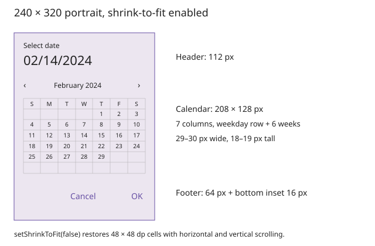

# Material 3 date pickers

## Status and scope

Implemented on 2026-09-19: single-date modal calendar, modal numeric input,
month/year selection, and docked date field with compact-screen promotion.
This document reconciles the earlier proposal with the current shared
transient host and the requested exclusive calendar focus behavior.

The implementation uses `roo_time::CivilDay`, never midnight timestamps.
Calendar selection is independent of time zones and daylight-saving changes.
Applications supply `today` explicitly, using their own clock and local-date
policy. No picker reads a clock, retains a time zone, or duplicates civil-date
arithmetic. Valid civil years are 1 through 9999.

Range selection, simultaneous field editing while the calendar is open,
live anchor repositioning, and arbitrary nested transient surfaces are future
work. Nothing in this component changes the transient-host model.

## Public API

Headers are under `roo_windows/material3/date_picker/`:

- `date_picker_types.h`: `DatePickerBounds`, `DatePickerEntryMode`,
  `DatePickerDismissReason`, `DatePickerStrings`, and `DateTextCodec`.
- `date_picker.h`: reusable `ModalDatePicker` presenter.
- `docked_date_picker_field.h`: `DockedDatePickerField`, a `TextField` subclass.

`ModalDatePicker` is a lightweight presenter, rather than a persistent widget
container. Configure it while closed, then call `open(Task&)`. The return value
is `PresentationStartResult`; unavailable owners, invalid bounds, unsuitable
viewports, and a busy host fail without taking over the current presentation.
It never replaces another active transient.

```cpp
#include "roo_windows/material3/date_picker/date_picker.h"

class MaintenancePicker : public roo_windows::material3::ModalDatePicker {
 public:
  using ModalDatePicker::ModalDatePicker;
 protected:
  void onAccepted(roo_time::CivilDay day) override {
    // Persist the confirmed civil date in the application model.
  }
};

// Keep the presenter alive for the session.
// MaintenancePicker picker(context);
// picker.setValue(roo_time::CivilDay::FromYmd(2026, 10, 1));
// picker.setToday(local_today);
// picker.setBounds({local_today, roo_time::CivilDay::FromYmd(2028, 12, 31)});
// picker.setEntryMode(DatePickerEntryMode::kCalendar);  // Or kInput.
// PresentationStartResult result = picker.open(owner_task);
```

Modal values use `setValue()/value()`. Docked fields use `setDate()/date()` to
avoid colliding with the inherited text editor's `value()` virtual method.
Both expose `setToday()`, `setBounds()`, `setDisplayedMonth()`, and
`setShrinkToFit()/shrinkToFit()`. Setters
require a closed picker. An invalid date represents no selection; invalid
bound endpoints mean unbounded. Reversed bounds reject admission.

Override `isDateEnabled(CivilDay)` for application filtering, and
`datePickerStrings()` for picker labels, `calendarLocale()` for shared
`roo_locale::CalendarLocale` names and week conventions, and `dateTextCodec()`
for numeric input. Filtering and
conversion must not mutate the presentation. Shared labels and codecs must
outlive their use; format output, including NUL, must fit a 64-byte buffer.

Calendar names and the first weekday come directly from
`roo_locale::DefaultCalendarLocale()`, including `ROO_CALENDAR_LOCALE` overrides.
The picker retains no copy of the locale descriptor or its name arrays. Compact
headers and month grids use the locale's standalone abbreviated month names
when wide names do not fit. `DatePickerStrings` contains only picker labels.
English numeric defaults use `MM/DD/YYYY`; `ROO_LANG=ROO_LANG_pl` selects
`DD.MM.RRRR`. Defaults delegate strict date-only
parsing and formatting to `roo_time`; partial, impossible, or out-of-bounds
input disables confirmation and displays a validation error.

## Session and commit semantics

An active-only `DatePickerSession` owns the panel, draft, visible month and
focus scope. Opening seeds the visible month from the explicit month, value,
today, lower bound, upper bound, then January 1970. Invalid or disabled values
start with an empty draft. The committed value remains unchanged until OK.

Day selection updates only the draft. Previous/next month navigation preserves
the draft. Explicit month/year selection preserves the day number when it is
valid and enabled in the destination month; otherwise it clears the draft.
No silent end-of-month clamping occurs. Switching calendar to input formats
the draft. Valid input returns to its calendar month; invalid input must be
corrected before switching back. Cancel and Back remain available.

Completion detaches the surface, restores focus, and frees session state
before delivering exactly one terminal hook: `onAccepted(day)` or
`onDismissed(reason)`. Hooks may destroy or reopen the presenter. Cancellation
preserves the committed value. Dismissal distinguishes Cancel, outside tap,
Back, programmatic dismissal, and an unavailable owner. Destruction silently
cancels without application callbacks. The registration cancels before its
owned panel and focus scope are destroyed.

Back closes a month/year body first, returning to the day grid. From calendar
or input it dismisses the picker. Outside interaction dismisses through the
host barrier, after pointer dispatch unwinds, without activating underlying
content. Owner navigation ends the session through the shared host contract.

## Docked field and focus

A docked field opens on activation or fresh focus. Focus-triggered admission
is scheduled after focus dispatch unwinds: the focus manager must not be
reentered from `onFocusChanged()`. Pending admission is canceled on blur or
destruction. A failed admission releases temporary state.

The open calendar owns an exclusive focus scope. The source field stops
editing and cannot resume editing while that scope is active. Focus restoration
after dismissal does not reopen the calendar. This deliberately replaces the
proposal's simultaneous source-field and calendar editing; that behavior is
future work.

A valid unconfirmed typed date seeds the calendar draft without committing it.
Cancellation preserves the field's pre-open text and committed date. OK
updates both, then calls `onAccepted()`. When the calendar is closed, explicit
text editing and edit confirmation use the same codec and bounds. Invalid
text stays visible with an error.

The field observes presentation changes while open, dismissing when detached
or hidden. The anchor is captured at admission. Live movement/repositioning
is not implemented.

## Presentation and geometry

One `TransientSurfaceHost` owns attachment, barrier paint, input isolation and
focus restoration. The presenter supplies an explicit interaction owner and
its focus scope. There are no extra popup tasks, no second active-presentation
authority, and no nested menus. Month and year selection replace the panel
body inside the existing surface.

At 100% scale the regular panel is 368 by 528 dp, with 16 dp outer clearance.
Modal presentation centers it with a scrim. Docked presentation uses the menu
placement resolver's below-start placement, with flipping/clamping and a
transparent barrier. If the regular panel plus clearance does not fit, both
variants promote to the full window with a scrim and square corners.
At default density, viewports smaller than 240 by 240 dp reject admission.
The live `Theme::material3Theme().density` reduces nominal cells from 48 dp to
28 dp in 4 dp steps, together with panel padding and chrome. At `kMinus5`,
the minimum viewport is 200 by 200 dp. Density changes whitespace; fitting
chooses smaller text only when cells still exceed the available area.
Floating panels retain a 16 dp inset to keep chrome inside their 28 dp rounded
corners; square full-screen panels use the tighter density inset. Both
policies use the exact cell rectangles for touch targets without copying
resolved theme values into the presenter. After changing density on a live theme,
call `app.invalidateTheme(true)` to request both measurement and painting.

Calendar density can also be pinned independently while the presenter is closed:

```cpp
picker.setDensity(roo_windows::material3::Density::kMinus5);
date_field.setCalendarDensity(roo_windows::material3::Density::kMinus5);
```

`clearDensityOverride()` and `clearCalendarDensityOverride()` restore live theme
inheritance. Explicit `kDefault` remains pinned even when the application theme
is tighter. A docked calendar's policy is separate from its source text field's
`densityOverride()`. Internal actions and numeric input use the calendar policy.
The one-byte policies occupy existing alignment padding on ESP32-C3.

The full-screen fallback pins the header and Cancel/OK actions. Both presenters
shrink the calendar to fit by default, keeping all seven weekday columns and six
week rows visible. Density first resolves nominal panel geometry and chrome.
Fitted cells then fill the complete remaining viewport in both axes, including
room released by tighter density. Measurement distributes remainder pixels
across cells, and hit testing uses those same boundaries. Small cells use compact typography and
markers; displays shorter than 320 dp also use a compact header and footer.
Shrinking reduces touch-target sizes. Calling `setShrinkToFit(false)` while
closed restores nominal density-sized cells, two-axis scrolling, and cursor
reveal. At default density those cells have 48 dp targets. The bounded year list
keeps vertical scrolling in either policy. Numeric input shares the panel chrome.



The day grid computes 42 cells arithmetically, including disabled adjacent
month dates. Month selection uses 12 cells. Year selection uses pages of up to
120 years, three columns, with previous/next page controls. This bounds scroll
coordinates for the library's 16-bit geometry instead of allocating or laying
out thousands of year rows.

Tab traverses header, body and actions (or the input field). Within the header,
Left/Right selects a control and Enter/Space activates it. In the body,
arrows move the cursor, Home/End reach the first/last cell, PageUp/PageDown
navigate months or year pages, and Enter/Space selects. Disabled days cannot
be committed through either touch or keyboard.

## Rendering and resources

The header and day/month/year cells are owner-painted; there are no per-day
widgets or row objects. Glyphs and rounded markers resolve together through a
tile with a raster background, including at reduced cell sizes. Short draw bands
avoid allocating background streams. Header feedback and keyboard outlines belong to individual
controls; generic header-center halos and whole-grid focus tint are suppressed.
Clipping skips non-visible body cells. Calendar selection and keyboard cursor
changes compare against the previous paint snapshot and repaint only changed
cells. Header updates track changed controls and the draft headline. Coalesced edits do not retain intermediate
selections. External invalidation, including framework focus-surface changes,
continues to repaint the exposed region. Four active-only flags share one byte.

Day and header presses use the core-owned shared `ClickAnimation`. A bounded
ripple is composed inside the active marker; day selection colors interpolate
from the retained sample without a widget timer or animation-registry track.
The departing and arriving date cells report separate damage rectangles, so
unchanged dates between distant selections remain unwritten. Cancellation,
mode changes, and rapid retaps retire the previous feedback before starting
another interaction. Disabled dates cannot start feedback. The previous
selection index uses existing body alignment padding: the complete change,
including fitting, density, and locale hooks, adds zero object bytes on ESP32-C3.

Idle presenters retain only configuration and a session pointer. Numeric
input is allocated lazily when that mode is first requested, then retained
until the session ends. The docked wrapper's deferred-open executable is also
active-only. There are no persistent calendar strings, timers, or shared-host
fields added to existing widgets.

Measured with the installed ESP32-C3 RISC-V compiler, `-fno-exceptions` and
`-fno-rtti` (object sizes, excluding allocator metadata and external host/editor
state):

| Object | Bytes |
| --- | ---: |
| Closed `ModalDatePicker` | 36 |
| Base Material 3 `TextField` | 104 |
| Closed `DockedDatePickerField` | 132 |
| Active `DatePickerSession`, including panel | 440 |
| `DatePickerPanel` (included in session) | 400 |
| Header (included in panel) | 32 |
| Body, including paint snapshot (included in panel) | 40 |

The November 2026 fitting and header changes add zero bytes to these objects
with the current library dependencies. The fitting option shares packed flag
storage; header measurement uses existing alignment padding.

Run `benchmarks/material3_date_picker_size_probe.sh COMPILER NM` with sibling
Roo libraries, or set `ROO_LIBRARIES_ROOT`. This is a target-ABI object-size
probe, not a firmware flash-size or peak-heap measurement.

The resource regression asserts zero allocations for warmed model navigation
and shared click admission/cancellation.
Ten selection-update frames record 237 allocations through
the existing `roo_display` glyph-stream renderer. As with Material 3 text fields,
removing those upstream allocations is deferred; this implementation does not
claim allocation-free paint.

## Validation and example

Focused tests cover civil bounds/locale helpers, drafts and terminal hooks,
input validation, month/year transitions, civil endpoints, shared-host rejection,
owner navigation, outside dismissal, callback reopening/destruction, field
focus restoration/destruction, and editor isolation. Golden tests cover modal
calendar/input/error/month/year bodies, fitted and scrolling compact layouts,
and closed/anchored/
promoted docked fields. A separate target verifies Polish defaults.

The runnable example is
`//examples/material3/date_picker/maintenance_date:maintenance_date`. It uses
real ILI9341/XPT2046 setup and ROO_TESTING emulation, demonstrates modal calendar,
modal input and the docked field, and saves accepted dates into the form.
Its native 240 by 320 portrait screen demonstrates promotion; the larger golden fixture exercises
anchored placement. Physical touchscreen validation remains manual.

The eight date-picker test targets pass with picker sources and test subclasses
compiled using `--per_file_copt='.*date_picker.*\.cpp@-fno-exceptions,-fno-rtti'`.
The rendering, presentation, docked behavior, and shared-click targets also
pass with `--config=asan`.
Related text-field, keyboard-avoidance, dialog, menu and transient-host
regressions pass. The example builds; interactive hardware checks were not run.

## Future work

- Simultaneous editing of the docked source while its calendar is open.
- Live anchor tracking and repositioning during a session.
- Dynamic input-only panel height.
- Range selection and richer locale-specific headline formatting.
- Upstream allocation-free glyph rendering.
