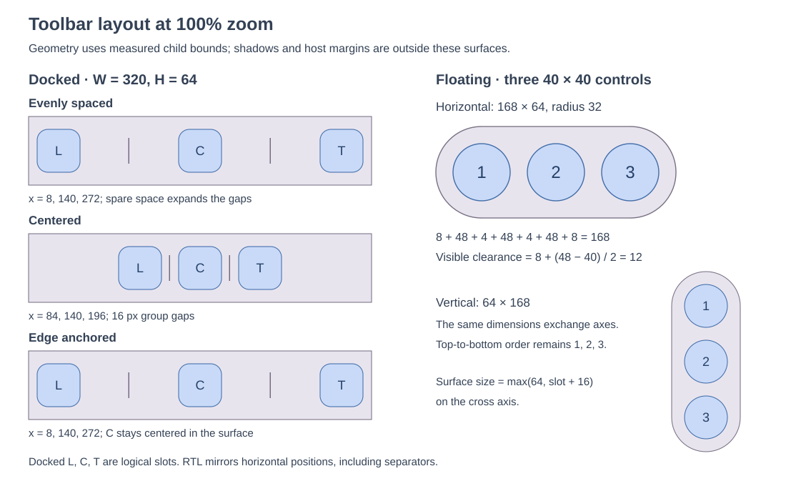
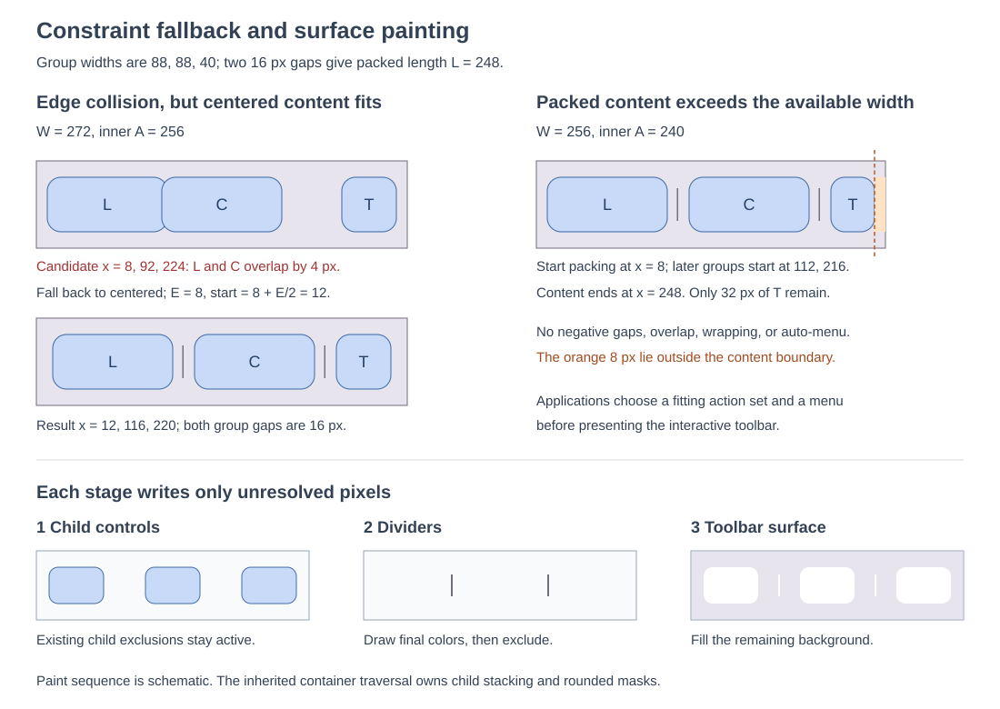

# Roo Windows Material 3 Toolbars Design

**Status: Implemented (2026-10-12).** Docked and floating toolbar containers,
examples, tests, and target resource measurements have landed in three commits.
See the [design status index](../README.md) and
[acceptance measurements](../../material3_target_baseline.md#material-3-toolbar-acceptance-2026-10-12).

## Objective

Add Material 3 docked and floating action toolbars that compose existing widgets,
follow the library's surface and ownership contracts, and remain inexpensive on
embedded targets.

## Motivation

A device's chart page needs actions such as pause, zoom, save, and more options.
On a small display those actions belong in a bottom strip; on a wider display
they can float beside the chart. Today each application must build that surface
and its spacing from generic containers. A toolbar component makes the layout,
shape, clipping, and theme behavior reusable while leaving action semantics on
the existing controls.

## Background

### Material references and scope

Material distinguishes docked toolbars from floating toolbars. Docked toolbars
replace the recommended use of bottom app bars. Floating toolbars support
horizontal and vertical orientation and standard or vibrant color treatments.
These are page action surfaces, separate from the library's implemented
[top app bars](material3_app_bars_design.md).
See the official [docked toolbar guide](https://github.com/material-components/material-components-android/blob/master/docs/components/DockedToolbar.md)
and [floating toolbar guide](https://github.com/material-components/material-components-android/blob/master/docs/components/FloatingToolbar.md).

The Material [overview](https://m3.material.io/components/toolbars/overview),
[specifications](https://m3.material.io/components/toolbars/specs), and
[guidelines](https://m3.material.io/components/toolbars/guidelines) are the design
entry points. The AndroidX [floating toolbar tokens](https://github.com/androidx/androidx/blob/androidx-main/compose/material3/material3/src/commonMain/kotlin/androidx/compose/material3/tokens/FloatingToolbarTokens.kt)
provide an inspectable reference for the 64 dp cross size, 8 dp end padding,
4 dp spacing, full rounding, and surface/primary-container colors. This proposal
uses those defaults and explicitly specifies local choices where the embedded
implementation differs: docked grouping, bounded overflow, elevation, and density.

### Existing library contracts

- [Material3Container](../../../src/roo_windows/material3/container.h) resolves
  its surface through Material color tokens without adding instance state.
  Its `Container` base paints children before the remaining surface.
- [Button](../../../src/roo_windows/material3/button/button.h),
  [IconButton](../../../src/roo_windows/material3/button/icon_button.h),
  [ToggleIconButton](../../../src/roo_windows/material3/button/toggle_icon_button.h),
  and [text fields](../../../src/roo_windows/material3/text_field/text_field.h)
  already implement their own actions, state, measurement, and appearance.
- [Menus](material3_menus_design.md) provide explicit overflow
  presentation; [FABs](material3_fabs_design.md) provide primary
  action widgets. Neither needs a second implementation inside a toolbar.
- [LayoutScaffold](../../../src/roo_windows/material3/layout_scaffold/layout_scaffold.h)
  already has `setBottomBar(WidgetRef)`, safety insets, and breakpoint visibility.
  It does not provide a floating-toolbar overlay slot.
- [Density](material3_density_design.md) reduces eligible
  component whitespace independently of `Scaled()` zoom. Eligible children
  follow their existing density contracts; icon buttons retain their geometry.
- [Borrowed objects, adopted objects, and WidgetRef](../glossary.md#ownership-and-lifetime)
  have established lifetime rules. `WidgetRef` is a transfer parameter, never
  retained child storage. [Non-touch input](non_touch_input_design.md)
  supplies focus traversal and activation.

The [widget authoring rules](../../../.github/instructions/roo-windows-widget-authoring.instructions.md)
require explicit surface ownership, compact state, child attachment through the
framework, and final-color painting. The existing
[button](material3_buttons_design.md) and
[list](material3_lists_design.md) designs provide adjacent
component context; current headers govern implemented API names.

## Requirements

1. Present page actions in a full-width bottom surface or a content-sized
   horizontal/vertical floating surface, with standard and vibrant fills.
2. Allow real controls of different sizes, with leading, center, and trailing
   groups on the docked surface and an ordered strip on the floating surface.
3. Support evenly distributed, centered, and edge-anchored docked arrangements,
   with optional separators between occupied groups.
4. Respect bounded and unbounded measurement, child margins and visibility,
   explicit RTL direction, and tight constraints without overlapping controls.
5. Preserve child activation, selection, focus, menu anchoring, and lifetimes.
   Changing the toolbar must not rewrite child styles or event callbacks.
6. Integrate with theme surfaces, zoom, density updates, rounded clipping, and
   damage restoration, including explicitly unclipped child decoration.
7. Keep retained storage proportional to the controls actually supplied. Add no
   fields to every widget and no toolbar-owned popup, FAB, or animation state.
   Toolbar measurement, layout, and painting allocate no scratch collections.
8. Include examples, behavioral tests, rendering coverage, and target resource
   acceptance with each usable implementation slice.

Automatic overflow conversion, scroll hide/show, expansion animations, search
editing policy, bottom-app-bar cutouts, and toolbar-specific child color
palettes are outside this proposal's scope.

## Design Overview

`DockedToolbar` and `FloatingToolbar` derive from `Material3Container`. Both own
an opaque background and a sequence of child entries. An **entry** retains a
raw child pointer and its latest measured dimensions; ownership remains in the
child's existing parent-owned flag. A docked entry additionally records its
**slot**, the logical leading, center, or trailing group used for placement.
Slots do not introduce child containers or separate ownership lifetimes.

The docked widget fills a bounded width and lays out one row. Its
**arrangement** determines where spare horizontal space goes. The floating
widget wraps one row or column and supplies a rounded surface. Orientation
changes axes; it does not rotate children. Both retain insertion order for
structural enumeration and keyboard traversal.



Separate types keep the grouping state on docked toolbars and the orientation
and elevation state on floating toolbars. A single vector per toolbar provides
composition and lifetime management; shared geometry helpers avoid a second
copy of measurement arithmetic. The existing child input path meets the
interaction requirement, and the existing surface path meets the paint and
clipping requirements. Placement remains with a scaffold or application
container, which knows which content must stay unobstructed.

For a chart with three controls measuring 40 by 40 pixels at 100% zoom, a
horizontal floating toolbar naturally measures
`8 + 48 + 4 + 48 + 4 + 48 + 8 = 168` pixels wide and 64 pixels high. Each
control occupies a 48 by 48 pixel slot; its visible bounds start at
`(12, 12)`, `(64, 12)`, and `(116, 12)`. Vertical orientation produces
64 by 168 pixels with the coordinates transposed. These dimensions include
toolbar padding and exclude host placement margins.

## Design Details

### Child storage and lifetime

`add(WidgetRef, ...)` accepts borrowed and adopted controls through the same API
as other containers. Null input is a no-op. A non-null child must be unattached,
belong to the same `ApplicationContext`, and not be the toolbar or an ancestor;
check these preconditions before attachment. Duplicates and reparenting are
programming errors, not a second insertion mode.

Retain the raw pointer before moving the incoming reference into
`attachChild()`. Store only that pointer, measurement fields, and the docked
slot. `clear()`, `clear(slot)`, and destructors use `detachChild()` exactly once
per removed child; the framework handles owned deletion, focus, gestures, and
presentation-anchor cleanup. Borrowed children must outlive attachment.
Mutation is UI-thread work outside layout and paint. Clearing preserves vector
capacity for reuse; destruction releases it.

`childCount()` and structural enumeration include gone and invisible children.
Layout omits `kGone` children and their gaps. `kInvisible` children retain space
but receive no paint or interaction. Empty slots contribute no group gap or
divider. No action descriptor, parallel ownership bit, or action callback is
stored on the toolbar.

### Geometry tokens and density

These values are shared constants in `toolbar_tokens.h`:

| Geometry | Default in dp | Source or decision |
| --- | ---: | --- |
| Minimum cross size | 64 | Floating token baseline, also chosen for docked |
| Main-axis padding per end | 8 | Floating token baseline, reused for docked |
| Cross-axis padding per edge | 8 | Local content-floor rule |
| Gap within a group or floating strip | 4 | Floating spacing token |
| Gap between docked groups | 16 | Local grouping rule, unchanged by dividers |
| Divider width and height | 1 by 24 | Local separator rule |
| Floating minimum main size | 64 | Local floor for single/empty strips |

Apply `Scaled()` to each dp token once; child measurements are already pixels.
Compute floating corner radii from actual pixel bounds, without scaling them
again. Do not use the legacy `ROO_WINDOWS_TOOLBAR_ICON_SIZE` macro: children
choose their own icon resources and sizes.

Toolbar chrome does not participate in density reduction in this scope. Its
64 dp minimum and padding stay fixed across all six density levels. Buttons
and fields inside it continue to follow their own application density or
explicit policy, without an ancestor override. A tall child can make the toolbar
larger than 64 dp; reducing that child's height can bring it back to the
64 dp floor. This preserves the Material toolbar baseline without inventing
an unvalidated compaction rule or storing a toolbar density override.

After shared density or geometry changes, callers use the existing root
`requestLayoutDescending()` plus `invalidateDescending()` contract. Every
toolbar measurement refreshes its entry dimensions, including after a formerly
gone child becomes visible. Suggested minimums remain cheap: return `(0, 0)`
and perform all child measurement in `onMeasure()`.

### Measurement and bounded overflow

The **main axis** is horizontal for docked and horizontal floating toolbars,
and vertical for vertical floating toolbars. The other axis is the **cross
axis**. Let $n$ be the participating child count. For child $i$, $m_i$ and $c_i$
are its measured main and cross extents including its margins. Let $p=Scaled(8)$,
$h=Scaled(64)$, and let $b_i$ be the gap after child $i$: `Scaled(4)` within a
group/strip, `Scaled(16)` across docked slots. All following arithmetic is in
pixels, using wide intermediates and saturating to representable spec/dimension
ranges before narrowing.

For floating toolbars, floor each margin-box extent at `Scaled(48)` before
using it as $m_i$ or $c_i$. The child keeps its measured size and is centered
with its margins inside that slot.

The required packed length and natural cross size are:

$$
L = \sum_{i=0}^{n-1}m_i + \sum_{i=0}^{n-2}b_i,
\qquad C = \max(h, 2p + \max_i c_i).
$$

Empty sums and the empty cross maximum are zero. Natural main size is $2p+L$
for docked and $\max(h,2p+L)$ for floating. An empty floating toolbar therefore
occupies 64 by 64 dp; applications hide it explicitly when empty.

Docked preferred size is `MatchParentWidth()` by `WrapContentHeight()`.
For `EXACTLY` or `AT_MOST` width it consumes the supplied width; for
`UNSPECIFIED` it uses natural width. Floating preferred size wraps both axes.
Floating main size and both widgets' cross sizes use `resolveSize()`: exact
constraints win, at-most constraints cap, and unspecified constraints wrap.

Measure each participating child against the toolbar's available interior,
subtracting its margins. Use `getChildWidthSpec()` and `getChildHeightSpec()`
with its preferred size. Main-axis `MatchParent` is treated as `WrapContent`:
a toolbar has no implicit weighted/fill child. Callers that need a long field
give it an explicit preferred width. On the cross axis, first measure
`MatchParent` as wrap, resolve the toolbar's cross size, then measure those
children once more with exactly the remaining cross space. Keep the first-pass
main result fixed during that second pass; there is no iterative flex solver.
Exact child preferences retain their requested measure, even when too large.

Store measured width and height for layout; never call `measure()` from paint
or from `getSuggestedMinimumDimensions()`. Layout computes positions from these
measurements and current margins, then intersects each child rectangle with
the padded content rectangle, as required by the
[measure/layout guidance](../../../.github/skills/roo-windows-measure-layout/SKILL.md).
Clamp negative free space to zero before constructing rectangles. Children
with no remaining area receive empty bounds. Nonnegative margins are supported;
negative margins are rejected because intentional overlap violates the toolbar
layout contract. Convert half-open calculation intervals to the framework's
inclusive `Rect` maximum coordinates only when constructing a nonempty rectangle.

When $L$ exceeds the available inner main length, all arrangements pack from
logical start using the minimum gaps and clip at the content boundary. They do
not shrink gaps below tokens, overlap controls, wrap, scroll, or silently change
child visibility. This is a deterministic rendering fallback, not a promise
that clipped actions remain usable. The application chooses a fitting action
set and exposes the rest through an explicit menu. In particular, placing
an overflow button last does not reserve its space automatically.

### Docked arrangements and separators

Perform calculations in logical coordinates over inner width $A=W-2p$,
clamped to zero. Flatten participating entries by slot order
leading/center/trailing, preserving insertion order within each slot. Let
$E=\max(0,A-L)$ be spare space.

- `kEvenlySpaced` places the first margin box at $p$. Before logical child
  $i$, add $\lfloor iE/(n-1)\rfloor$ to its packed position for $n>1$.
  This distributes integer remainders deterministically without retained
  gap arrays. A single child is centered.
- `kCentered` starts the packed strip at $p+\lfloor E/2\rfloor$.
- `kEdgeAnchored` places the leading group at $p$, the center group at
  $p+\lfloor(A-G_C)/2\rfloor$, and the trailing group at $p+A-G_T$,
  where $G_C$ and $G_T$ are the packed widths of those groups. Omit absent
  groups. Use this arrangement only when every present group is within the
  interior and adjacent groups have at least the group gap between them.
  Otherwise use centered layout; its overfull case follows the start-packing
  rule above. A lone leading/trailing group remains on its corresponding edge.

For example, at $W=320$, three 40 px controls in distinct slots have $L=152$
and $E=152$. Even spacing and edge anchoring both place them at x=8, 140, 272;
centered placement uses x=84, 140, 196. With group widths 88, 88, 40 in a
256 px toolbar, packed length is 248, exceeding inner width 240. The fallback
starts groups at x=8, 112, 216 and clips the trailing group to 32 px. The second
figure distinguishes this case from an edge collision where centered layout
still fits.



For every arrangement, center each child's margin box on the cross axis. If
that box is too tall, start at the cross padding and intersect with the content
rectangle. Do not let a negative centering offset consume toolbar padding.

Optional separators occupy the middle of the actual space between adjacent
nonempty groups. For the previous group's exclusive end $e$, next start $s$,
and divider width $t=Scaled(1)$, the divider starts at
$e+\lfloor(s-e-t)/2\rfloor$. Its height is the lesser of `Scaled(24)` and
the content height, centered vertically. Intersect it with the content bounds;
omit empty results. Dividers consume no extra layout space, so toggling them
does not move children. Invisible children still count toward group occupancy.

### Floating geometry and placement

Floating controls use the same child measurement rules, then reserve a slot
at least 48 dp per axis around each measured control including its margins.
Center the control's margin box in its slot and use fixed 4 dp gaps between
slots. This matches the default icon-button layout area assumed by
[Compose's toolbar padding](https://github.com/androidx/androidx/blob/androidx-main/compose/material3/material3/src/commonMain/kotlin/androidx/compose/material3/FloatingToolbar.kt).
With a 40 dp button, the 8 dp toolbar padding plus 4 dp inside the slot gives
12 dp visible clearance on each edge. The end button's center is 32 dp from
the edge, matching the center of the 64 dp toolbar's rounded cap. The slot
floor scales with zoom and requires no additional stored state.

When exact constraints make the main axis longer than its natural size, center
the packed strip. Under overfull constraints, pack from logical start. Rounded
corners use the integer-pixel `BorderStyle` radius
`floor(min(actual_width, actual_height) / 2)`, with no outline. The underlying
border API cannot represent the half-pixel ideal for odd dimensions.

Host placement margins are excluded from `getPadding()` and child measurement.
Examples use at least 16 dp around horizontal toolbars, matching the
[Android floating-toolbar example](https://github.com/material-components/material-components-android/blob/master/docs/components/FloatingToolbar.md),
and choose 24 dp for vertical side placement as a local placement convention.
The host reserves readable content, safety insets, and space for the shadow.
A FAB is a sibling; neither widget reserves a slot in the other.

Use `LayoutScaffold::setBottomBar()` for docked placement. A floating toolbar
uses an application-owned layout/overlay container; adding a general scaffold
overlay API is a separate proposal. Putting a floating toolbar in the bottom
slot reserves a bottom band and does not create an overlay over page content.

### Direction and input

Both widgets expose explicit `LayoutDirection`, defaulting to LTR, like the
existing scaffold and grid. Compute horizontal positions in logical order,
then map a child interval `[x, x+w)` to `[W-x-w, W-x)` in RTL. Mirror dividers
by the same rule. Physical child margins retain their physical meaning; account
for them after mirroring the enclosing margin box. Vertical order stays
top-to-bottom; the host chooses its side. No child styles, icon glyphs, or child
layout-direction properties are changed by the toolbar.

The toolbar itself is not clickable or focusable. Existing child touch,
physical-key activation, hover, and click settlement remain authoritative.
Tab order follows structural insertion order, so callers add docked groups in
their intended reading order. Directional navigation follows physical child
positions. There is no toolbar-level roving selection or arrow-key interception
that would interfere with text fields or sliders. Existing clipped-bound and
focus eligibility rules apply; applications must resolve overflow before
presenting an interactive workflow. Clearing a focused or menu-anchor child
uses the ordinary detach path, including cancellation and focus restoration.

### Theme surfaces and child appearance

Add one shared `ToolbarTheme::standardContainer` token to `ComponentTheme`,
defaulting to `ColorToken::kSurfaceContainer`. Both toolbar types consult this
live theme slot for `kStandard`; `kVibrant` resolves
`ColorToken::kPrimaryContainer`. Follow the existing
[component surface theme contract](material3_component_surface_theme_design.md):
the shared slot accepts neutral surface roles, and changing it requires
application invalidation. Vibrant remains an explicit instance choice.

The standard/vibrant selector styles the toolbar surface only. It never
mutates children or installs theme overrides on generic controls. Examples use
filled or filled-tonal controls on vibrant surfaces so each has its own matched
foreground/container pair. Transparent standard icon buttons keep their
existing foreground tokens and are not advertised as the Material vibrant
toolbar button palette. The Android [toolbar styles](https://github.com/material-components/material-components-android/blob/master/lib/java/com/google/android/material/floatingtoolbar/res/values/styles.xml)
define specialized child colors; parity with those palettes is explicitly
outside this container proposal. This boundary preserves the existing child
appearance contracts instead of promising colors the current button API cannot
express.

Docked elevation is zero. Floating elevation defaults on and resolves through
`internal::RendererElevation(2)`; off resolves to zero. Level 2 is the local
floating-surface choice. Use the
[existing elevation mapper](../../../src/roo_windows/material3/internal/elevation.h)
without applying `Scaled()` to its renderer index. No shadow padding is hidden
inside the toolbar's logical bounds.

### Painting, clipping, and invalidation

Both widgets return `true` from `mayHaveUnclippedChildren()` because they accept
caller-supplied children. Floating also returns `true` from
`clipsChildrenToRoundedBounds()`. Docked keeps the rectangular default. These
are constant capability hooks, not scans or cached child counts.

Keep the inherited `paintChildren()` and `paintWidgetContents()` traversal.
The framework paints explicitly unclipped children above clipped children,
and clips the latter to the floating rounded shape. Unclipped children bypass
this immediate parent mask while retaining ancestor clips; the toolbar does
not automatically mark children unclipped. Normal rounded toolbars containing
rectangular fields or buttons use the implemented rounded clipping path.

Floating uses the inherited surface paint. Docked overrides `paint()` only for
separators: resolve each divider's final color against the toolbar background,
paint it, exclude the settled rectangle, then call `Container::paint(ctx)`
for the unresolved background. Use `kOutlineVariant` on standard and
`kOnPrimaryContainer` at 12% opacity on vibrant, composed to final opaque color.
Child exclusions are already active; there is no manual background-between-
children calculation or second pass that clears finished pixels. The second
figure shows the ordering.

| Change | Required effect |
| --- | --- |
| Color style or shared surface token | Call `invalidateDescending()` plus `invalidateInterior()` to mark descendants and schedule redraw, because transparent child pixels resolve against the surface |
| Arrangement, direction, orientation, insertion, clearing, or child measure change | Request layout; repaint changed child and surface bounds through normal move/detach damage |
| Divider visibility | Invalidate toolbar interior; no measurement change |
| Elevation | Call `elevationChanged()` and invalidate affected surface/decorations |
| Floating bounds/radius | Use normal surface layout and border-change bookkeeping to restore old rounded corners and shadow |
| No-op setter | No relayout or repaint |

No toolbar animation track, timer, cached drawable, or paint-time mutation is
introduced. Rounded clip scratch and child drawing retain their existing
framework costs; the toolbar does not claim those paths are universally
allocation-free.

### RAM and algorithm costs

Retain one vector and one packed flags byte per toolbar. Entry fields are
ordered as pointer, measured `YDim` height, measured `XDim` width, then the
docked slot byte. This uses alignment padding for the slot without storing
ownership twice. No measurement-spec cache is needed: `onMeasure()` measures
participating children on each invocation, and layout consumes the stored sizes.

| Storage | 32-bit estimate | 64-bit host estimate |
| --- | ---: | ---: |
| Either child entry | 12 B | 16 B |
| Vector control block | 12 B | 24 B |
| Toolbar increment over `Material3Container`, including flags/alignment | 16 B | at most 32 B |
| Four-entry live payload | 48 B | 64 B |

The [2026-10 target baseline](../../material3_target_baseline.md#material-3-density-acceptance-2026-10-08)
reports a 44 B `Container`; with that base ABI, an empty toolbar is estimated at
60 B on ESP32-C3. Four entries at capacity four add 48 B, for 108 B excluding
the child widgets and allocator metadata. Retained vector capacity, not live
count, determines allocated storage. Geometric growth can leave unused entries;
`clear()` deliberately retains them. Adding the theme slot costs one shared
token byte before enclosing-struct alignment, and no widget pointer.

Use size assertions relative to `sizeof(Material3Container)`,
`sizeof(std::vector<Entry>)`, and alignment; verify both target and host entry
sizes. Do not reuse the older proposal's `WidgetRef`-based estimates. Adding
the shared theme slot changes the application-owned theme ABI and requires a
library/application rebuild, like other component-theme extensions.

For $n$ structural children, measurement and layout perform a constant number
of scans, $O(n)$ toolbar bookkeeping plus the children's measurement costs.
Grouping uses three fixed slot accumulators on the stack; it never sorts or
allocates a temporary list. Cross-axis matching adds at most one measurement
per matching child. Divider painting takes another $O(n)$ scan and emits at
most two rectangles. Typical toolbars have three to eight children; there is
no fixed public count cap. Use wide checked totals for unusually large lists.
Insertion has vector growth costs; slot clearing is one stable compaction pass.
Shared private geometry helpers keep compiled layout code small without a
new public layout framework or virtual strategy object.

## Proposed API

Add `toolbar/toolbar.h`, `toolbar/toolbar.cpp`, and `toolbar/toolbar_tokens.h`
under the existing [Material 3 source directory](../../../src/roo_windows/material3/).
This is a design sketch; declarations receive full Doxygen contracts when
implemented.

```cpp
namespace roo_windows::material3 {

enum class ToolbarColorStyle : uint8_t { kStandard, kVibrant };
enum class ToolbarSlot : uint8_t { kLeading, kCenter, kTrailing };
enum class DockedToolbarArrangement : uint8_t {
  kEvenlySpaced, kCentered, kEdgeAnchored,
};
enum class FloatingToolbarOrientation : uint8_t { kHorizontal, kVertical };

class DockedToolbar : public Material3Container {
 public:
  explicit DockedToolbar(ApplicationContext& context);

  ~DockedToolbar() override;

  void add(WidgetRef child, ToolbarSlot slot = ToolbarSlot::kTrailing);
  void clear();
  void clear(ToolbarSlot slot);
  int childCount() const;

  ToolbarColorStyle colorStyle() const;
  void setColorStyle(ToolbarColorStyle style);
  DockedToolbarArrangement arrangement() const;
  void setArrangement(DockedToolbarArrangement arrangement);
  bool showsGroupDividers() const;
  void setShowGroupDividers(bool show);
  LayoutDirection layoutDirection() const;
  void setLayoutDirection(LayoutDirection direction);

  ColorToken containerRole() const override;
  Padding getPadding() const override;
  PreferredSize getPreferredSize() const override;
  bool mayHaveUnclippedChildren() const override { return true; }
  void paint(PaintContext& ctx) const override;

 protected:
  int getChildrenCount() const override;
  const Widget& getChild(int index) const override;
  Widget& getChild(int index) override;
  Dimensions onMeasure(WidthSpec width, HeightSpec height) override;
  void onLayout(bool changed, const Rect& rect) override;

 private:
  struct Entry {
    Widget* widget;
    YDim measured_height;
    XDim measured_width;
    ToolbarSlot slot;
  };

  std::vector<Entry> children_;
  uint8_t color_style_ : 1;
  uint8_t arrangement_ : 2;
  uint8_t show_group_dividers_ : 1;
  uint8_t direction_ : 1;
};

class FloatingToolbar : public Material3Container {
 public:
  explicit FloatingToolbar(ApplicationContext& context);

  ~FloatingToolbar() override;

  void add(WidgetRef child);
  void clear();
  int childCount() const;

  ToolbarColorStyle colorStyle() const;
  void setColorStyle(ToolbarColorStyle style);
  FloatingToolbarOrientation orientation() const;
  void setOrientation(FloatingToolbarOrientation orientation);
  bool elevated() const;
  void setElevated(bool elevated);
  LayoutDirection layoutDirection() const;
  void setLayoutDirection(LayoutDirection direction);

  ColorToken containerRole() const override;
  Padding getPadding() const override;
  BorderStyle getBorderStyle() const override;
  uint8_t getElevation() const override;
  bool mayHaveUnclippedChildren() const override { return true; }
  bool clipsChildrenToRoundedBounds() const override { return true; }

 protected:
  int getChildrenCount() const override;
  const Widget& getChild(int index) const override;
  Widget& getChild(int index) override;
  Dimensions onMeasure(WidthSpec width, HeightSpec height) override;
  void onLayout(bool changed, const Rect& rect) override;

 private:
  struct Entry {
    Widget* widget;
    YDim measured_height;
    XDim measured_width;
  };

  std::vector<Entry> children_;
  uint8_t color_style_ : 1;
  uint8_t orientation_ : 1;
  uint8_t elevated_ : 1;
  uint8_t direction_ : 1;
};

// Added to component_theme.h; ComponentTheme contains ToolbarTheme toolbar.
struct ToolbarTheme {
  ColorToken standardContainer = ColorToken::kSurfaceContainer;
};

}  // namespace roo_windows::material3
```

Defaults are standard color and LTR for both types; evenly spaced and no
dividers for docked; horizontal and elevated for floating. There are no public
padding/gap setters, density overrides, popup slots, or FAB fields. The existing
surface hooks remain available to subclasses. All new public methods land with
working behavior in their phase; no declaration-only release or silent stub is
planned. An unavoidable intermediate unimplemented void geometry method must
use `LOG(FATAL) << "Unimplemented: ..."` because it has no safe usable layout.

### Representative composition

This function uses implemented toolbar calls with existing button and scaffold
APIs. The scaffold adopts the toolbar, which adopts its buttons. Static label
storage and application-owned actions outlive the widgets.

```cpp
void InstallChartActions(ApplicationContext& context, LayoutScaffold& scaffold,
                         const MonoIcon& pause_icon, const MonoIcon& more_icon) {
  auto toolbar = std::make_unique<DockedToolbar>(context);
  toolbar->setArrangement(DockedToolbarArrangement::kEdgeAnchored);

  auto pause = std::make_unique<IconButton>(context, pause_icon);
  pause->setOnInteractiveChange([] { PauseChart(); });
  toolbar->add(std::move(pause), ToolbarSlot::kLeading);

  auto save = std::make_unique<Button>(context, "Save",
                                       ButtonVariant::kFilledTonal);
  save->setOnInteractiveChange([] { SaveSnapshot(); });
  toolbar->add(std::move(save), ToolbarSlot::kCenter);

  auto more = std::make_unique<IconButton>(context, more_icon,
                                          IconButtonStyle::kFilledTonal);
  // Bind the application's Menu presenter to this stable widget before moving
  // it. Presenter/Task ownership follows the existing menu API.
  BindChartMenu(*more);
  toolbar->add(std::move(more), ToolbarSlot::kTrailing);
  scaffold.setBottomBar(std::move(toolbar));
}
```

`PauseChart`, `SaveSnapshot`, and `BindChartMenu` are application functions,
not proposed library APIs. The borrowed icons must outlive the adopted buttons.
The runnable example uses the existing menu presentation API directly and
keeps its presenter alive for the toolbar's attachment lifetime.

## Implementation Plan

Follow the [C++ authoring instructions](../../../.github/instructions/general-cpp-code-authoring-instructions.md),
[widget guidance](../../../.github/instructions/roo-windows-widget-authoring.instructions.md),
[repository code skill](../../../.github/skills/roo-windows-code-authoring/SKILL.md),
and [example instructions](../../../.github/instructions/embedded-example-authoring.instructions.md).
Run all commands from the canonical `roo_windows` repository. Each phase is one
usable, tested commit; the targets below are to be added, not current targets.

### Phase 1 — Docked toolbar and chart actions

Implement `DockedToolbar`, common tokens and geometry helpers, raw-pointer
entries, all three arrangements, explicit RTL, bounded overflow, and divider
paint. Add the shared neutral theme slot and update its size assertion/test
(currently 27 bytes before this extension). Include focused ownership,
measurement, invalidation, and arrangement tests, plus light/dark rendering
baselines. Add `examples/material3/toolbars/chart_actions/chart_actions.ino`
with pause/save actions and a working menu on an adopted scaffold bottom bar.
Document the fit requirement and the surface-only vibrant selector there.

Validation: `bazel test //:material3_toolbar_test
//:material3_toolbar_golden_test //:material3_component_surface_theme_test`;
`bazel build //examples/material3/toolbars/chart_actions:chart_actions`.
Check null insertion, borrowed/adopted clearing, hidden/gone controls, exact
oversized children, margins, unbounded specs, rounding, and both illustrated
fallback cases in the focused tests.

Proposed commit message:

> Material 3 toolbars Phase 1: add docked page actions.
>
> Implement the docked toolbar from material3_toolbars_design.md with grouped
> layout, RTL, divider painting, shared surface theming, behavioral and golden
> coverage, and a chart-actions example using an explicit overflow menu.

### Phase 2 — Floating toolbar and drawing tools

Implement `FloatingToolbar` in both orientations, actual-bounds rounding,
rounded child clipping, standard/vibrant surfaces, and the elevation toggle.
Extend the focused tests and goldens with single/empty strips, exact expansion,
tall children, unclipped decoration, moving/hiding the toolbar, and switching
orientation or elevation after painting. Test density changes with eligible
children while toolbar tokens stay fixed. Add
`examples/material3/toolbars/drawing_tools/drawing_tools.ino`: a small drawing
surface with selectable tools and a sibling clear-canvas FAB, placed by an
explicit application container. The example demonstrates a fitting strip,
not automatic overflow or a new scaffold overlay API.

Validation: `bazel test //:material3_toolbar_test
//:material3_toolbar_golden_test`; `bazel build
//examples/material3/toolbars/drawing_tools:drawing_tools`. Exercise physical
key focus and activation through the existing test input harness, including
menu focus restoration and detachment while an action is pending.

Proposed commit message:

> Material 3 toolbars Phase 2: add floating drawing tools.
>
> Implement horizontal and vertical floating toolbars from
> material3_toolbars_design.md with rounded clipping and elevation, add lifecycle
> and rendering coverage, and demonstrate tool selection beside a separate FAB.

### Phase 3 — Target resource acceptance and public documentation

Add `material3_toolbar_resource_test` and a target size probe. Measure empty,
four-child, and eight-child instances, plus retained capacity after clearing.
Require entry sizes no greater than 12 B on 32-bit and 16 B on 64-bit, and
instance increment no greater than vector size plus one alignment unit. Measure
toolbar bookkeeping using allocation-free test children: no allocations during
repeated measure/layout, divider painting, or no-op setters after construction.
Report rounded-renderer and real-child allocations separately. Test zoom at
75%, 100%, 150%, and 200% using the repository's existing configuration pattern.

Build both examples for the documented ESP32-C3 target and record flash/static
RAM and type sizes beside the [target baseline](../../material3_target_baseline.md).
Treat the stated type budgets and zero toolbar-owned steady allocations as
acceptance gates; simplify the implementation before landing when they fail.
Flash measurements are reported rather than assigned an unsupported threshold.
Update the public component docs, [roadmap](../../material3_roadmap.md), and
status index; move this design to `implemented/` with repaired relative links
once its entire scope passes. No hardware result is implied by emulator tests.

Validation: the two toolbar test targets, the new resource target, theme test,
both example builds, and the target probe/build. Inspect the golden previews
using the [golden workflow](../../../.github/skills/roo-windows-golden-tests/SKILL.md)
and manually check touch targets and shadow restoration on the device.

Proposed commit message:

> Material 3 toolbars Phase 3: record resource acceptance and document usage.
>
> Verify the RAM, allocation, zoom, and target-build gates in
> material3_toolbars_design.md, publish measured costs and composition guidance,
> and mark the completed toolbar scope implemented.

## Testing Plan

| Target or check | Coverage |
| --- | --- |
| `material3_toolbar_test` | Ownership, measurement, arrangements, visibility, RTL, density integration, input, and detach lifecycle |
| `material3_toolbar_golden_test` | Both surfaces/orientations, grouped spacing, light/dark palettes, dividers, clipped corners, decoration, and repaint restoration |
| `material3_component_surface_theme_test` | Shared neutral token lookup and updated compact theme storage |
| `material3_toolbar_resource_test` and target probe | Entry/instance budgets, vector capacity, allocation boundaries, and target sizes |
| Leaf example builds and device checks | Usable menu/action flows, sibling FAB placement, touch, and physical rendering |

Use explicit 240x320 or larger render fixtures; the default tiny fixture is
smaller than a normal toolbar. Include reduced-width and zero-sized cases in
behavior tests rather than treating their clipped output as a recommended UI.
The implementation and acceptance measurements are recorded in the
[target baseline](../../material3_target_baseline.md#material-3-toolbar-acceptance-2026-10-12).
Physical-device touch and shadow checks require device access and are not
claimed by the host emulator or target build.

## Caveats

The initial component covers Material toolbar containers and composition,
not every expressive behavior or child palette. Apps choose the reachable
actions, menu lifetime, toolbar placement, and touch-appropriate child sizes.
The framework's existing sloppy-touch behavior remains unchanged; a 64 dp
surface alone does not enlarge every child's exact hit rectangle.

### Rejected Alternatives

#### One mode-switching Toolbar

One type offers fewer public names, but mixes full-width groups with a floating
strip and makes mode changes reinterpret slot state. Separate types keep those
contracts explicit while private helpers share the arithmetic.

#### FlexLayout or three permanent group containers

Generic layouts remain suitable for custom action rows. Their flex parameters,
wrap state, and extra child-container instances buy capabilities this component
does not need. A dedicated vector with a few scans handles the three-group
contract with the inspectable costs above.

#### Automatic overflow, child recoloring, or parent-owned FAB slots

Automatic overflow is useful for adaptive products, but needs action labels,
priorities, and menu ownership that arbitrary widgets do not supply. Implicit
child recoloring also needs an appearance contract absent from today's buttons.
FAB pairing needs host placement and occlusion policy. Keep these responsibilities
explicit rather than adding speculative state and cross-component mutation.

#### Saving RAM by remeasuring during layout or paint

Omitting entry dimensions saves eight nominal bytes per entry before packing,
but moves child measurement into later passes and makes geometry-dependent paint
harder to reason about. Retain width and height, refresh them during measurement,
and keep all later passes allocation-free at the toolbar level.

## Future Work

- A separately designed adapter for automatic action overflow with explicit
  labels, priorities, and presenter lifetime.
- Toolbar-specific child color treatments with a shared appearance contract,
  including vibrant toggle selection, without changing arbitrary children.
- Scaffold overlay placement and coordinated scroll visibility, with focus and
  accessibility policy defined before adding animation state.
- Toolbar density reduction only with its own token/content-floor proposal and
  touch acceptance; this scope preserves the 64 dp baseline.
