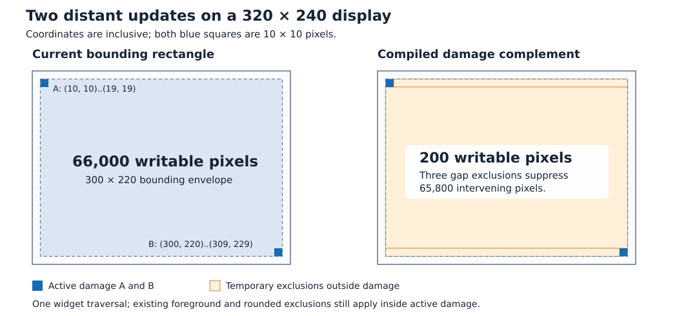

# Sparse damage regions

Status: **in progress**. Reviewed against `roo_windows` HEAD `1914bd23` and
the working tree on 2026-10-12. P1 damage geometry is implemented; renderer
integration and resource acceptance remain. Synchronous painting, rounded child
clipping, prepared exclusions, rounded scroll copying, and accelerated-scroll
cleanup are existing prerequisites. The phase ledger below is the implementation
handoff; update it as each phase lands.

Amended on 2026-10-13: use damage directly for early clip rejection and trimming,
retain compiled gaps for initial output filtering, and compare native damage
filtering in a separate measurement phase after the hybrid implementation.

## Objective

Preserve separation between small invalidations so a refresh avoids writing
unchanged pixels between them, with bounded window-owned state and one widget
paint traversal.

## Motivation

Two 10 by 10 updates at opposite sides of a screen can currently become a
single large repaint rectangle. On a 320 by 240 display, damage at inclusive
coordinates `(10, 10)..(19, 19)` and `(300, 220)..(309, 229)` has area 200 pixels,
but its bounding rectangle has area 66,000 pixels. Repainting an exposed
background through that envelope can write 330 times the necessary area.

Clean foreground exclusions already prevent some of that work: two opaque
child updates do not necessarily repaint their parent's background. The
optimization addresses amplification when background, large leaves, or rounded
contributors actually draw through the accumulated envelope. It complements
the recent reductions in individual shadow and transparent-menu invalidations.

## Background

The [current paint contract](../README.md#current-paint-contract) is synchronous.
Every refresh samples animations, lays out, and completes its traversal before
click settlement. Exclusions, overlays, effects, and rounded boundary colors
have one-paint lifetimes; their backing storage retains capacity. The advisory
paint budget permits optional background deferral without interrupting the
traversal. There is no continuation, partial traversal cursor, or rounded repair
transaction to extend.

The [widget-authoring rules](../../../.github/instructions/roo-windows-widget-authoring.instructions.md)
define dirty versus invalidated content, foreground-first exclusion, and
surface ownership. The [glossary](../glossary.md) defines ownership and
presentation terminology. Relevant implementation points are:

| Area | Current behavior |
| --- | --- |
| [MainWindow](../../../src/roo_windows/core/main_window.cpp) | Accumulates a bounded `pending_damage_` union; snapshots and clears it before painting so new requests survive. Root invalidation and presentation pins also add damage. |
| [Container](../../../src/roo_windows/core/container.cpp) | Stores one `invalid_region_` for its surface. Dirty propagation can stop when that envelope contains the new rectangle. |
| [Widget](../../../src/roo_windows/core/widget.cpp) | Calls `prepareClip()` before content generation, clears clipped-away descendants, and publishes decorations and exclusions after content. |
| [ClipperOutput](../../../src/roo_windows/core/clipper.cpp) | Prepares relevant exclusions once for its current bounds. Clip queries and output share them; overlay changes alone do not invalidate that preparation. |
| [ExclusionFilter](../../../src/roo_windows/core/exclusion_filter.h) | Handles streamed colors, sparse pixels, rectangle batches, and direct images. Rectangle subtraction has a bounded-depth fallback. |
| [Rounded clipping](../implemented/rounded_child_clipping_design.md) | Reconstructs contributors during the ordinary traversal and accumulates fractional boundary colors before deferred composition. |
| [BlitCacheContainer](../../../src/roo_windows/containers/blit_cache_container.cpp) | Uses a previous source certificate, a safe-copy planner, and raw device copying; publishes a provisional next certificate before traversing children. |
| [AcceleratedScrollablePanel](../../../src/roo_windows/containers/accelerated_scrollable_panel.cpp) | Uses full-viewport admission, records omitted background work, and requests a later cleanup through ordinary invalidation. |

The October 4 investigation measured the 66,000 versus 200 write example on an
earlier tree. The [P0 baseline](measurements/sparse_damage_baseline.md) now
reproduces the 66,000-write envelope on the current host fixture and records
the scenes, build and control measurements. Neither run is target performance
acceptance; P8 measures the ESP32-S3 device.

## Requirements

1. Produce the same final pixels as ordinary complete rendering of the declared
   changes, including rounded boundaries, shadows, translucent foreground,
   owner effects, and unclipped children.
2. Preserve disjoint damage within a fixed capacity. Any approximation must
   overestimate damage and must never discard required drawing.
3. Visit widget paint hooks at most once per synchronous traversal. Preserve
   foreground ordering and the existing no-duplicate-settled-writes contract,
   counting hardware-copy destinations as writes.
4. Preserve invalidations raised during painting for the next refresh,
   including both their geometry and the affected widgets' paint obligations.
5. Add no instance fields to `Widget` or `Container`. Bound geometry scratch
   independently of tree depth and screen area, and add no warmed allocations
   in fixed scenes.
6. Preserve full-frame and single-rectangle fast paths. Measure CPU, display
   traffic, stack, retained capacity, and flash rather than equating fewer
   pixels with faster rendering.
7. Keep framebuffer copies and accelerated cleanup correct when a rectangular
   clip contains holes in its damage coverage.
8. Preserve existing application and widget drawing APIs. Implement internal
   prerequisites as fully functional, independently testable increments.

General region algebra, per-container rectangle lists, tiles, multiple tree
paints per refresh, source-rasterizer redesign, and changing acceleration policy
are outside this proposal.

## Design Overview

A **damage region** is a bounded union of device-coordinate rectangles in which
pixel values need to be reconstructed. It is conservative: declared damage can
include unchanged pixels. A **damage envelope** is its bounding rectangle,
retained for the existing rectangular canvas clip.

**Pending damage** belongs to `MainWindow` and accumulates until the next
refresh. **Active damage** is the immutable snapshot borrowed by one `Clipper`
during the current paint. New requests go into pending damage, never into that
snapshot. Neither object contains widget pointers.

A **gap exclusion** is an ordinary rectangle covering part of the current clip
outside active damage. It exists only in the prepared filter inputs. A
**semantic exclusion** is the existing registered foreground or preserved-output
rectangle; it retains its current composition and cache semantics. These two
categories share a filtering representation, not ownership or meaning.

For current rectangular clip $C$, active damage union $D$, and the existing
ordinary and rounded exclusion coverage $E$, prepare gap coverage $G=C\setminus
D$. The unchanged filter then produces:

$$
C\setminus(E\cup G)=(C\cap D)\setminus E.
$$



The figure uses inclusive Roo coordinates. Rectangle maxima become exclusive
boundaries only inside the complement algorithm. Its three orange rectangles
total 65,800 pixels, so excluding them leaves exactly 200 pixels before any
foreground exclusions are considered.

The root stores at most four damage rectangles. Containers retain their
existing conservative surface rectangles; the shared clipper enforces the
precise active union. P6 activates this path for ordinary window painting; the
host characterization fixture now records 200 writes per two-corner frame
instead of the P0 baseline's 66,000. The initial implementation combines two mechanisms:

1. `prepareClip()` intersects its requested clip with each damage member and
   bounds the surviving intersections. An empty result skips widget content
   generation before any exclusions are prepared.
2. For a surviving clip, prepare semantic and gap exclusions inside those
   smaller bounds. Reuse them for further clip trimming and exact output
   filtering, including holes that a rectangular canvas clip cannot represent.

This keeps widget rejection to at most four rectangle intersections while
preserving the existing output algorithms. No second widget traversal paints
another rectangle. [P9](#p9-compare-native-damage-output-filtering) measures
native output filtering against this hybrid; it does not change the initial
implementation choice.

| Requirement | Mechanism |
| --- | --- |
| Correct pixels and ordering, R1/R3 | Exact gap exclusions share the existing ordinary and rounded output filter; contributor and decoration order remains intact. |
| Bounded conservative damage, R2/R5 | Four window-owned members, deterministic outward merging, and a bounded complement sweep. |
| Next-refresh work, R4 | Consume pending damage before painting, then restore pending paint obligations after traversal. |
| Fast paths and measurements, R6 | Direct four-member clip rejection/trimming before shared exclusion preparation, coverage shortcuts, and explicit resource gates. |
| Copy and cleanup safety, R7 | Separate destination coverage and source eligibility; require exact viewport coverage for complete-scroll admission. |
| Incremental integration, R8 | Optional internal damage input defaults to unrestricted behavior until the root is switched. |

## Design Details

### Bounded accumulation

Introduce internal `DamageRegion` in matching `damage_region.h/.cpp` files.
It owns four `roo_display::Box` entries and an 8-bit count, with no heap storage
or cached envelope. Root entry points intersect framework `Rect` values with
window bounds before converting to the device coordinate range.

For each nonempty addition:

1. Ignore it when one retained rectangle contains it, and remove entries it
   contains.
2. Merge pairs whose bounding rectangle adds zero area. Repeat containment and
   zero-cost merges until no such simplification remains.
3. When five candidates remain, merge the pair with the smallest additional
   area, then repeat simplification. Retain at most four members.

For rectangles $a,b$, the pair's added area is
$|\operatorname{bbox}(a,b)|-|a|-|b|+|a\cap b|$. Use widened signed arithmetic
for area and coordinate-boundary calculations. Break ties by candidate index
in insertion order; the new rectangle follows retained candidates. Fix that
rule in tests. No proximity threshold, percentage heuristic, or public tuning
knob is introduced. Overlap alone does not justify merging thin crossing
rectangles with a large bounding envelope.

Members can overlap. Output observes their union, so overlap never causes
repeated painting. `covers(box)` proves coverage by the whole union, not merely
by its envelope or a single member. Reuse the allocation-free complement sweep
with an early exit at the first nonempty gap; do not collect temporary fragments
just to answer this query. The empty candidate is covered; an empty region
covers no nonempty candidate.

### Direct damage rejection and trimming

An undamaged widget does not need complement construction to prove that it can
skip painting. For requested clip $C$ and damage members $D_i$, compute

$$
B=\operatorname{bbox}\!\left(\bigcup_i(C\cap D_i)\right).
$$

`DamageRegion::intersectionBounds(C)` ignores empty intersections and accumulates
their envelope in one local box. It returns empty when none survive. This is
at most four rectangle intersections and bounding updates, with no sorting,
allocation, fragment list, or exclusion scan. Intersect each member separately:
`C` intersected with the overall damage envelope would retain undamaged gaps.
For the figure above, a widget clip `(100, 100)..(199, 139)` is rejected even
though it lies inside the 300 by 220 damage envelope.

`ClipperOutput::prepareClip()` follows this sequence:

```text
candidate = damage present ? damage.intersectionBounds(requested) : requested
setBounds(candidate)
if candidate is empty: return empty
prepareExclusions() within candidate
visible = exclusion_union.visibleBounds(candidate)
adopt visible using the existing prepared-subset reuse; return visible
```

Update bounds even on early rejection so later expansion cannot reuse stale
preparation. A null damage pointer preserves unrestricted behavior; a non-null
empty region rejects every clip. Direct damage rejection performs no exclusion
preparation or overlay composition. Callers still adopt the returned clip.

`B` is the exact bounding box of the damage intersections, not a disjoint
region. The later semantic-exclusion search can trim it further but retains
its existing conservative search limit. Internal holes remain for output
filtering. If a requested clip meets only one damage member, the trimmed
candidate is wholly inside that member and needs no gap fragments.

The existing empty-clip handling skips the content paint hook; a container can
also skip descendant drawing, while dirty-flag cleanup can still visit them.
Keep the [decoration overflow path](#rounded-contributors-and-effects): a shadow
can reach damage even when its widget's content clip is rejected. Do not put
an unconditional widget return ahead of that path.

### Compiling gap exclusions

Compile $C\setminus D$ while preparing exclusions for the current clip. After
direct damage trimming, $C$ is the surviving candidate above. Other entry
points that bypass `prepareClip()` still receive exact gap filtering through
ordinary output preparation; correctness must not depend on the early query.
Choose a horizontal-band sweep with fixed local scratch:

1. Intersect damage members with $C$; discard empty intersections.
2. Collect `C.yMin`, widened `C.yMax + 1`, and the intersections' corresponding
   Y boundaries; sort and deduplicate them.
3. Within each resulting band, sort and union the active half-open X intervals.
4. Append uncovered X intervals as inclusive `Box` rectangles spanning that
   band. Their interiors are disjoint.

With $N\leq4$ members there are at most $2N+2=10$ Y boundaries, $2N+1=9$
bands, and $N+1=5$ gaps per band. Thus at most 45 gap rectangles are appended.
This is a conservative pre-coalescing bound, not an expected count. A clip
inside one damage member emits no gaps, and the illustrated two-corner envelope
emits three. Directly rejected widget clips never run this compiler. The first
implementation emits these bands directly; it does not maintain another
fragment vector or vertical-coalescing cache. This makes storage and failure
behavior inspectable.

An empty clip emits nothing. No damage intersecting a nonempty clip emits that
clip alone. A single member covering the clip emits nothing. An empty active
region suppresses all output; an absent damage argument means unrestricted
legacy behavior. These cases must remain distinguishable.

Append gaps to `bounded_exclusions_` in `prepareExclusions()`, before relevant
semantic rectangles, so ordinary subtraction can eliminate broad gaps early.
Install `ExclusionUnion`'s borrowed pointers only after every append is finished.
Keep rounded descriptors in their existing separate prepared array.

Reuse `exclusions_valid_`: changed bounds or registered exclusions rebuild the
combined list; overlay/effect-only changes do not. Active damage cannot change
while a clipper exists, so no generation counter is needed. Direct damage
trimming precedes preparation. When the later exclusion search shrinks $C$ to
a subset, its prepared gaps remain valid for that subset exactly as existing
exclusions do. A later expansion goes through `setBounds()` and rebuilds
preparation.

Do not call `addExclusion()` for gaps, prune overlays because of them, add them
to `exclusions()`, or present them to source certification as scene coverage.
The existing draw methods and bounded subtraction stay unchanged.

The 45-fragment bound removes an output-time overflow policy. All outward
damage coalescing happens before the active snapshot is used. Never merge gaps
through damaged pixels, truncate gap generation, or enlarge active damage after
earlier widgets have already been skipped.

### Root collection and propagation

Replace `redraw_bounds_` with `pending_damage_`; derive its envelope on demand.
Audit constructor initialization, both root `invalidateDescending()` overloads,
`propagateDirty()`, `childInvalidatedRegion()`, and presentation-pin damage.
Full invalidation replaces the pending union with window bounds. First display
initialization remains a full-window paint.

Remove `Container::propagateDirty()`'s early return based on
`invalid_region_.contains(rect)`. For example, after left and right surface
damage, a new center-child change lies inside that envelope but outside the
root's two retained rectangles. It must still reach the root. Preserve
visibility, parent clipping, unclipped-overflow, rounded-backdrop notification,
and empty-rectangle dirty-flag propagation. Do not add a second root lookup or
a region field on every ancestor.

Retain `Container::invalid_region_` and the current descending intersection
logic. Do not replace geometry unions used for layout or maximum bounds with
damage lists. Root filtering limits what those conservative surface clips
actually write.

### Paint lifetime and restoration of new obligations

Pending geometry alone is insufficient. A widget's `paint()` can invalidate
itself, or an earlier sibling can invalidate a later sibling outside active
damage. Existing paint code can then clear that widget's dirty flags, especially
when `prepareClip()` rejects its content. The next refresh would know the area
but could skip the leaf that must reconstruct it.

Introduce protected framework hook `Widget::restorePaintObligation(rect)`.
The default restores invalidated/dirty flags for intersecting visual bounds.
`Container` supplies a final override that restores its flags, unions the
rectangle into `invalid_region_`, and recurses into intersecting child maximum
bounds in child coordinates. It stores no fields. This is restoration of a
previously reported obligation, not a new semantic invalidation.

The hook must not call `setDirty()`, parent notification, layout hooks, cache
invalidation, or accelerated scrolling's `observeDamage()`. Original requests
already performed those actions. P5 re-arms the existing rectangular pending
region after the clipper's scope ends; P6 changes only that snapshot to iterate
the bounded pending union. Calling ordinary virtual
`invalidateDescending()` again would reset acceleration's baseline after every
cleanup request and can cancel valid cache state unnecessarily. A framework-only
virtual adds a vtable slot, whose flash cost must be measured, but no per-widget
RAM. Container's final override prevents specialized containers from treating
this replay as another state change.

The root follows this order:

```text
layout and presentation-pin preflight
    -> take pending damage into active snapshot; clear pending
    -> paint once with the snapshot; new requests accumulate in pending
    -> destroy the clipper that borrows the snapshot
    -> reuse snapshot storage to copy pending damage
    -> restore descendant obligations for each copied pending rectangle
    -> commit presentation-pin bounds; return with pending work still dirty
```

No restoration walk occurs when painting raised no new nonempty damage. Never
iterate a live accumulator while calling subtree hooks; use the copied region.
The helper itself raises no requests, and the existing frame request from each
original invalidation remains authoritative. Click settlement still occurs
after the drawing context closes, as it does today. This mechanism does not
authorize arbitrary tree destruction or unsupported reentrant paints.

### Rounded contributors and effects

Keep the synchronous rounded reconstruction path. Prepare and mask child groups
in their current order, accumulate fractional colors, and publish owner
decoration normally. Direct damage intersection restricts early content
eligibility; compiled gaps restrict output and subsequent exclusion trimming.
Neither supplies opaque scene coverage or boundary colors.

Keep decoration overflow handling even when content is rejected by damage:
a shadow can reach active damage from a widget whose content does not. Preserve
the existing restoration of the enclosing clip before decoration publication.
Verify nested masks, unclipped foreground, disabled styling, tint and ripple
with disjoint damage against a complete-render pixel oracle. No full-window
rounded restart or continuation repair is introduced.

### Framebuffer copies and source certification

Raw copying bypasses the output filter. Extend the existing
[planner](../../../src/roo_windows/core/blit_plan.cpp) with active damage as a
destination constraint, independently of foreground restrictions at both
endpoints. After computing source-certificate, viewport, and mask eligibility,
intersect candidate destinations with each damage member. Run the existing
foreground search on those candidates and select one safe rectangle. Keep the
current shared node/depth budgets across the search, current area cutoff, and
one-copy-per-cache policy. Ordinary painting supplies the remainder.

Do not pass each damage rectangle as the planner's viewport: it uses viewport
geometry at both endpoints, which would incorrectly make damage a source
restriction. The previous certificate can supply pixels outside active damage.
Retain the existing conservative canvas-derived viewport in
`BlitCacheContainer`; source opportunities outside that viewport still fall
back to painting. Expanding source eligibility is outside this design. P3
keeps that container path unchanged and applies destination membership inside
`BlitPlanner` after its existing source and opaque-mask proof.

Restrict each **new** source certificate to one active-damage member as well as
the existing foreground/effect/mask proof. A foreground widget entirely inside
a gap can return before registering its semantic exclusions. Consequently,
certifying the whole envelope on the assumption that its unchanged gaps are
safe could later copy unrelated foreground as cached subtree content.
Conservative certification avoids a second scene traversal or a persistent
foreground map. With no damage argument, preserve the current planner behavior.

Publish the provisional certificate before child traversal as today, so new
content damage still shrinks it. Preserve invalidation on background deferral.
Register only the actual copied destination as a semantic exclusion.

### Accelerated background cleanup

`AcceleratedScrollablePanel::beginPaint()` must require both the current clip
and the active damage union to cover its visible viewport before establishing
a complete baseline, declaring cleanup complete, or entering accelerated mode.
Envelope containment alone is insufficient. Partial coverage follows the
existing `kPartial` path: invalidate the baseline and retain/request cleanup.

Add the same coverage guard to optional background-band admission, so a band
outside active damage cannot be reported as omitted background work. In normal
operation a fully covered viewport satisfies this automatically; the local
check also protects directly constructed internal scopes. Ordinary output
still goes through gap filtering. Fractional rounded-edge accumulation remains
mandatory under the existing rules.

The post-paint restoration hook above leaves the acceleration baseline intact
while restoring requested cleanup flags. Its regression must include several
successive moving frames followed by the unchanged-position cleanup frame.

### Producer precision

Preserve separate old and new footprints where producers currently join them
only to submit invalidation. The bounded root cannot recover separation after
a producer has already supplied a bounding rectangle.

P7 covers `preparePresentationPinsForPaint()`,
`ClickAnimation::invalidateTransientFootprint()`, and the press-state old/new
interior notification in `Widget::setPressed()`. They now submit their two
footprints independently to the bounded root union. Pin presentation still
retains a conservative `presented_bounds_` rectangle for lifecycle bookkeeping;
visibility, clipping, and existing repaint requests remain intact. Keep conservative
presentation bookkeeping and structural/visual bounds as rectangles; they are
not interchangeable with damage accumulation.

### Resource and complexity budget

Let $N\leq4$ be damage members, $H\leq45$ compiled gaps, $E$ prepared semantic
rectangles for a clip, $V$ widgets visited by a restoration walk, and $d$ the
ancestor depth of a reported change. These are independent input dimensions.

| Storage or work | Chosen cost |
| --- | --- |
| Persistent damage | Four 8-byte device boxes plus count/alignment: 34 bytes in the P1 host test, replacing the root's 10-byte `Rect` at P6; measure the complete target ABI delta. |
| Active damage | One approximately 34-byte paint-stack snapshot, reused for restoration after the clipper is destroyed. |
| Clipper input | One borrowed pointer to immutable damage; no stored copy and no per-widget fields. |
| Complement scratch | At most ten 32-bit Y boundaries and four pairs of 32-bit X endpoints: 72 bytes of array payload, plus compiler locals. |
| Prepared gap payload | At most 360 additional live bytes in the existing reusable vector. Vector capacity growth can retain more; record actual capacity and allocator cost. |
| Accumulation | At most five candidates, ten pairs per merge decision, with bounded repeat simplification. No input history is retained. |
| Propagation | One ordinary ancestor walk per notification, $O(d)$ before existing subclass work; no new ancestry search. |
| Direct clip query | $O(N)$: at most four box intersections and envelope updates, constant box scratch, no allocation or sorting. Rejected queries perform no exclusion preparation. |
| Complement preparation | $O(N^2\log N)$ for band and interval sorting, on invalid prepared clips that survive the direct query, or on output that bypasses it. Constants are bounded by four members. |
| Filtering | Existing algorithms see $E+H$ ordinary rectangles; fewer output pixels do not imply fewer membership scans. |
| Obligation restoration | Up to $O(NV)$ after paints that report further damage; no walk on an ordinary settled paint. |

Choose direct clip queries plus compilation at `prepareExclusions()`, without
a second cached global complement. This reuses established output preparation
and avoids another retained fragment list and cache state. Overlay-only changes
already avoid repeated preparation. P8 separates query cost, rejected-query
count, complement construction, filtering, and device traffic. P9 compares
native output filtering without weakening the cheap direct query. Algorithm
changes require a measured design amendment, not an undocumented switch.

Keep the current single-region path free of gap fragments when its canvas clip
is already inside that region. Warmed fixed-scene allocations must not increase.
Require unchanged `sizeof(Widget)` and `sizeof(Container)`, at most 32 bytes
growth in `MainWindow` on the target ABI, and a complement-emission target
function frame no larger than 256 bytes. Report vtable/flash deltas and retained
capacity separately; fixed arrays consume RAM even without heap allocation.

## Proposed API

These are internal framework sketches. New helpers get normal Doxygen
contracts and matching implementation files. Application-facing refresh and
widget drawing APIs do not change.

```cpp
namespace roo_windows::internal {

class DamageRegion {
 public:
  static constexpr uint8_t kCapacity = 4;

  void clear();
  void add(roo_display::Box clipped_damage);
  bool empty() const;
  uint8_t size() const;
  const roo_display::Box& at(uint8_t index) const;
  roo_display::Box bounds() const;
  // Bounds of the union of member intersections, empty if none; allocation-free.
  roo_display::Box intersectionBounds(const roo_display::Box& clip) const;
  bool covers(const roo_display::Box& candidate) const;
  void appendComplement(const roo_display::Box& clip,
                        std::vector<roo_display::Box>& output) const;

 private:
  roo_display::Box rects_[kCapacity];
  uint8_t count_ = 0;
};

}  // namespace roo_windows::internal

// Clipper: keep existing constructor calls valid.
Clipper(internal::ClipperState& state, roo_display::DisplayOutput& out,
        roo_time::Uptime deadline = roo_time::Uptime::Max(),
        const internal::DamageRegion* damage = nullptr);

bool damageCovers(const roo_display::Box& candidate) const;

// ClipperOutput owns the borrowed pointer and forwards it to its planner
// consumer through a narrow internal accessor. nullptr means unrestricted;
// a non-null empty region allows no writes. Lifetime: the whole Clipper.
const internal::DamageRegion* damage_;

// Widget, protected framework hook. Container's override is final.
virtual void restorePaintObligation(const Rect& local_damage);

// MainWindow replaces redraw_bounds_ with this member.
internal::DamageRegion pending_damage_;
```

`damageCovers()` returns true for unrestricted mode and otherwise tests the
union. Low-level clipper callers keep unrestricted behavior until they explicitly
supply damage. P2 implements direct clip trimming, filtering and the coverage
query completely; P3/P4 extend their separate consumers before P6 activates
sparse damage at the window.
There are no placeholder APIs returning success for unimplemented behavior.

## Implementation Plan

Authoring references: [shared C++ rules](../../../.github/instructions/general-cpp-code-authoring-instructions.md),
[widget and rendering rules](../../../.github/instructions/roo-windows-widget-authoring.instructions.md),
and [example rules](../../../.github/instructions/embedded-example-authoring.instructions.md)
when a phase edits a runnable example. Run tests from the canonical
`~/Documents/Arduino/roo/roo_windows` source repository, preserving workspace
symlinks and unrelated changes.

### Agent handoff and phase ledger

Each phase is one reviewable commit with its own tests and documentation update.
The phase owner reads this document, applicable `AGENTS.md`, and current Git
state before editing. Reconcile current code with the stated baseline; do not
redo prerequisites already implemented. The status ledger, not conversational
memory, records completed slices.

| Phase | Depends on | Status | Delivered commit and evidence |
| --- | --- | --- | --- |
| P0 Characterization | Existing renderer | Implemented | `damage_region_resource_test`, [baseline report](measurements/sparse_damage_baseline.md); host target and four renderer regressions pass. |
| P1 Damage geometry | None | Implemented | `damage_region.h/.cpp`, pixel-oracle test; `//:damage_region_test` and ASan pass, 34-byte host state. |
| P2 Direct clip queries and prepared gaps | P1 | Implemented | `ClipperOutput` trims direct clips and prepares exact gap exclusions; `//:damage_region_render_test`, `//:paint_context_test`, and `//:masked_exclusion_test` pass. |
| P3 Copy and certificate restrictions | P2 | Implemented | Destination-only damage restriction in `BlitPlanner`; `//:blit_plan_test`, `//:damage_region_render_test`, and `//:horizontal_page_host_render_test` pass. |
| P4 Accelerated coverage guards | P2 | Implemented | Exact viewport coverage and per-band damage guards; `//:accelerated_scroll_state_test`, `//:background_deferral_test`, and `//:damage_region_render_test` pass. |
| P5 Restore pending paint obligations | P0 | Implemented | Framework-only widget/container restoration after paint; both sibling orders and semantic-hook count pass in `//:roo_windows_test`, and `//:accelerated_scroll_state_test` passes. Host `Widget`/`Container` remain 40/56 bytes. |
| P6 Activate sparse root damage | P0–P5 | Implemented | `MainWindow` snapshots four-box pending damage and passes it to the clipper; 200 exact writes for distant 10×10 boxes, rejected middle container, capacity/full/idle and paint-time gap tests pass in damage resource and core targets; 10 renderer regressions pass. |
| P7 Preserve producer footprints | P6 | Implemented | Pin preflight, click spill, and press-state notifications submit old/new bounds separately; moving-pin regression writes 200 pixels with an untouched gap; producer and settlement suites pass. |
| P8 Resource and device acceptance | P6, P7 | Proposed | — |
| P9 Native output comparison | P8 | Proposed | — |

P0/P1 and, after P2, P3/P4 can be delegated independently with explicit file
ownership. Serialize edits to `BUILD`, this ledger, and the design index, or
integrate isolated commits. Never run agents concurrently against shared core
files without an agreed owner. No agent implements a later phase silently.

Each handoff records files changed, exact validation commands/results, resource
deltas, unresolved failures, and the next eligible phase. Update only the
delivered phase's status. Move the document/index to in-progress after the first
phase. P8 accepts the production hybrid; mark the full design implemented after
that acceptance and P9's comparison report. Native production integration is a
separate amendment, not a prerequisite for this design. Move this design's
figure and measurement reports with it, update inbound links, and check all
relative links after each status-directory move.

### P0 Characterize current damage costs

**Files:** new `test/damage_region_resource_test.cpp`, narrowly scoped `BUILD`
target, and `measurements/sparse_damage_baseline.md` beside this document in its
current status directory.

Build a repeatable recording-device fixture using the existing output-counting
test patterns. Record writes, unique touched pixels, address-window commands,
paint-hook counts, CPU time, and warmed allocations for distant background
invalidations, hidden children, one partially invalidated leaf, and two opaque
child updates. Include full-window and one-rectangle controls, rounded owners,
and the existing scrolling examples. Record scene coordinates and source commit.
Characterization must not assert that the old excess writes remain required.

**Validation:** new resource target plus `//:roo_windows_test` and
`//:surface_widget_invalidation_test`; record correctness and baseline metrics.
Update the Motivation evidence reference and ledger with the checked-in report.

**Proposed commit message:**

> Sparse damage regions P0: characterize invalidation write amplification.
>
> Add repeatable pixel, command, traversal and allocation measurements for
> sparse and contiguous damage, with a baseline report for the design.

### P1 Implement bounded damage geometry

**Files:** new `core/damage_region.h/.cpp`, `test/damage_region_test.cpp`, `BUILD`.

Implement accumulation, deterministic merge policy, envelope, direct
`intersectionBounds()` and exact coverage queries, and the bounded complement
sweep. Keep the helper independent of widgets, clipping state, and device I/O.
Document inclusive-boundary conversion and fragment bounds beside the algorithms.

**Validation:** `//:damage_region_test`. Compare coverage and complements with a
small-grid pixel oracle for overlapping, nested, adjacent, crossing, empty and
clipped inputs; exercise the fifth insertion, tie cases, full representable
boundary arithmetic, and repeated additions. Assert original coverage is never
lost, gaps are disjoint and exact, and emitted count never exceeds 45. Compare
`intersectionBounds()` with the oracle's exact bounding box, including a query
inside the damage envelope but between every member. Verify the query allocates
nothing. Update API/resource notes with measured helper size.

**Proposed commit message:**

> Sparse damage regions P1: add bounded damage accumulation and exact complements.
>
> Implement the four-rectangle helper, direct intersection bounds, conservative
> merging and band-based gap generation with geometry-oracle coverage.

### P2 Add direct clip queries and prepared damage exclusions

**Files:** `core/clipper.h/.cpp`, `test/paint_context_test.cpp`, and focused
`test/damage_region_render_test.cpp` support/target.

Add the optional immutable damage input and exact coverage query. Implement
the [direct query sequence](#direct-damage-rejection-and-trimming) before
exclusion preparation, then compile gaps only within surviving bounds. Retain
output-side preparation for callers that bypass the query and preserve lazy
overlay composition. Exercise the input directly in low-level tests;
`MainWindow` still passes no damage. No drawing routine gains a native damage
algorithm. P2 now uses this path in the internal clipper, while `MainWindow`
continues to pass null damage until P6.

**Validation:** new render target, `//:paint_context_test`,
`//:masked_exclusion_test` (which includes subdivision cases).
Cover all output methods, clip shrinking and later expansion, exclusion and
effect changes, unrestricted versus empty damage, nested masks and translucent
overlays. Assert no outside-damage writes, no duplicate writes, unchanged
semantic descriptors, and preparation reuse after overlay-only changes.
Instrument preparation through test-only counters: a direct damage rejection
must make zero preparation/compiler calls, allocate nothing, and avoid content
paint hooks for widgets without decoration overflow. Test exact damage-envelope
trimming, one-member survivors with zero gap fragments, and multi-member
survivors whose internal gaps remain filtered. Check expansion after rejection,
semantic-exclusion trimming after damage trimming, decoration overflow reaching
damage from rejected content, and exact filtering without `prepareClip()`.
Update the direct-query and shared-preparation documentation in this design.

**Proposed commit message:**

> Sparse damage regions P2: trim clips directly before preparing damage gaps.
>
> Reject undamaged clips with the bounded damage query, then reuse prepared
> exclusions for surviving clips and exact output without changing scene coverage.

### P3 Restrict raw copy destinations and new certificates

**Files:** `core/blit_plan.cpp`, `containers/blit_cache_container.cpp` as needed,
`test/blit_plan_test.cpp`, focused render tests and existing cache regressions.

Apply damage only after the existing source/viewport/mask eligibility proof.
Select one destination inside a damage member and certify one eligible member
for the next paint. Preserve budgets, minimum-copy threshold and unrestricted
behavior. Do not expand the existing source viewport.

**Validation:** `//:blit_plan_test`, `//:horizontal_page_host_render_test`, and
the new damage render target with a device supporting copies. Cover a legal
source outside damage, illegal destination gaps, foreground hidden inside a
gap, disjoint members, masks/effects, and copy fallback. Compare copied and
ordinary-render pixels, count copies as writes, and verify the next certificate
cannot include a gap. Update planner-contract documentation.

**Proposed commit message:**

> Sparse damage regions P3: constrain copies and certificates to valid damage.
>
> Add destination-only damage restrictions and conservative next-source
> certification while retaining previous-frame source eligibility and copy gates.

### P4 Guard accelerated scrolling with exact coverage

**Files:** `containers/accelerated_scrollable_panel.cpp`, background admission
in `core/clipper.cpp`, `test/accelerated_scroll_state_test.cpp`,
`test/background_deferral_test.cpp`.

Require active-damage coverage for viewport admission and complete cleanup,
and prevent outside-damage bands from creating deferral debt. Keep root
collection unchanged. Add the sparse-coverage contract to the existing
[accelerated redraw design](../in_progress/selective_accelerated_redraw_design.md)
only in the sections affected by this phase; do not rewrite its independent
implementation status.

**Validation:** both named targets and the damage render target. An enclosing
envelope with a hole must take the partial path. A union that exactly covers
the viewport must pass. Check pending cleanup, fractional edges, nested scopes,
and no false deferral from excluded gaps.

**Proposed commit message:**

> Sparse damage regions P4: require complete damage coverage for scroll baselines.
>
> Make accelerated admission, cleanup completion and optional background bands
> respect the damage union, with partial-viewport and debt regressions.

### P5 Restore paint-time obligations without semantic reinvalidation

**Files:** `core/widget.h/.cpp`, `core/container.h/.cpp`, `core/main_window.cpp`,
`test/roo_windows_test.cpp`, accelerated-scroll regression tests and size probe.

Implement the protected restoration hook and Container's final recursive
override. After the clipper is destroyed, snapshot and restore the root's
currently pending rectangle. This phase fixes flag loss while the root still
uses its old envelope; P6 replaces that one rectangle with region iteration.
Add the distinction between restoration and new invalidation to the relevant
framework comments and widget-authoring guidance.

**Validation:** `//:roo_windows_test` and `//:accelerated_scroll_state_test`.
Invalidate self during `paint()`, an earlier/later sibling, and a later sibling
outside the active rectangular clip; verify the next refresh paints the final
state and settles. Count semantic invalidation hooks to prove restoration does
not replay them. Verify multiple accelerated moving frames retain their baseline
and eventually clean up. Measure unchanged Widget/Container instance sizes and
report added vtable bytes.

**Proposed commit message:**

> Sparse damage regions P5: preserve paint-time work after dirty flags are cleared.
>
> Restore pending descendant paint obligations after traversal through a
> framework-only hook that preserves cache and accelerated-scroll state.

### P6 Activate sparse window damage atomically

**Files:** `core/main_window.h/.cpp`, `core/container.cpp`, new render/resource
tests, existing surface, rounded-owner and transient tests.

Replace root bounds accumulation, snapshot active damage, pass it to Clipper,
iterate pending regions for restoration, and remove the unsafe containment
shortcut in the same commit. Cover every root entry point and retain empty
dirty-state traversal. Enable the feature without a public switch. P3/P4/P5
must already be complete; there is no intermediate production mode with sparse
root output and unguarded copying or cleanup.

**Validation:** new damage targets, `//:roo_windows_test`,
`//:surface_widget_invalidation_test`, `//:rounded_child_clip_test`,
`//:rounded_owner_effect_test`, `//:transient_presentation_pin_test`,
`//:transient_surface_host_test`, and the P3/P4 targets. Add the center-child
notification after two distant invalidations and a paint-time sibling change
inside a damage gap. Compare complete-render pixels for rounded/effected,
overlapping and unclipped scenes. The unmerged two-box background case must
write exactly 200 pixels and zero gap pixels after initial painting. Verify
capacity overflow, full refresh, root-local invalidation and settled idle state.
Assert an undamaged middle widget skips its content hook without preparing
exclusions for that query; include a rejected container and the shadow-overflow
exception. Paint-time requests for skipped widgets must survive restoration.
Record this as the first end-to-end sparse behavior in the status index.

**Proposed commit message:**

> Sparse damage regions P6: preserve disjoint invalidations through window painting.
>
> Replace the root envelope with bounded pending damage, enable exact gap
> filtering, and forward new damage through already-invalidated ancestors.

### P7 Preserve separate producer footprints

**Files:** `core/main_window.cpp`, `core/click_animation.cpp`, `core/widget.cpp`,
presentation-pin, click and surface invalidation tests.

Submit old and new footprints separately at the three named
[producers](#producer-precision). Keep structural unions, conservative presented bounds and
effect ownership intact. Add focused write-count regressions in this commit
and update the producer audit notes; do not broaden into geometry refactoring.

**Validation:** `//:transient_presentation_pin_test`, `//:click_animation_test`,
`//:surface_widget_invalidation_test`, `//:overlay_test`, and damage render tests.
Test both separated and overlapping footprints, clipping, disappearance and
normal animation settlement; gaps between distant footprints remain untouched.

**Proposed commit message:**

> Sparse damage regions P7: retain old and new invalidation footprints separately.
>
> Remove premature bounding unions from pin, transient click and press-state
> damage notifications while preserving conservative geometry bookkeeping.

### P8 Complete resource and device acceptance

**Files:** damage resource tests, a focused target size/frame probe following
the existing [rounded probe](../../../benchmarks/rounded_child_clip_size_probe.sh),
measurement reports and this design/index. Reuse the existing scrolling
benchmark/example instead of creating a new public demo API.

Run the P0 scenes with one, two and four damage members, dense overlap, fifth
insertion, 0/8/32 children, nested rounded owners, and simple/blit/accelerated
scroll policies. Measure total refresh median/p95 time, emitted pixels and
address commands, hook visits, direct-query time/rejections, complement
counts/preparation calls and time, output-filter CPU time, warmed
allocations, live/retained heap, object/vtable/flash sizes, and target stack.
Use the same build flags and scene setup for baseline and candidate.

**Acceptance:** all correctness gates above; no new fixed-scene warmed
allocations; the [resource size/frame limits](#resource-and-complexity-budget); and at
least 25% measured task-stack headroom in the target benchmark. On ESP32-S3,
the sparse background scene must reduce median total refresh time by at least
20%; single-rectangle/full-redraw controls and the existing rounded-scroll
acceptance scenes must regress by no more than 5% median or 10% p95. Use five
interleaved baseline/candidate batches after warmup, retaining at least 200
frames per scene per batch. These are proposed acceptance limits, not measured
claims. Keep the four-member policy fixed during the initial acceptance run.

**Validation:** focused tests first, then `bazel test //...` in the source
repository under its default frontend, the target probe, and ESP32-S3 runs.
Record build flags, hardware, all batches, actual vector capacity and known
font/framework allocations separately. A failing or unavailable hardware gate
leaves P8 pending; hand off the exact missing evidence rather than marking the
design implemented. A necessary algorithm/budget revision must update this
document and receive its own measured rationale before implementation.

**Proposed commit message:**

> Sparse damage regions P8: validate rendering costs and target acceptance.
>
> Record sparse and contiguous damage measurements, bounded memory and stack
> costs, and complete regression and device evidence for the implemented design.

### P9 Compare native damage output filtering

**Files:** benchmark-only filter prototype and driver under `benchmarks/`, a
focused benchmark target, and `measurements/sparse_damage_native_comparison.md`
beside this document. Keep production filtering and public APIs unchanged.

Compare the accepted hybrid against an output filter that consults the four
damage members directly. Both use the same early `intersectionBounds()` query
and semantic/rounded exclusions. Concentrate the prototype in the filter:
point membership, streamed visible runs, and disjoint rectangle portions
inside damage. Union overlapping members before emitting output; preserve
input cursor advancement across skipped streamed pixels and safe row batching.
Exercise direct images through the filtered methods, and retain filtering when
semantic exclusions are empty but damage has holes. Do not repaint widgets
once per damage member.

Use one/two/four members, overlap and crossing shapes, fragmented damage,
large background fills, sparse pixels and streamed images, plus the P8
single-rectangle/full-frame and rounded controls. Report actual gap counts;
the 45-fragment bound is not an assumed workload. Measure filter-only CPU,
total refresh median/p95, writes, address commands, scratch/retained RAM,
allocations, stack and flash on the same host and ESP32-S3 setups. Follow P8's
batching protocol and reuse its fixtures.

**Decision criterion:** recommend a separate native-integration amendment only
when pixels and write uniqueness match, the existing memory/stack/allocation
gates hold, and native filtering improves median total refresh by at least 10%
in at least two of the fragmented fill, sparse-pixel and streamed-image scenes,
with no control regression beyond P8's 5% median / 10% p95 limits. Report flash
and retained-memory deltas alongside the timing decision. Otherwise retain the
hybrid. These are proposed thresholds; fewer descriptors alone do not pass.

**Validation:** run the prototype against the same geometry/pixel/write-count
oracles and output-method cases as P1/P2, then record reproducible commands,
source revisions, target results and the decision. Missing target evidence
leaves P9 pending. This phase completes with a checked-in comparison and
recommendation; it never silently replaces the production filter.

**Proposed commit message:**

> Sparse damage regions P9: compare native damage filtering with compiled gaps.
>
> Add a benchmark-only prototype and reproducible correctness and cost evidence
> to decide whether a separate output-filter integration is justified.

## Testing Plan

Use the [repository test launcher](../../../.roo_testing/bin/bazel) from the
source repository. P0/P1/P2 add the named `damage_region_*` targets; they are
planned targets, not commands available before those phases. Existing core
targets are listed per phase. C++ changes require formatting and focused tests
under the linked authoring guidance.

Validation has four layers: geometry against a pixel-set oracle; clipper output
against a recording device exercising every output method; full widget scenes
against complete-render snapshots and write counts; and host/target resource
measurements. Correct final pixels alone cannot establish that gaps were not
written or that pixels were written only once. Test-only preparation counters
establish that direct rejection avoids complement construction; hook counts
establish that widgets actually skip content generation. P9 reuses the same
oracles for its isolated comparison rather than changing production behavior.

Snapshots use already-settled scenes before submitting measured damage. Compare
effects at the same sampled animation state. Count raw copy destinations as
device writes, inspect future source certificates, and drive cleanup through
the public refresh path. Repeat warmed scenes long enough to distinguish
retained capacity from per-frame allocation churn. Keep goldens unchanged
unless a separate, demonstrated rendering bug justifies their review.

## Caveats

The region is conservative, not a minimal changed-pixel set. Four rectangles
can collapse under widespread damage, and coalescing increases work safely.
Existing widgets can still declare broad bounds. This design cannot recover
precision already lost at a producer.

Output filtering cannot prevent every source rasterizer from generating pixels
inside holes. Early clip preparation rejects complete gaps and trims edges but
still returns a rectangle. Host CPU and device transfer costs must therefore be
reported separately. Background deferral remains the existing explicit opt-in
exception to fully current output after a refresh.

Restoration re-arms only geometry reported through normal invalidation. It does
not discover unreported mutations. It also adds a new internal virtual slot;
applications must rebuild against the changed library, and flash/vtable growth
is part of P5/P8 acceptance.

### Rejected Alternatives

#### A rectangle list on every container

Local precision can reduce surface work before output, but multiplies storage
throughout the tree. Four 10-byte framework rectangles already add at least
30 bytes over each existing rectangle, before metadata. The chosen
[root storage](#root-collection-and-propagation) plus shared filtering satisfies
the demonstrated problem without that instance cost.

#### Paint the tree once per damage rectangle

This gives simple rectangular clips but repeats widget hooks, changes flag
consumption and effect lifetimes, and requires special handling for overlapping
damage. The chosen [single traversal](#paint-lifetime-and-restoration-of-new-obligations)
preserves current composition contracts.

#### Compile gaps before testing widget damage

Shared exclusion preparation can discover an empty visible clip, but it first
builds and scans data unnecessary for a four-member intersection test. The
chosen [direct query](#direct-damage-rejection-and-trimming) rejects gaps before
preparation and reduces the bounds of surviving work. Reusing output filtering
does not require using complement construction for that first decision.

#### Replace output filtering with native damage handling immediately

Native membership avoids gap storage and repeated complement scans even at
four members. Its changes belong mainly in `ExclusionFilter`, not in individual
widgets. It still needs correct point tests, streamed runs, overlap-free
rectangle emission, row batching and output-bypass guards. The initial hybrid
keeps these tested algorithms while making widget rejection cheap. The
[P9 comparison](#p9-compare-native-damage-output-filtering) evaluates the real
runtime and memory benefit before a separate production integration; it does
not assume that four members versus a loose 45-gap bound predicts the speedup.

#### Cache a global complement for each paint

One global compilation avoids rebuilding after clip/exclusion changes, but
adds another retained list and makes each small clip inspect global fragments.
The chosen [shared preparation](#compiling-gap-exclusions) has no second cache
and already survives overlay-only changes. Its measured acceptance is explicit
in [P8](#p8-complete-resource-and-device-acceptance).

#### Use dirty tiles or an unbounded exact region

Tiles provide predictable screen-dependent storage but expand small damage to
tile boundaries. An unbounded region preserves precision but exposes animation
and paint to allocation and fragmentation growth. Four rectangles directly
serve sparse UI changes with bounded input size and a
[safe degradation policy](#bounded-accumulation).

#### Store gaps as semantic exclusions

This would reuse registration but can prune overlays and corrupt assumptions
in blit planning, source certification and background admission. Prepared gaps
only restrict output; they never [certify scene content](#framebuffer-copies-and-source-certification).

#### Replay ordinary invalidation to restore pending flags

It reuses an existing traversal, but repeats cache and acceleration mutation
hooks after the original request. The narrow
[restoration hook](#paint-lifetime-and-restoration-of-new-obligations) keeps the
same paint obligation without treating cleanup as a new content change.

## Future Work

Potential separate improvements are a larger region capacity backed by measured
workloads, vertical coalescing of compiled gaps, rasterizer-aware disjoint clips,
and broader source-viewport reuse for partial scroll copies. None is required
for the correctness or acceptance of the four-member design above. Production
native damage filtering is a separate extension governed by P9's measured
recommendation; the comparison itself is part of this implementation plan.
