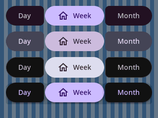
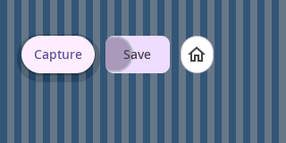

# Material 3 button group acceptance

All six phases of the [implemented design](implemented/material3_button_groups_design.md)
are complete. The [usage and migration guide](../material3_button_groups.md) links
the two runnable examples. Measurements below were collected on 2026-10-12;
physical checks are listed separately.

## Retained object storage

The 64-bit host allocation test and the ESP32-C3 ABI probe measure these sizes
in bytes. Target results use `riscv32-esp-elf-g++` 14.2.0, C++17, `-Os`,
`-fno-exceptions -fno-rtti`. Baseline target headers came from `48df9bd1`.

| Type | Host | ESP32-C3 | ESP32-C3 baseline |
| --- | ---: | ---: | ---: |
| `Widget` / `SurfaceWidget` | 40 | 24 | 24 |
| `Container` | 56 | 44 | 44 |
| `Button` | 72 | 40 | 40 |
| `IconButton` | 56 | 32 | 32 |
| `ToggleIconButton` | 72 | 40 | 40 |
| `ButtonGroupButton` | 80 | 44 | — |
| `ButtonGroupIconButton` | 64 | 36 | — |
| `ButtonGroup` | 88 | 60 | — |
| `ConnectedButtonGroup` | 96 | 68 | — |
| `ComponentTheme` | 29 | 29 | 28 |
| `Material3Theme` | 960 | 960 | 960 |
| `Theme` | 240 | 232 | 232 |
| `CachedMeasure` | 16 | 16 | 16 |

Incremental label/icon entry costs are 40/24 B on the host and 20/12 B on the
target. Standard/connected group increments over `Container` are 32/40 B on the
host and 16/24 B on the target. All four meet the design ceilings. Standalone
buttons retain their previous sizes. The shared theme byte fits existing
aggregate alignment. The wider transient `WidthSpec` fixes the positive int16
range without increasing `Widget` or `CachedMeasure` storage.

Both the host resource target and the standalone target probe contain assertions
for these budgets. Run from the canonical source repository:

```sh
bazel build //:material3_button_group_size_probe
benchmarks/material3_button_group_size_probe.sh \
  ~/.platformio/packages/toolchain-riscv32-esp/bin/riscv32-esp-elf-g++ \
  ~/.platformio/packages/toolchain-riscv32-esp/bin/riscv32-esp-elf-nm
```

## Capacity and allocation

`material3_button_group_resource_test` intercepts C++ allocation/deallocation
with a fixed static ledger. Retained/peak values are requested payload bytes,
excluding allocator metadata and unmeasured direct C allocation. Instrumentation
and report output do not allocate inside the measured intervals.

Both group policies have the same observed host vector growth, for both content
families. Entry objects are created before measuring vector growth.

| Attached entries | Retained capacity | Host add allocations | Host pointer payload | Host growth peak | Target pointer payload at this capacity |
| ---: | ---: | ---: | ---: | ---: | ---: |
| 0 | 0 | 0 | 0 | 0 | 0 |
| 3 | 4 | 3 | 32 | 48 | 16 |
| 5 | 8 | 4 | 64 | 96 | 32 |
| 32 | 32 | 6 | 256 | 384 | 128 |

The target payload column applies the measured 4-byte pointer ABI to the observed
capacity; it is not a target runtime heap measurement. Clearing retains capacity;
five add/clear cycles after initial growth allocate zero times. No group eagerly
reserves 32 slots.

The first test measures ordinary `Button` work before grouped scenes consume
shared caches:

| Standalone baseline stage | Allocations | Retained bytes | Peak bytes |
| --- | ---: | ---: | ---: |
| First font metrics | 1 | 96 | 96 |
| First paint | 11 | 72 | 72 |
| Warm full repaint | 7 | 0 | 48 |
| First click service admission | 0 | 0 | 0 |

The cold font allocation is reported explicitly. Group scenes then use this
font baseline; their first layout reports zero allocations. First icon-only
layout also reports zero without font measurement. Twenty warmed layout passes,
twenty feedback/state/layout samples, first click admission, five warmed
click/cancel cycles, five add/clear cycles, and 100 full-mask/bit-31 projections
all report zero allocations. Group interaction introduces no registry tracks.
No object, metric, position, animation or callback cache was added to entries.

Complete painting still invokes existing glyph, shape, exclusion and surface
services. Representative measured results follow; these are whole framework
repaints, not allocations in the group's layout or policy code.

| Scene in 296 px clipped viewport | First paint allocations / retained / peak | Warm repaint allocations / retained / peak |
| --- | --- | --- |
| Empty, either policy | 2 / 16 / 16 | — |
| 3 labels, either policy | 33 / 264 / 312 | 21 / 0 / 48 |
| 3 icons, either policy | 15 / 264 / 312 | 3 / 0 / 40 |
| 5 labels, standard / connected | 37 / 288 / 360; 39 / 288 / 360 | 21 / 0 / 48; 23 / 0 / 48 |
| 5 icons, either policy | 23 / 984 / 1080 | 6 / 480 / 480 |
| 32 labels, standard / connected | 37 / 288 / 360; 39 / 288 / 360 | 21 / 0 / 48; 23 / 0 / 48 |
| 32 icons, standard / connected | 26 / 1032 / 1176; 29 / 1056 / 1224 | 7 / 480 / 520; 8 / 480 / 520 |

At 32 members only the visible part of the natural strip paints; all members
still participate in layout/projection. The 480 B retained by some warm icon
repaints is shared renderer scratch acquired by those paths, not group storage.
These costs are reported rather than hidden by additional warmups or attributed
to the child vector. Existing renderer allocation removal remains separate work.

## Linked target flash

The [firmware fixture](../../benchmarks/material3_button_group_firmware.cpp)
builds the same two labels and home icon as standalone controls, standard
entries or connected entries. Each scene includes one real callback, an ILI9341
output and the normal application/scheduler path. The standalone row uses
`FlexLayout`; group rows replace that row and its controls. All sources are local
canonical libraries. No firmware was uploaded.

PlatformIO used `esp32-c3-devkitm-1`, Arduino 3.3.5, the installed Espressif32
platform, `ROO_WINDOWS_ZOOM=100`, and the same compiler/options above, plus
`-fstack-usage -fcallgraph-info=su`. Only the fixture's scene translation unit
changes between current-family builds. Target ELF section measurements follow.

| Linked section | Before feature standalone | Current standalone | Standard group | Connected group |
| --- | ---: | ---: | ---: | ---: |
| `.flash.text` | 670240 | 670854 | 675564 | 676068 |
| `.flash.rodata` | 172396 | 172452 | 175300 | 175300 |
| `.iram0.text` | 60544 | 60544 | 60544 | 60544 |
| `.dram0.data` | 7044 | 7044 | 7044 | 7044 |
| `.dram0.bss` | 11512 | 11512 | 11480 | 11496 |
| `.eh_frame` | 8976 | 8976 | 8976 | 8976 |

The current standalone text/rodata delta is +670 B (+614/+56). Its linked symbol
report contains no public or internal group implementation. Against that current
standalone scene, standard groups add 7558 B (+4710 text, +2848 rodata); connected
groups add 8062 B (+5214 text, +2848 rodata). These are equivalent-scene linked
deltas, not unlinked object sizes or a universal per-widget flash cost. The BSS
reduction reflects the fixture's replaced `FlexLayout` composition; dynamically
allocated vector payload is accounted separately above.

The [reproduction script](../../benchmarks/material3_button_group_firmware_size_probe.py)
archives the baseline, stages dependency wrappers with registry metadata removed,
builds all four scenes, and saves ELF, section/symbol reports, and compiler stack
reports in the output directory. It checks that standalone builds do not link
public or internal group classes:

```sh
python3 benchmarks/material3_button_group_firmware_size_probe.py \
  --baseline 48df9bd1 --output-dir /tmp/roo-button-group-flash --jobs 8
```

## Geometry scratch and full-stack estimates

Layout retains two `int16_t[32]` arrays on the stack: 128 B explicit geometry
scratch, below the 192 B cap. Connected layout shares that same compiled routine;
there is no heap or retained geometry buffer. Scratch is separate from the
complete function frame and the callers/callees still on the stack.

| Compiler static frame | ESP32-C3 bytes |
| --- | ---: |
| `ButtonGroupBase::onLayout` | 240 |
| `ButtonGroupBase::measureStrip` | 64 |
| `ButtonGroupBase::onMeasure` | 32 |
| `ButtonGroupEntry::entryDimensions` | 96 |
| `ResolveButtonContentMetrics` | 96 |
| `RedistributeGroupWidths` | 64 |
| `GroupIntervalLeft` | 32 |
| `ButtonGroupEntry::paint` | 208 |

For the fixture's label layout branch, summing reported live frames from
`Widget::layout` through `onLayout`, `measureStrip`, `entryDimensions`, content
metrics, `SmoothFontV2::getHorizontalStringMetrics` (112 B) and glyph-pair push
(80 B) gives a 704 B call-chain estimate. Including the fixture's complete
application/window/task/column-layout ancestry gives approximately 1344 B:
16 B each for application/window refresh, 160 B refresh paint, 32 B update
layout, 16 B root layout, 16 B root container layout, 16 B task layout, 112 B
task panel layout, 32 B child-with-margins layout, 16 B scene layout, 208 B flex
layout, plus that 704 B branch.

These are static estimates of a representative successful layout path, not
measured stack watermarks or a worst-case bound over fatal checks, recursive
invalidation, allocation, presentation callbacks, libc and device rendering.
Full painting adds its canvas, font, clipper and driver frames; the 208 B entry
paint frame is not its complete call stack. The script preserves `.su` and `.ci`
reports for those dependencies too. Hardware stack/latency validation remains
separate from the explicit geometry-scratch acceptance.

## Behavior, rendering and examples

The focused group unit, golden and resource targets pass. Unit coverage includes
membership/ownership, capacity/context checks, all sizes/density levels, both
layout directions, overflow, geometry invariants at every active index for
0/1/2/3/5/32 members, bit-31 masks, state projection, physical keys, cancellation,
slow paint and destructive callbacks. Geometry/palette helpers also pass at
zoom 75/100/150/200. Group unit/golden and click-controller tests pass under ASan.
The 17-target affected button-family/density/layout regression run passes.

Partial frames are compared with an actual full repaint from the application
root at the same retained click sample. Nonuniform ancestor backgrounds expose
stale gaps and corners. Per-pixel output counts verify one final write during
motion/cancellation. Gone-endpoint restoration is covered even when constrained
surviving frames remain unchanged. Selected elevated overlay roles are checked
separately from pure palette helpers.





Both leaf examples build and were launched with their `bazel run` targets under
Xvfb. In the view selector, Tab/End/Enter selected Month and a pointer action
selected Day; descriptions and rendered frames were reviewed. In capture
actions, keyboard activation invoked history and a pointer action invoked
Capture; feedback frames were reviewed. Automated motion/cancellation tests
cover repeated feedback and final restoration.

```sh
bazel test //:material3_button_group_test \
  //:material3_button_group_golden_test \
  //:material3_button_group_resource_test
bazel test --config=asan //:material3_button_group_test \
  //:material3_button_group_golden_test //:click_animation_test
bazel build //:material3_button_group_size_probe \
  //examples/material3/button_groups/view_selector:view_selector \
  //examples/material3/button_groups/capture_actions:capture_actions
```

Physical compact-touch usability, slow-display motion quality, device latency
and stack watermarks remain unperformed manual hardware checks. Host timing is
not reported as target latency.
