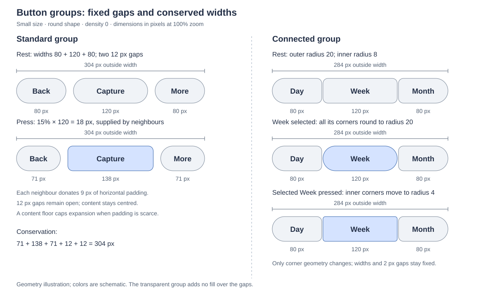

# Roo Windows Material 3 Button Groups Design

Status: **proposed**. No button-group implementation exists. Reviewed against
`roo_windows` HEAD `86960589` and the working tree on 2026-10-12. Existing
framework prerequisites are implemented; group-specific helpers, theme storage,
widgets and tests below are proposed work. See the [status index](../README.md)
and [Material 3 roadmap](../../material3_roadmap.md).

## Objective

Add Material 3 standard action groups and connected selection groups with
label or icon entries, coordinated geometry, and bounded embedded costs.

## Motivation

A device can offer a Day / Week / Month view selector or a row of related
capture actions. Applications currently assemble independent buttons and
selection callbacks, or use the icon-only, pre-Material-3
[`ToggleButtons`](../../../src/roo_windows/widgets/toggle_buttons.h).
Neither approach supplies connected corner geometry or coordinated press
expansion. A component should keep those rules consistent without adding
group-specific fields to every standalone button.

## Background

### Current framework

The [design glossary](../glossary.md) defines borrowed and adopted children
and the temporary ownership-transfer role of `WidgetRef`.

- [`Button`](../../../src/roo_windows/material3/button/button.h),
  [`IconButton`](../../../src/roo_windows/material3/button/icon_button.h), and
  [`ToggleIconButton`](../../../src/roo_windows/material3/button/toggle_icon_button.h)
  are implemented `SurfaceWidget` subclasses. `BasicSurfaceWidget` is not the
  current base. Toggle icon buttons use `Widget::setSelected()`, distinct from
  `setActivated()`, and suppress the generic selected overlay.
- [`ButtonSize` and `ButtonShape`](../../../src/roo_windows/material3/button/button_types.h)
  already provide five size tiers and round/square shapes. Shared
  [geometry](../../../src/roo_windows/material3/button/internal/button_geometry.h)
  and [appearance](../../../src/roo_windows/material3/button/internal/button_appearance.h)
  helpers already serve buttons, `DropdownButton` and split buttons; their
  extraction is not a prerequisite to repeat. Icon geometry and palette
  resolvers remain file-local in
  [`icon_button.cpp`](../../../src/roo_windows/material3/button/icon_button.cpp)
  and [`toggle_icon_button.cpp`](../../../src/roo_windows/material3/button/toggle_icon_button.cpp).
  Standalone icon buttons do not currently participate in application density.
- [`Container`](../../../src/roo_windows/core/container.h) provides structural
  child attachment, focus enumeration, layout, clipping and invalidation.
  [`BorderStyle`](../../../src/roo_windows/core/border_style.h) supports four
  independent corner radii.
- [Click delivery](../implemented/click_delivery_policy_design.md) separates
  semantic activation from visual feedback. The shared click controller
  samples before layout; refresh paints synchronously to completion.
  [`onClickAnimationChanged()`](../../../src/roo_windows/core/widget.h) can
  request layout before painting. Paint must not advance time or move children.
- [Density](../implemented/material3_density_design.md), component surface
  themes, task-local focus, physical-key activation and ordinary widget
  lifetime cleanup are available.

There is no Material 3 group implementation. The [segmented-button
proposal](material3_segmented_buttons_design.md) describes the classic
shared-outline component and remains a distinct proposal. [Split
buttons](../../material3_split_buttons.md) are implemented, including
[acceptance evidence](../material3_split_button_acceptance.md) and an
[implemented design](../implemented/material3_split_button_design.md). Their
transparent composition and decoration hooks are useful precedents, but their fixed two-child layout and
menu ownership are not group infrastructure.
[Toolbars](../implemented/material3_toolbars_design.md) are also implemented
and are not a dependency of this one.

### Material references and local decisions

Material publishes button-group
[overview](https://m3.material.io/components/button-groups/overview),
[specs](https://m3.material.io/components/button-groups/specs), and
[guidelines](https://m3.material.io/components/button-groups/guidelines). The
earlier review could not read those JavaScript pages as text; this review uses
the official implementation sources below for concrete tokens. The following
primary implementation references make the critical mechanics checkable
(rechecked 2026-10-12):

- AndroidX [ButtonGroup defaults](https://github.com/androidx/androidx/blob/androidx-main/compose/material3/material3/src/commonMain/kotlin/androidx/compose/material3/ButtonGroup.kt)
  define a 15% pressed-width expansion that compresses neighbouring entries.
  Gaps are spacing, not consumable motion bands.
- AndroidX [connected group tokens](https://github.com/androidx/androidx/blob/androidx-main/compose/material3/material3/src/commonMain/kotlin/androidx/compose/material3/tokens/ConnectedButtonGroupSmallTokens.kt)
  define the small group's 40 dp height, 2 dp gap, resting/pressed inner
  corners, and fully rounded selected inner corners.
- AndroidX [connected shape defaults](https://github.com/androidx/androidx/blob/androidx-main/compose/material3/material3/src/commonMain/kotlin/androidx/compose/material3/ButtonGroup.kt)
  retain exposed outer corners on press and round the selected entry.
- Android Material [button color tokens](https://github.com/material-components/material-components-android/blob/master/lib/java/com/google/android/material/button/res/values/tokens.xml)
  distinguish selected and unselected contained treatments, including elevated
  buttons.

This proposal adopts the expansion ratio, small connected spacing and corner
tokens, and enabled palette roles from those references. Fixed gaps, bounded
compression, five-size geometry, square connected contours, selected-press
precedence and animation timing below are explicit Roo Windows choices. They do
not imply upstream API or token parity. Source links on moving branches are
references, not runtime dependencies.

## Requirements

1. Offer separate standard action groups and connected selection groups, each
   in one horizontal row, mixing single-line labels with optional leading icons
   and icon-only entries.
2. Coordinate five sizes, round/square resting shapes, density and left-to-right
   or right-to-left placement at group level. Use contained button styles.
3. Keep a standard group's outside width and gaps stable while a pressed entry
   expands and its immediate neighbours compress without losing content.
4. Keep connected entry frames stable through press and selection. Support
   single or multiple selection, optional empty selection and required selection.
5. Give pointer and physical-key users the same actions, visible focus and
   disabled-state rules. Moving focus must not silently change selection.
6. Define bounded membership, borrowing/adoption, empty groups, visibility,
   width constraints and reentrant callback behaviour.
7. Reuse surface painting and click feedback, restore exposed pixels correctly,
   and introduce no allocations in group layout, paint or selection logic.
   Account separately for existing framework and font allocations.
8. Keep group-only state out of standalone buttons. Use one canonical connected
   selection representation and no new per-entry callback storage.

Wrapping, overflow menus, arbitrary child widgets, multiline labels, trailing
icons, per-entry size overrides and standalone selectable label buttons are
outside this proposal.

## Design Overview

The public family consists of `ButtonGroup`, `ConnectedButtonGroup`,
`ButtonGroupButton` and `ButtonGroupIconButton`.

An **entry** is one group-specific surface widget and its borrowed content.
An **attachment index** is its insertion index until `clear()`; visibility and
RTL never change it. A **participating entry** is attached and not `kGone`;
an invisible entry retains its layout slot. The **press target** is the visible,
enabled entry currently supplying the shared click-feedback sample, or a held
press when no sample exists. It is transient and does not represent selection.

`ButtonGroup` coordinates standard entry widths. It owns no selection and
does not interpret activated or selected bits as a persistent width change.
`ConnectedButtonGroup` owns a 32-bit mask indexed by attachment order and
projects it into each entry's existing selected bit. Both keep size, shape and
layout direction in one place. Entries keep content and style; an internal
entry base handles the common group relationship and surface hooks.

The group containers use the existing transparent `Container` path, while
entries own the visible surfaces. This preserves framework child lifetime,
focus and paint ordering without a new core hierarchy. As with `SplitButton`,
the container introduces no group surface: its explicit transparency and
exclusion overrides are required by the current surface-owning container base.
Typed attachment limits the component to the two supported entry families.

Entries need to notify the group when shared click feedback or content changes,
without consuming the application callback. A typed group pointer provides that
reverse link and distinguishes group membership from merely having a structural
parent. The latter matters because an entry is still a `Widget` that a caller
can borrow into another layout. Only typed group attachment activates its group
behaviour; no unchecked cast of an arbitrary `parent()` is needed.

A view selector needs one application callback:

```cpp
#include "roo_windows/material3/button/button_group.h"

using namespace roo_windows::material3;

// Borrowed entries are constructed first, so the group detaches them first
// during destruction. String literals also satisfy the borrowed-label lifetime.
ButtonGroupButton day(context, "Day");
ButtonGroupButton week(context, "Week");
ButtonGroupButton month(context, "Month");
ConnectedButtonGroup period(context);  // Small, round, single, required.
period.add(day);
period.add(week);
period.add(month);
period.setSelectionMask(1u << 1);  // Week; programmatic, no notification.
period.setOnInteractiveChange([&period] {
  ShowPeriod(period.selectedIndex());
});
// Attach period to the application's layout through its normal borrowing API.
```

Tapping Day changes `0b010` to `0b001`, updates both affected surfaces, then
invokes the group callback. Tapping Day again leaves the mask unchanged and
emits no change. For capture actions, use `ButtonGroup` and callbacks on its
individual entries instead.



The figure uses small, round groups at 100% zoom and density zero. Its fully
unselected connected row illustrates optional empty selection. It is a geometry
construction, not a rendering golden. Standard widths sum to 280 px and two 12
px gaps give 304 px; connected widths use two 2 px gaps for 284 px. The pressed
and resting rows have identical outside bounds.

## Design Details

### Membership and lifetime

Both groups accept at most 32 entries, including invisible and gone entries.
This bounds indexing and scratch storage and avoids a second large-group API.
Typical groups have three to five entries. `add()` returns false on null owned
input or capacity exhaustion. It appends on success and never reorders entries.
Attaching an already parented entry or one from another `ApplicationContext` is
a checked programmer error. Check `parent() == nullptr`, `group_ == nullptr`
and context equality explicitly before mutating storage: `Widget::setParent()`
alone permits the same parent and does not reject a duplicate group insertion.
Validate non-null input before checking capacity, so an already attached entry
is never treated as an ordinary rejected owned argument. Record the raw pointer
and group relationship before calling `attachChild()`; callbacks from
structural setup must see consistent enumeration. Normalize selection after
attachment.

Borrowing and adoption follow the [framework contract](../glossary.md#widgetref):
typed reference and `unique_ptr` overloads construct a temporary `WidgetRef`,
retain the raw pointer, and move the ref into `attachChild()`. The vector stores
raw pointers only; `isOwnedByParent()` remains the ownership record. An owned
argument passed by value is consumed even when admission fails and is then
destroyed. Borrowed rejected inputs remain untouched.

`clear()` first clears the mask, severs every entry's group relationship and
clears its selected projection. Then pop one raw pointer from the vector before
calling `detachChild()` on it, repeating until empty; never retain a vector
iterator across detachment or enumerate a deleted child. This needs no second
vector or allocation. Structural detachment cancels framework focus, gesture
and pending click reachability. Group-specific state hooks become inert as soon
as the relationship is cleared, so teardown cannot normalize a partially
cleared mask back into a required selection. Adopted children are deleted by
the framework; borrowed children survive and must outlive their attachment.
Destructors perform the same cleanup without notifications. Vector capacity is
retained by `clear()` and released by destruction. There is no individual
removal or reorder API in v1; callers rebuild a short group.

Detached entries remain configurable but are not clickable or focusable. They
measure and paint with small, round, unselected defaults until attached. They
are intended for groups, not as alternate standalone buttons. The same inert
behaviour applies when an entry is placed directly in a generic layout. No
position or index is stored on entries; bounded scans resolve the current
position. The concrete group destructor clears while its selection policy is
still alive; the internal base destructor requires empty membership.

### Measurement, density and constraints

Entries have zero implicit margins. Label entries reuse current button content
metrics and default small-button padding; icon entries use the uniform width of
`IconButton`. Labels and icons are borrowed until replaced or destroyed. An
icon-only constructor requires a non-null icon reference. Empty labels are
allowed; there is no automatic switch to icon-only geometry. Exact entry
metrics come from internal content helpers, not from measuring a standalone
button with different margins. Entry and group suggested minimums are `(0, 0)`;
entry `onMeasure()` supplies exact natural dimensions and wrap-content
preferred size avoids the base preferred-size path remeasuring labels.

Outlined entries reserve the family outline inset in both selected and
unselected measurements and content bounds. Removing the painted outline on
selection must not change the content anchor or its clipping. Labels use
label-large typography and the existing button-family metrics at every size,
matching this repository rather than importing a second typography table.

Apply application density to heights using the existing button-family helpers,
including content floors; spacing and corner tokens do not shrink with density.
For group icon entries, density is new behaviour: retain the standalone uniform
width, measure icon height through `ResolveButtonContentMetrics({}, icon, size,
level)`, and use the vertical edges of `ResolveButtonPadding()` to derive
natural height. This matches standalone icon geometry at density zero and
applies the button family's compact ink floor at negative levels. Ignore that
helper's horizontal padding for icon-only entries. Standalone icon buttons stay
unchanged. Entries in a row share the maximum of their natural heights and
centre content vertically. The row starts at the group's top; excess assigned
height remains below it. This accommodates oversized icons without clipping
their ink. No group-level density override is added. Runtime changes use
`requestLayoutDescending()` and `invalidateDescending()` at the affected root,
as described in the density design.

These are the adopted group geometry constants in dp before `Scaled()`:

| Size | Nominal height | Standard gap | Connected gap | Connected resting inner / square radius | Connected pressed inner radius |
| --- | ---: | ---: | ---: | ---: | ---: |
| XS | 32 | 18 | 2 | 4 | 2 |
| S | 40 | 12 | 2 | 8 | 4 |
| M | 56 | 8 | 2 | 8 | 4 |
| L | 96 | 8 | 2 | 16 | 8 |
| XL | 136 | 8 | 2 | 20 | 10 |

The small connected row matches the primary reference above. For other sizes,
the retained resting-radius table and a half-radius pressed treatment are
explicit local scaling choices. Standard entry corners continue to use their
respective button/icon-button helpers, not this connected table.

For participating count $n$, resting widths $w_i$, and scaled gap $g$:

$$
W_0 = \sum_{i=0}^{n-1}w_i + \max(n-1,0)g,\qquad
H_0 = \begin{cases}\max_i h_i & n>0\\0 & n=0.\end{cases}
$$

An empty or all-gone group has natural dimensions `(0, 0)`; constraints can
still give it space. Resolve `WidthSpec` and `HeightSpec` normally. A standard
group given extra width keeps its natural strip at logical start. A connected
group distributes $E=\max(W-W_0,0)$ extra pixels: add $\lfloor E/n\rfloor$ to
each width and one pixel to each of the first $E\bmod n$ participating entries
in attachment order. Never divide by zero.

With the default clipped entries, when assigned width is smaller than natural,
retain natural entry widths and clip at group bounds. Do not wrap, compress to
fit, or silently drop entries. An undersized height likewise clips the
natural-height row. Applications must provide enough room or a scrolling parent
for every action to be reachable. Use `int32_t` intermediates for dimensions,
sums and mirrored coordinates. The natural strip and each entry must fit the
positive `int16_t` dimension range; reject unrepresentable content with a
checked programmer error before narrowing. Saturating each child position
independently would overlap entries and violate width conservation. Parent
constraints within that range still use the clipping policy above. Zero-size
rectangles remain empty.

Compute logical positions, then mirror each interval as $x'=W-x-w$ in RTL;
also mirror leading icons and exposed corners. Attachment indices, masks and
remainder distribution retain their meaning. Invisible slots count for spacing
and corner position; gone slots do not. Visibility changes request layout
through the existing framework path.

Exact measurements belong in `onMeasure()`/`onLayout()`. Group suggested
minimums remain cheap as specified above. Before `layout()`, measure each
participating child with its resolved exact frame dimensions so framework
measurement state agrees with the placed rectangle, including animated widths.
Use bounded stack scratch for resting widths, heights and compression budgets;
do not derive resting widths from previously animated frames. No retained
per-entry geometry cache is introduced in v1.

### Standard press expansion

A fixed gap keeps adjacent rounded surfaces distinct throughout a press. The
extra width instead comes from the immediate participating neighbours' padding.
Let $c_i$ be the measured label/icon content width and
$m_i=\min(w_i,c_i+2\,\mathrm{Scaled}(4))$ its compression floor. Define the
available budget $b_i=\max(0,w_i-m_i)$. Here $c_i$ includes the full icon slot,
label advance/ink span and icon-label gap, plus any reserved outline insets; it
is not just the visible glyph width. Invisible neighbours can donate padding;
gone entries are skipped. Disabled neighbours retain their geometry and can
also donate padding, but cannot become the press target.

For target $a$ and sampled emphasis $p\in[0,1]$, the desired increase is
$D=\lfloor0.15w_ap+0.5\rfloor$. With one neighbour, take
$d=\min(D,b_{neighbour})$. With two, first cap $d=\min(D,b_L+b_R)$ and split:

$$
d_L=\min\bigl(b_L,\max(\lfloor d/2\rfloor,d-b_R)\bigr),\qquad
d_R=d-d_L.
$$

Here $L$ and $R$ are the logical preceding/following neighbours. The following
neighbour gets the odd pixel. Expand $w_a$ by $d$, shrink those neighbour widths
by $d_L,d_R$, and place the row with unchanged gaps. With no neighbour, $d=0$.
Width conservation gives $\sum w'_i=\sum w_i$, including at edge presses and
when available padding limits expansion. Content remains centred in each frame.

For example, widths `[80, 120, 80]` at full emphasis request 18 px for the middle
entry. Neighbours with at least 9 px available each give `[71, 138, 71]`.
The total stays 304 px including gaps. This is the figure's worked example.

Reuse the shared click sample: $p=\min(1,3\,\mathrm{progress})$, matching the
current button press-morph scale. With no sample, a held press gives $p=1$ and
rest gives $p=0$. Resolve the click-controller target first, then the first
visible enabled held press in attachment order. Use widget-local
`getClickAnimation()` views; do not expose or retain a core controller pointer.
Only one entry expands at once. Switching target restores the old target before
applying the new sample; no crossfade or persistent activated-entry expansion
is added.

Entry `notifyStateChanged()` and `onClickAnimationChanged()` call a
no-allocation group hook which requests layout and invalidates the strip for
standard groups. Connected groups invalidate old/new corner decoration without
width layout. Preserve `previous_progress` in the click hook and reconstruct
the old state from `state_diff` for `borderStyleChanged(previous_style)`;
damage limited to the new contour leaves stale rounded pixels. Compare resolved
integer geometry during layout so unchanged samples do not move frames.
Sampling occurs before layout. On click cancellation, hiding, detachment or
loss of eligibility, resolve without the cancelled target. No registry track,
timer, per-entry animation value, or paint-time invalidation loop is needed.
`ButtonShapeMorph::kDisabled` at group level disables press width and corner
morphing while preserving ordinary click feedback.

### Connected selection

The canonical state is `uint32_t selection_mask_`. Defaults are single selection
with selection required. An empty group has mask zero. Required selection means
at least one attached entry is selected whenever the group is nonempty; it does
not mean an enabled or visible option must always exist.

Normalization is deterministic and shared by all configuration paths:

1. Clear bits outside the attached count; count 32 uses `UINT32_MAX`, avoiding
   a shift by 32.
2. In single mode keep the lowest set bit.
3. When the result is empty, selection is required and entries exist, select
   index zero.

Adding the first entry therefore selects it by default. Adding more preserves
the mask. Switching multiple to single keeps the lowest selected index; turning
required selection on repairs an empty mask. Programmatic selection can select
disabled, invisible or gone entries, and changing those properties preserves
selection. This keeps application state stable when an option temporarily
cannot be operated. `clear()` always produces mask zero.

User activation is accepted only for a currently attached, effectively visible
and enabled entry in an enabled group. Single mode selects an unselected entry;
activating its selected entry clears it only when empty selection is allowed.
Multiple mode toggles that bit, except removing the final required selection
is a no-op. `selectedIndex()` returns an index only when exactly one bit is set,
in either mode; otherwise it returns `-1`. Invalid `isSelected(index)` queries
return false without shifting.

Project the normalized mask through `Widget::setSelected()`, and override
`useOverlayOnSelection()` to return false because the palette already encodes
selection. Direct child selection is not a second API: while connected,
`notifyStateChanged(kWidgetSelected)` repairs an external write to the
canonical bit before returning. Reentrant repair terminates on equality.
Geometry and palette resolution read the canonical mask, so projection order
never exposes a partially updated selector. Pass the previous mask into the
projection helper to reconstruct each changed entry's old border before
notifying surface damage; this mask is stack-local, not retained state.
Activated state does not participate in selection or shape resolution. Both
entry families suppress the generic activation/selection overlays; standard
groups ignore persistent selected bits altogether.

Use `kImmediateContinueAnimation` for connected entries, as toggle icon buttons
do. Commit the entire mask, update every affected entry and schedule repaint
before calling `triggerInteractiveChange()` on the group once, and only when
the mask changed. Programmatic setters, normalization, add and clear are silent.
There is no second virtual selection callback. Connected entries do not also
emit their own interactive-change event; applications observe the group.

Notification is the last operation: neither the entry nor group handler reads
members, visits children, or sends another callback afterwards. A callback can
set a new mask, clear the group or destroy the containing UI. Standard entries
instead use `kAfterNaturalAnimation` and finish with `Widget::onClicked()` for
their own action callback. This avoids a group-then-child callback chain that
could access a child already deleted by the group listener.

### Connected shape and palette

Position is resolved from participating order: single, first, middle or last.
For the unselected resting shape, round groups use fully rounded exposed outer
corners; square groups use the connected square radius. Corners adjacent to
another slot use the connected inner radius. The figure labels outer and inner
edges separately.

Selection rounds all four corners to $R=\lfloor\min(w,h)/2\rfloor$, including
inner corners. On press, interpolate inner corners from their current selected
or unselected resting radius toward the pressed-inner token; exposed corners
remain at their resting value. A single entry has no inner corners and retains
its contour on press. Every radius is clamped to actual dimensions and the
`BorderStyle` representation. This intentionally does not reuse standalone
toggle-button round/square inversion for connected entries.

Selection updates colors and resting corners immediately in v1; click samples
still provide press morphing. No independent selected-shape animation track is
added. Morph-disabled groups keep selection shapes but suppress press morphs.
Selection never changes content, outline space reservation or measured widths.

Standard entries resolve their momentary palette through the implemented button
and icon-button helpers. Connected label and icon entries use this common
selected/unselected palette (elevated is label-only):

| Style | Unselected container / content | Selected container / content |
| --- | --- | --- |
| Filled | `surfaceContainer` / `onSurfaceVariant` | `primary` / `onPrimary` |
| Filled tonal | `secondaryContainer` / `onSecondaryContainer` | `secondary` / `onSecondary` |
| Outlined | transparent / `onSurfaceVariant` | `inverseSurface` / `inverseOnSurface` |
| Elevated | `surfaceContainerLow` / `primary` | `primary` / `onPrimary` |

Resolve the filled neutral through a new shared
`components.buttonGroup.filledUnselectedContainer` token, defaulting to
`kSurfaceContainer`. This grows the current 28-byte
[`ComponentTheme`](../../../src/roo_windows/material3/component_theme.h) to 29
bytes, with matching size assertions and theme tests, and keeps group theming
independent of standalone toggle icon buttons. Elevated entries reuse
`components.button.elevatedContainer` and the existing button elevation
resolver. Use a consistent style across a connected selector in examples;
per-entry styles remain available.

Outlined entries keep the family outline width while unselected and remove the
outline when selected, without changing measurement or the reserved content
inset. Unselected outlines use `outlineVariant`, matching existing families.
Disabled colors use the existing contained-style composites (38% on-surface
content, 12% on-surface filled background, transparent outlined background and
disabled outline). For disabled outlined entries, show the disabled outline
only when unselected; selected ones remain outline-free with transparent fill.
This is the existing Roo toggle-icon disabled treatment, not a claim of exact
Android token parity. Disabled selection remains stored and retains its
selected shape, but does not use enabled accent colors. Apply the Material
disabled palette exactly once, with automatic disabled styling suppressed on
entries and their group. Effective disabling also suppresses entry
hover/focus/press overlays, even though each child retains its local enabled
flag. Hover, focus and press layers use the resolved content treatment and the
inherited surface overlay pipeline.

### Focus, hit testing and painting

Groups themselves are not clickable or focusable. Entry `isClickable()` and
`isFocusable()` require live typed membership and an enabled entry/group.
Tab/Shift+Tab use ordinary task traversal. The group's `onKeyEvent()` handles
unmodified `KeyPhase::kDown`/`kRepeat` events for Left/Right in physical
direction without wrapping; Home/End chooses the first/last eligible entry in
logical order. Eligibility requires effective visibility/enabled state and a
nonempty frame. Consume these navigation keys even at an edge, preventing task
fallback from escaping the group; Up/Down, modified keys and key releases
bubble normally. Use `requestFocus()` on the chosen child and the existing task
Enter/Space activation path. Focus movement does not change selection or start
a press; ordinary focus loss still cancels any held key press. RTL changes
placement, not key identity.

Group disable preserves each child's local enabled bit. `Widget::setEnabled()`
already cancels subtree gestures and focus, but it does not propagate child
palette state or clear every retained click sample. The group state hook calls
`Widget::onCancel()` on each entry to clear press state and cancel its
identity-checked shared click, then invalidates descendants and old decoration,
and requests standard resting layout. Resolve child palettes and elevation
against `entry.isEnabled() && group.isEnabled()`, reconstructing the old group
enabled value for damage. Re-enabling reveals the original local child flags;
it neither resumes a cancelled click nor restores focus automatically. Entry
`onClicked()` rechecks group membership, presentation and enabled ancestors
before committing an action, including delayed standard-button delivery. An
entry's own enabled-state hook also cancels its pending click when disabled, so
a disable/re-enable before the next refresh cannot revive that action.

Hit testing uses laid-out frames and the framework's existing strict/sloppy
touch paths. The gap has no semantic action of its own. Do not add overlapping
48 dp child rectangles that change sibling targeting; compact touch usability
remains a hardware validation concern. Once acquired, a gesture retains its
entry even while neighbouring widths change. Cancellation never selects it.

The internal group container reports transparent background, `kNone` container
role, zero border/elevation/padding/margins, and
`fullyCoversBoundsWithOpaqueColors() == false`. It introduces no opaque
exclusion over the gaps. It must also return an empty
`getDirectPaintExclusionBounds()` and `getOverlayType() == OVERLAY_NONE`;
transparent background alone does not override the inherited rectangular
exclusion or area effects. Keep `respectsChildrenBoundaries()` false because
elevated decorations can overlap adjacent entries despite disjoint frames.
Because callers retain mutable entries, `mayHaveUnclippedChildren()` returns
true; default entries stay clipped. Preserve the base clipped/unclipped paint
and hit-test ordering. Default clipping also clips elevated shadows at group
bounds. Callers can opt an entry into `kUnclipped` when the surrounding layout
reserves decoration space; this also opts that entry out of the group's
undersized-frame clipping. Ancestor clips still apply, and no stronger
outside-group touch reachability is promised.

Each entry paints final content through `paint(PaintContext&)` and the surface
pipeline, resolving transparent glyph/icon pixels against the current surface
in the same draw. Do not clear the strip and then repaint over it. Standard
motion invalidates the full strip plus framework-tracked old/new decoration
bounds; unclipped elevated shadows can extend outside the interior. Connected
selection invalidates changed surfaces and their old/new corner/shadow coverage
through `borderStyleChanged()`/`elevationChanged()`. A single-select change can
damage both the old and new selections. Stable siblings need no new layout.

### Resource model

Let $n\le32$ be attached count, $C\ge n$ the vector's retained capacity, $L$ the
total label bytes and $P$ pointer size. Use one `std::vector<Entry*>`, not a
parallel vector of ownership records or geometry caches. No entries are
allocated by borrowing; adopted widget allocations remain caller-created.

The internal entry base adds one group-membership pointer and packed style bits
to `SurfaceWidget`; label entries add one string view and one icon pointer, and
icon entries add one icon pointer. The internal group base adds one vector
control block and packed size/shape/direction/morph bits to `Container`. The
connected subclass adds only its mask and mode/required flags; the standard
subclass needs no persistent animation state.

These are incremental budgets, not guessed absolute object sizes:

| Object | 32-bit ceiling above framework base | 64-bit ceiling above framework base |
| --- | ---: | ---: |
| Label entry above `SurfaceWidget` | 20 B | 40 B |
| Icon entry above `SurfaceWidget` | 12 B | 24 B |
| Standard group above `Container` | 16 B | 32 B |
| Connected group above `Container` | 24 B | 40 B |

Budgets include alignment, assuming a three-pointer vector and a two-word
string view; target probes must verify the ABI. Capacity costs another $CP$
bytes outside the object, plus allocator overhead. Five slots cost 20 B of
pointer payload on ESP32; 32 slots cost 128 B. Do not reserve 32 slots eagerly
for every small group. Clearing retains that capacity. One shared theme byte
and const token tables are accounted separately. Adding one theme byte does not
imply that `sizeof(Theme)` grows by exactly one byte; measure aggregate
alignment too.

The width/height arithmetic and text measurement cost $O(n+L)$ per pass, with
at most three 32-element `int16_t` scratch arrays (192 B). This trades repeated
short label measurement for zero retained geometry payload. Selection
normalization is constant-time bit arithmetic and click lookup costs $O(n)$.
Projection scans the entries; each changed entry's state hook also locates its
canonical bit. For $k$ changed bits this costs $O(n+kn)$: ordinary single
selection changes at most two bits, while replacing an entire
multiple-selection mask is $O(n^2)$. Corner and palette queries also resolve
position/selection by bounded scans. One such scan for each entry costs
$O(n^2)$: 1,024 membership checks for 32 entries, 25 for a typical five. Layout
damage and a full paint can each perform several such queries, so complete
layout has an $O(n^2+L)$ bound rather than claiming that all framework work is
linear. Those explicit bounds are preferred to cached indices and mutation
bookkeeping. Raster cost still depends on damaged pixels and glyph work, not
just $n$.

Group-owned allocation occurs only when adding entries grows vector capacity.
Layout, mask updates, click-sample handling and group painting add none.
Existing font metric/stream painting, gesture-path buffers and shared services
retain their own allocation contracts; measure their baseline separately. No
extra animation registry tracks are introduced. Acceptance records host and
target sizes, retained/peak allocation, linked flash delta and stack usage; it
does not infer ESP32 sizes from a host build. The 192 B cap covers explicit
geometry arrays only, not the total call stack or font/renderer stack frames.
Record the full stack estimate separately. Compare linked flash for both a
standalone-button scene (no new family linked) and equivalent grouped scenes;
helper extraction must not force all group implementations into ordinary apps.

## Proposed API

The public header is `material3/button/button_group.h`. The following sketch
shows the caller surface and all new retained state. Routine paint,
measurement, input and surface overrides implement the contracts above; their
declarations are omitted here. Internal bases are implementation details, not
extension APIs. The sketch lists retained state, not complete compilable
declarations: context-forwarding constructors, friend access for typed
attachment and virtual policy hooks are required implementation details.
Initialize every packed field in constructors. Public declarations receive
Doxygen comments in the implementation.

```cpp
namespace roo_windows::material3 {

enum class ButtonGroupButtonStyle : uint8_t {
  kFilled, kFilledTonal, kOutlined, kElevated,
};

enum class ButtonGroupIconStyle : uint8_t {
  kFilled, kFilledTonal, kOutlined,
};

enum class ConnectedButtonGroupSelectionMode : uint8_t {
  kSingle, kMultiple,
};

namespace internal {

class ButtonGroupBase;

class ButtonGroupEntry : public SurfaceWidget {
 protected:
  // Group membership; allocation ownership remains in Widget.
  // Common surface, click/state and group-notification hooks live here.
  ButtonGroupBase* group_ = nullptr;
  uint8_t style_ : 2;
};

class ButtonGroupBase : public Container {
 public:
  static constexpr int kMaxEntries = 32;

  ButtonSize size() const;
  void setSize(ButtonSize size);

  ButtonShape shape() const;
  void setShape(ButtonShape shape);

  ButtonShapeMorph shapeMorph() const;
  void setShapeMorph(ButtonShapeMorph morph);

  LayoutDirection layoutDirection() const;
  void setLayoutDirection(LayoutDirection direction);

  int entryCount() const;

 protected:
  // Typed public overloads delegate through a temporary WidgetRef.
  bool addEntry(ButtonGroupEntry* entry, WidgetRef reference);
  void clearEntries();

  // Virtual group-policy hooks distinguish standard/connected operation;
  // no RTTI, stored type tag, callbacks, or per-entry selection field.
  std::vector<ButtonGroupEntry*> entries_;
  uint8_t size_ : 3;
  uint8_t shape_ : 1;
  uint8_t direction_ : 1;
  uint8_t morph_ : 2;
};

}  // namespace internal

class ButtonGroupButton : public internal::ButtonGroupEntry {
 public:
  explicit ButtonGroupButton(
      ApplicationContext& context, roo::string_view label = {},
      ButtonGroupButtonStyle style = ButtonGroupButtonStyle::kFilled);

  roo::string_view label() const;
  void setLabel(roo::string_view label);

  const MonoIcon* icon() const;
  void setIcon(const MonoIcon* icon);

  ButtonGroupButtonStyle style() const;
  void setStyle(ButtonGroupButtonStyle style);

 private:
  roo::string_view label_;
  const MonoIcon* icon_ = nullptr;
};

class ButtonGroupIconButton : public internal::ButtonGroupEntry {
 public:
  explicit ButtonGroupIconButton(
      ApplicationContext& context, const MonoIcon& icon,
      ButtonGroupIconStyle style = ButtonGroupIconStyle::kFilled);

  const MonoIcon& icon() const;
  void setIcon(const MonoIcon& icon);

  ButtonGroupIconStyle style() const;
  void setStyle(ButtonGroupIconStyle style);

 private:
  const MonoIcon* icon_;
};

class ConnectedButtonGroup : public internal::ButtonGroupBase {
 public:
  explicit ConnectedButtonGroup(ApplicationContext& context);
  ~ConnectedButtonGroup() override;

  ConnectedButtonGroupSelectionMode selectionMode() const;
  void setSelectionMode(ConnectedButtonGroupSelectionMode mode);

  bool selectionRequired() const;
  void setSelectionRequired(bool required);

  uint32_t selectionMask() const;
  void setSelectionMask(uint32_t mask);

  int selectedIndex() const;
  bool isSelected(int index) const;

  bool add(ButtonGroupButton& entry);
  bool add(ButtonGroupIconButton& entry);
  bool add(std::unique_ptr<ButtonGroupButton> entry);
  bool add(std::unique_ptr<ButtonGroupIconButton> entry);
  void clear();

 private:
  uint32_t selection_mask_ = 0;
  uint8_t mode_ : 1;
  uint8_t selection_required_ : 1;
};

class ButtonGroup : public internal::ButtonGroupBase {
 public:
  explicit ButtonGroup(ApplicationContext& context);
  ~ButtonGroup() override;

  bool add(ButtonGroupButton& entry);
  bool add(ButtonGroupIconButton& entry);
  bool add(std::unique_ptr<ButtonGroupButton> entry);
  bool add(std::unique_ptr<ButtonGroupIconButton> entry);
  void clear();
};

}  // namespace roo_windows::material3
```

Both constructors default to small, round, left-to-right and default (enabled)
press morphing. Setters are UI-thread operations between completed frames. Size
changes relayout descendants; shape, morph and direction changes invalidate old
geometry and request the corresponding layout. Content changes relayout the
group and refresh stable content bounds; style changes also relayout when
outline reservation changes. Equal-value setters do no work. Content mutation
during click feedback recomputes resting widths and budgets from the new
content; it does not retain old metrics or restart the click sample. Neither
group accepts arbitrary `WidgetRef` publicly. Public APIs land only with
functioning behaviour; intermediate helpers remain internal.

## Implementation Plan

Follow the shared [C++ authoring instructions](../../../.github/instructions/general-cpp-code-authoring-instructions.md),
[widget guidance](../../../.github/instructions/roo-windows-widget-authoring.instructions.md),
and [example guidance](../../../.github/instructions/embedded-example-authoring.instructions.md).
Each phase below is one commit, with its tests and documentation in that commit.
The named group targets and examples are **new targets to add**, not commands
that already exist. Run all commands from the canonical `roo_windows` repository.

### Phase 1: Shared geometry, palettes and theme support

Implement pure contained palette helpers, connected corner resolution and the
shared group theme token. Reuse the existing button helpers; extract the
file-local icon geometry/palette pieces needed by both consumers. Keep matching
`.h`/`.cpp` basenames under `button/internal/`, with explicit content, size,
theme and enabled-state inputs rather than standalone-widget dependencies. Keep
standalone geometry and `sizeof` unchanged. Publish no group API yet. Add
helper/surface tests, representative selected/disabled corner and color
goldens, and update the component-theme documentation and size assertions with
the new byte.

Proposed commit message:

> Material 3 button groups Phase 1: add shared geometry and palette helpers.
>
> Add reusable icon metrics, connected geometry and palette resolution, shared
> theme support and focused rendering tests for the button-groups design.

Validation: new `//:material3_button_group_test` and
`//:material3_button_group_golden_test`; existing `//:material3_button_test`,
`//:material3_icon_button_test`, `//:material3_toggle_icon_button_test`,
`//:material3_component_surface_theme_test`, `//:material3_split_button_test`,
`//:material3_dropdown_button_test` and affected button-family goldens.
Internal tests can use a small concrete test host without exposing partial
public types.

### Phase 2: Internal membership, surfaces and stable layout

Add the internal group/entry bases, borrowed content, typed attachment
plumbing, transparent composition and stable connected layout. Use a private
test host; publish no partial group API. Test empty/one/32 entries, rejected
capacity and duplicate/context admission, borrowed/adopted clear and
destruction, clipped and unclipped painting, exact child measurements, outline
reservation, RTL and visibility changes and rejection of unrepresentable
natural widths. Include mixed label/icon density floors, theme relayout and
nonuniform backgrounds to catch accidental gap exclusions. Assert incremental
sizes before exposing the public family. Document these invariants alongside
the internal helpers.

Proposed commit message:

> Material 3 button groups Phase 2: add internal membership and layout.
>
> Add bounded typed child storage, lifetime cleanup, entry surfaces and stable
> row layout with ownership and transparent-composition regression coverage.

Validation: group unit/golden targets, including `bazel test --config=asan
//:material3_button_group_test`. No interactive example is needed for
internal-only types.

### Phase 3: Publish connected groups and selection

Publish both entry types and `ConnectedButtonGroup`, including typed ownership,
mask normalization, stable layout, density, RTL and physical-key operation.
Cover shifts at bit 31, zero/all-bit masks, mode changes,
gone/invisible/disabled selection, direct selected-bit repair, borrowed/adopted
cleanup and callback-triggered clear/destruction/repopulation. Test group
disable/re-enable during pointer and key presses without overwriting child
flags, navigation edge consumption, direct-entry callback suppression, and
mutation through `Widget&`. Include constrained-width and odd-pixel
distribution tests and connected rendering coverage in this phase. Add the
realistic `examples/material3/button_groups/view_selector/` example with a leaf
Bazel target and document its single group callback.

Proposed commit message:

> Material 3 button groups Phase 3: add connected selection groups.
>
> Publish connected groups with bounded membership, single and multiple
> selection, input/lifetime coverage and the view-selector example.

Validation: group unit and golden targets, ownership/callback cases under ASan,
and `bazel build //examples/material3/button_groups/view_selector:view_selector`.
Manually run that same target with `bazel run` for pointer and keyboard review.

### Phase 4: Standard layout arithmetic

Implement the internal resting-width, compression-budget and mirrored-placement
helpers. Test conservation and non-overlap for every active index at counts
0, 1, 2, 3, 5 and 32; cover exhausted neighbour budgets, odd pixels, all size
gaps, representative zoom/density values and narrower parent bounds. Keep the
standard public type absent. Add worked geometry assertions matching the SVG
and retain this section as the helper contract.

Proposed commit message:

> Material 3 button groups Phase 4: implement bounded press geometry.
>
> Add standard-group width redistribution with fixed gaps, content floors,
> deterministic rounding and geometry invariant tests.

Validation: `bazel test //:material3_button_group_test`. This phase needs no
emulator UI because the new functionality is an internal layout calculation.

### Phase 5: Publish standard groups and click-driven motion

Add `ButtonGroup` with click-sample/state hooks, full-strip restoration and
per-entry action delivery. Test quick taps, held press, release, cancellation,
retargeting, content changes mid-click, disabled morph, group/entry disabling,
slow synchronous refresh, callback-triggered destruction and ancestor
detachment. Use the shared controller rather than polling time or allocating
widget tracks. Include incremental rendering comparisons against clean full
paints for moved frames and elevated shadows. Add the mixed label/icon
capture-action example at `examples/material3/button_groups/capture_actions/`
and link both examples.

Proposed commit message:

> Material 3 button groups Phase 5: add standard action groups.
>
> Connect standard geometry to shared click feedback, preserve child action
> delivery, and add motion restoration tests and a capture-action example.

Validation: group unit/golden targets, existing `//:click_animation_test`, and
`bazel build //examples/material3/button_groups/capture_actions:capture_actions`.
Run the example manually to review motion and repeat activation.

### Phase 6: Resource acceptance and migration

Add `//:material3_button_group_resource_test` and
`//:material3_button_group_size_probe`, following existing resource-test and
target-probe patterns. Measure empty, three-, five- and 32-entry groups,
icon-only and labelled scenes, repeated add/clear, first interaction and warmed
interaction. Record retained vector capacity separately from live child count.
Require the incremental object budgets above, no standalone size increase,
at most 192 B of explicit geometry scratch, and zero group-added allocations
in layout, mask changes and animation samples. Report existing glyph/service
allocations separately; do not hide them through warm-up alone. Report the
linked flash delta of each family and check ESP32-C3 no-exceptions/no-RTTI builds.

Add migration documentation: legacy `ToggleButtons` callers construct grouped
icon entries, use single/required defaults, map their selected index to one mask
bit and observe the group callback. Keep the legacy class available; no consumer
migration is required to claim the new family is implemented. Update example
indexes, roadmap and design status after acceptance; record manual hardware
checks separately from automated results.

Proposed commit message:

> Material 3 button groups Phase 6: validate costs and document migration.
>
> Add allocation and target-ABI evidence, legacy migration guidance and final
> status updates for the implemented button-group family.

Validation: group resource/unit/golden targets and both example builds. Compare
target object-size and linked-section reports before and after the feature;
budget overruns or new hot-path allocations require correction before exit.

## Testing Plan

Validation combines helper/state tests, real task/controller input integration,
rendering comparisons and resource measurements. The implementation phases own
the detailed cases above. The aggregate focused command is:

```sh
bazel test //:material3_button_group_test \
  //:material3_button_group_golden_test \
  //:material3_button_group_resource_test
bazel build //examples/material3/button_groups/view_selector:view_selector \
  //examples/material3/button_groups/capture_actions:capture_actions
```

Unit tests cover all size/density tiers and RTL; selected representative light
and dark scenes cover palettes, mixed content, intermediate click samples and
constrained bounds. Framebuffer comparisons use changing/nonuniform ancestor
backgrounds to expose stale transparent gaps and rounded-corner pixels.
Resource checks include first-use and warmed paths, target ABI and compiled
flash; host timing is not a substitute for device latency. Physical compact
touch usability and slow-display motion quality remain explicit manual checks.

## Caveats

### Deliberate scope limits

The first version has fixed-gap, bounded neighbour compression and synchronous
selection-shape updates. It does not reproduce Android spring motion or overflow
menus. Its five-size connected table includes explicitly local extrapolations.
Applications that need smaller-than-natural groups must provide scroll or choose
different content; clipping alone cannot make hidden controls reachable.

### Rejected Alternatives

#### Consume gaps while only the active entry grows

This is inexpensive but closes the visible separation and does not implement
the documented neighbour compression. The [chosen arithmetic](#standard-press-expansion)
preserves gaps and width with only bounded stack scratch and no animation state
per neighbour. There is no longer a missing numeric expansion ratio to justify
the old separator-band approximation.

#### Reuse standalone Button or ToggleIconButton as group entries

Reusing leaves reduces duplicate code, but group-owned policy would require
overriding their independent size, selection and shape contracts. A toggle icon
button also owns selection animation and an optional alternate icon that this
proposal does not need. Group-specific entries share helpers instead, keeping
standalone instance sizes unchanged.

#### Add a generic non-surface child-host hierarchy

A non-surface host would express the transparent group more directly. However,
the current child machinery lives on `Container`; splitting it affects every
layout and traversal. This component keeps the established path and explicitly
opts out of opaque coverage. A core hierarchy change needs its own design and
cost evidence rather than becoming a hidden dependency here.

#### Add per-entry callbacks, cached positions or independent animations

These can reduce scans or support richer choreography, but introduce persistent
state and more cancellation paths. Typed owner hooks, the existing sparse event
service and one shared click sample meet this scope. The bounded scan and scratch
costs are explicit in the [resource model](#resource-model).

#### Merge with the classic segmented-button proposal

The classic shared-outline proposal offers a compact unified contour and
optional selected check glyph; connected groups offer separated surfaces and
changing inner corners. Both remain unimplemented. Keep their APIs distinct;
the migration path here is from the implemented `ToggleButtons`, not from a
segmented-button symbol that users can already call.

## Future Work

- Overflow-menu or scrolling presentation for groups that cannot fit.
- Per-entry width presets and standalone selectable label buttons.
- Independently animated connected selection transitions, with measured active
  registry cost and a defined cancellation contract.
- Generic non-surface containers, through a separate framework proposal.
