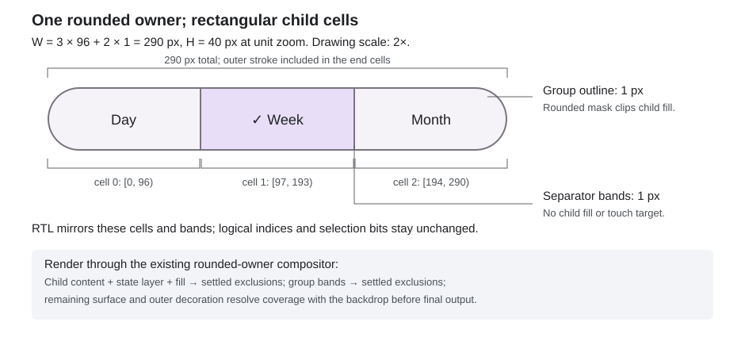

# Roo Windows Material 3 Segmented Buttons Design

## Implementation status

**Proposed.** Reviewed against `roo_windows` HEAD `e564685a` and the working
tree on 2026-10-12. No segmented-button implementation exists. Shared button
geometry hooks, density, menus, and non-touch input are implemented; the working
tree also contains uncommitted split-button implementation and tests. Those
changes are context, not a prerequisite or acceptance evidence for this design.
See the [status index](../README.md).

## Objective

Add classic Material 3 segmented buttons for compact single-choice and
multiple-choice controls, with stable sizing and ordinary Roo input behavior.

## Motivation

A schedule view needs **Day / Week / Month** choices; a device filter can need
several active categories at once. Independent action buttons do not express
that connected selection clearly. A dedicated control can own the selection
rules and shared border while applications use the existing change callback.

## Background

The [design glossary](../glossary.md) defines ownership, surfaces, and framework
interaction terminology. Relevant current facilities are:

- [`Button`](../../../src/roo_windows/material3/button/button.h) is a momentary
  action surface with optional shape morphing. Its private
  [appearance](../../../src/roo_windows/material3/button/internal/button_appearance.h)
  and [geometry](../../../src/roo_windows/material3/button/internal/button_geometry.h)
  helpers already exist, including text-bearing measurement. Extracting them
  is not a prerequisite.
- [`SurfaceWidget`](../../../src/roo_windows/core/surface_widget.h) is the
  surface-owning base; `BasicSurfaceWidget` is obsolete.
  [`Container`](../../../src/roo_windows/core/container.h) supplies child
  traversal, rounded child clipping, decoration, and `invokeChild()`.
- The [widget instructions](../../../.github/instructions/roo-windows-widget-authoring.instructions.md)
  require raw retained child pointers, `attachChild()` / `detachChild()` for
  ownership, and foreground-first painting. `WidgetRef` is only a temporary
  transfer parameter. The renderer resolves final pixels through exclusions
  and deferred decorations, not background-prefill followed by foreground.
- [Lists](../implemented/material3_lists_design.md) already own separator bands;
  [navigation rails](../implemented/material3_navigation_rail_design.md) own
  selection. These are patterns to reuse, not instructions to copy their
  storage or callback sequences unchanged.
- [Non-touch input](../implemented/non_touch_input_design.md) provides ordinary
  focus traversal and Enter/Space activation. Shared click feedback settles
  semantic delivery after a completed refresh.
- [Density](../implemented/material3_density_design.md) already changes eligible
  whitespace without scaling text or artwork. New families need explicit
  participation, content floors, and runtime relayout coverage.

Material references are the [overview](https://m3.material.io/components/segmented-buttons/overview),
[specifications](https://m3.material.io/components/segmented-buttons/specs), and
[guidelines](https://m3.material.io/components/segmented-buttons/guidelines).
The specification page required JavaScript during this review. Concrete tokens
were checked against official AndroidX
[OutlinedSegmentedButtonTokens, version v0_162](https://github.com/androidx/androidx/blob/androidx-main/compose/material3/material3/src/commonMain/kotlin/androidx/compose/material3/tokens/OutlinedSegmentedButtonTokens.kt)
and its [segmented-button implementation](https://github.com/androidx/androidx/blob/androidx-main/compose/material3/material3/src/commonMain/kotlin/androidx/compose/material3/SegmentedButton.kt),
accessed 2026-10-12. The tokens specify a 40 dp container, 1 dp outline,
18 dp icon, label-large typography, and full outer corners. Selected colors are
secondary-container / on-secondary-container; unselected content is on-surface.
AndroidX supplies 12 dp horizontal padding and an 8 dp icon gap.

This proposal covers classic segmented buttons. Expressive connected button
groups remain a separate proposed family. Capacity, icon-only selection policy,
density, keyboard behavior, and non-overlapping separator ownership below are
Roo decisions, not claims of exact AndroidX behavior.

## Requirements

1. Support two to five connected horizontal choices, single or multiple
   selection, and text-only, icon-only, or icon-plus-text content.
2. Keep one-line content centered and measured size independent of selection,
   hover, focus, and press. Offer an optional selected check glyph.
3. Keep logical selection indices stable under RTL and visibility changes.
   Support tight parent constraints without overflow or negative geometry.
4. Use active theme colors and shared density, with one outer pill outline,
   single separators, zero elevation, and independent child state layers.
5. Support touch and ordinary keyboard activation, individual and group
   disabling, and one group notification per interactive selection change.
6. Make child ownership, borrowed content lifetime, teardown, and callback
   reentrancy explicit. Avoid per-child application callback registration.
7. Keep hot component paths allocation-free and retained storage bounded.
   Account for all children, shared renderer costs, and target ABI padding.

## Design Overview

`SegmentedButtonGroup` is a `Container` holding at most five `SegmentedButton`
surfaces. A **segment** is a real child input/focus target with borrowed label
and icon content. Its logical index is its insertion position. A **cell** is
its rectangular allocation in the horizontal layout. A **separator band** is
the narrow allocation between cells, painted by the group.

The group owns one selection bitmask, the outer rounded clip and outline,
equal-width allocation, and separator bands. Children own rectangular fills,
content, and normal state layers; the group's rounded clip supplies the outer
corners. There is no independent rounded child edge to misalign with the outer
outline at fractional zoom.

Retain five raw child pointers. Each child keeps one typed group pointer so it
can query selection and geometry without RTTI or assuming an arbitrary parent
is a group. Find its index by scanning at most five pointers; do not also store
an index, position enum, selection byte, or direction on each child.

| Requirement | Mechanism |
| --- | --- |
| Single/multiple selection | One group bitmask and normalization path |
| Stable content size | Measure normal and selected content together |
| Shared edges and RTL | Group cell allocation, rounded owner clip, disjoint separator bands |
| Ordinary interaction | Real child surfaces, shared click controller, one terminal group hook |
| Bounded ownership | Five raw pointers and existing parent-owned ownership bit |

For **Day / Week / Month**, selecting Week sets mask `0b010`. Selecting Month
sets `0b100` in single mode and `0b110` in multiple mode. RTL moves Day to the
right but keeps its mask bit and callback index zero.



## Design Details

### Ownership, capacity, and visibility

The group starts empty. `add(SegmentedButton&)` borrows a child;
`add(std::unique_ptr<SegmentedButton>)` adopts it. Both validate capacity,
context identity, and absence of an existing parent/group before constructing
a temporary `WidgetRef` and calling `attachChild()`. Null owned input fails.
Failure leaves the group unchanged; an owned argument passed by value is
destroyed on failure. Borrowed objects are never deleted by a failed add.

`clear()` clears selection silently, resets each child's group link, and calls
`detachChild()` exactly once per stored child. The destructor performs the same
detachment before its pointer array disappears. Only `detachChild()` applies
the ownership bit and deletes adopted children. Borrowed children outlive their
attachment; label bytes and icon objects outlive their use. All mutation is on
the UI task. Context shutdown uses the existing detach contract, without
calling dead context services.

Zero children measure zero and paint nothing. One child is permitted during
construction/reconfiguration and renders a single pill, but is non-interactive;
normal application controls have two through five participating choices. An
empty label with no icon also makes that child non-interactive.
Detached segments have no standalone control behavior: they measure zero,
paint nothing, and report unselected until admitted to a group.

Hidden children reserve a cell but paint nothing and cannot be activated.
Gone children do not receive a cell. Neither visibility state renumbers logical
indices or clears selection. With fewer than two non-gone children, interaction
is disabled. Layout still services pending measure/layout requests for hidden
and gone children as the base container contract requires. Geometry and corner
coverage are based on non-gone cells, not on the highest selected bit.

Because children are caller supplied, `mayHaveUnclippedChildren()` returns
`true`, and custom paint traversal preserves normal unclipped/clipped grouping.
The standard connected appearance uses clipped children. Explicitly selecting
`ParentClipMode::kUnclipped` retains the framework's documented escape behavior,
including bypassing this group's rounded mask; it is not a second segmented
appearance policy.

### Selection and terminal notification

Only the low `segmentCount()` bits are valid. Single mode retains the lowest
set bit; multiple mode retains any valid subset, including zero. Changing modes
normalizes the current mask. Appending a child leaves its bit clear. Disabling
or hiding a selected child preserves its bit.

`selectedIndex()` returns the lowest selected logical index in either mode,
or `-1`. `setSelectedIndex(-1)` clears selection; a valid index replaces the
mask with that one bit in either mode. Other indices are ignored.
`isSelected()` returns false for an invalid index. Setters, mode changes, add,
and clear are silent: they update state and damage but emit no semantic hook
or interactive event. Equal assignments are inert.

On an admitted, settled click, the child forwards to the group's
`invokeChild()` and returns without further child access. The group verifies
membership and current eligibility, then selects the invoked bit in single
mode or toggles it in multiple mode. Reselecting the same single choice is
inert. For a change, it commits the normalized mask and invalidates affected
surfaces **before** calling `onSelectionChanged(old_mask, new_mask)`.
The routing hook returns false for a non-member and true for a member even
when that invocation is ineligible or leaves selection unchanged.

That hook is the sole terminal application boundary. Its default implementation
calls `triggerInteractiveChange()` exactly once. Overrides can replace this
behavior or call the base implementation as their final action. No code in the
child or group accesses either object after the hook: the callback can clear,
detach, reconfigure, or destroy the group. A programmatic setter inside the
callback is silent and its new state wins. There is no earlier invocation hook
followed by more work on potentially destroyed widgets, and no second automatic
event after a virtual application hook.

The inherited child callback registration API still exists, but child clicks
are handled by the group and do not dispatch child interactive-change events.
Selection is not mirrored into `Widget::activated`; external activation state
does not change the canonical selection mask.

### Input, enabled state, and focus

The group is neither clickable nor focusable. Each eligible segment is an
ordinary focus stop. Tab/directional navigation moves focus through the
existing task policy; moving focus does not select. Enter/Space activates via
the existing click controller. There is no roving-focus radio-group protocol,
custom key-repeat timer, or auto-selection on arrow navigation in v1.

A segment is effectively enabled only when both it and its group are enabled.
Disabling the group preserves individual child enabled flags, cancels pending
input in the subtree through the core lifecycle, and invalidates descendants.
Re-enabling restores eligibility only for individually enabled children. Check
eligibility again at semantic settlement; hidden, gone, disabled, or detached
segments cannot deliver a stale selection change. Use the existing shared
gesture cancellation path, fixing that path with regression coverage if needed.

Exact hit bounds are the cell rectangles, including their parts under the
outer outline. Separator bands are non-clickable: override each child's sloppy
touch bounds to equal its cell, preventing the generic 50-pixel expansion from
bridging separators or adjoining choices. A cross-cell release never activates
the other cell; cancellation follows the normal gesture policy. This exact-hit
choice is a Roo exception to ordinary buttons' sloppy expansion. Surrounding
padding does not itself enlarge a hit target; explicit parent sizing can.

### Tokens, content, and density

Add a shared private `segmented_button_tokens.h`, with no per-widget palette or
density override. Use theme color roles and existing label-large typography.
Defaults: 40 dp height, 12 dp horizontal padding per cell edge, 8 dp icon/text
gap, 18 dp minimum icon slot, 1 dp outer outline/separator, full outer corners,
zero margins between cells, and zero elevation. The group has no interactive
state layer of its own.

| State | Fill | Content |
| --- | --- | --- |
| Enabled, unselected | Transparent | On-surface |
| Enabled, selected | Secondary-container | On-secondary-container |
| Disabled, unselected | Transparent | On-surface at 38% |
| Disabled, selected | Secondary-container | On-surface at 38% |

The group outline and separators use outline when the group is enabled, and
on-surface at 12% when it is disabled. Individual disabling changes that cell's
content but leaves the shared outline uniform. This explicitly follows the
token file's disabled outline role; the linked AndroidX implementation instead
applies disabled alpha to outline. Both group and child disable automatic
disabled tinting to avoid applying it twice. Alpha resolves against the current
surface/backdrop through the shared compositor.

Resolve selected state layers from on-secondary-container and unselected state
layers from on-surface through the existing overlay hooks and theme opacities.
Effective disabling suppresses hover/press/focus overlays. Selection supplies
the semantic surface role without setting the generic activated flag. Ordinary
hover, focus, and click feedback retain the shared lifecycle and fixed shape.

The selected check option defaults to true. With label text, reserve one icon
slot of width equal to the maximum of the 18 dp token, normal icon extents, and
check extents. A selected check replaces a normal leading icon, or appears
before text-only content. Reserve the same width and height in both states.
With checks disabled, reserve only actual normal content. Icon-only segments
keep their identity icon and use selected colors; they reserve no extra check
slot. Empty content reserves no check slot. Mixed content forms are allowed.

Center the currently visible content cluster; unselected text-only content is
centered without a phantom leading glyph even though its natural width reserves
the possible check. Selecting it changes content placement immediately, not
the measured size. RTL reverses icon/text order. Use the shared text-span
helper covering both advance and ink, including negative bearings. Icon slots
cover anchor and painted horizontal extents; oversized artwork raises natural
size rather than silently changing scale. Tight constraints clip all content
to its allocated cell and the owner mask.

Read density from `theme().material3Theme().density`. For signed level
$d \in [-5,0]$, the nominal height is $\max(24,40+4d)$ dp. After scaling,
raise height to the maximum content footprint plus 4 dp of clearance on each
vertical edge. Text uses line height; icon/check footprint uses the existing
button geometry convention for centered artwork, preserving asymmetric ink.
Include both selected and normal content in that floor. Text, icon artwork,
horizontal padding, gaps, and strokes do not shrink with density. Explicit
constraints can clip below the natural floor. No per-child metric cache is
introduced. Runtime theme/density changes use `requestLayoutDescending()` and
`invalidateDescending()` as documented by the density design.

### Measurement and integer allocation

Suggested minimums remain cheap and non-measuring. Exact text and icon
measurement occurs in `onMeasure()`. Let $n$ be the number of non-gone cells,
$p$ the scaled horizontal padding, $c_i$ the reserved content width of cell
$i$, $o=\mathrm{Scaled}(\mathrm{SmallNumber}(1))$ the fixed-point outline,
and $s=\max(1,\lceil o\rceil)$ its integer separator allocation. For $n>0$:

$$
W_\text{natural}=n\max_i(2p+c_i)+(n-1)s
$$

Padding is measured from each cell boundary and already accommodates the outer
stroke. Do not add another outer inset to the width: end-cell fills extend
under the owner's rounded clip/outline. Natural height is the shared maximum
of the density token and all state-independent content floors above.

Resolve parent width/height constraints first. For available width
$W\ge(n-1)s$, distribute $A=W-(n-1)s$ pixels among cells: each gets
$\lfloor A/n\rfloor$, and the first $A\bmod n$ logical cells receive one more
pixel. Lay out in logical order, then mirror the complete allocation for RTL.
Widths differ by at most one pixel, sum exactly to the available width, and
never leave a trailing remainder gap. All cells occupy the full allocated
height; the group alone clips outer corners.

When $W<(n-1)s$, allocate empty child bounds and paint the clipped group outline
only; omit separators and content. Zero width/height paints nothing. Use wide
signed intermediates, clamp before narrowing dimensions, and never construct
wrapped rectangles. Labels remain single-line, clipped without ellipsis.

The figure's worked example uses three 96-pixel cells and two 1-pixel bands:
$W=3\cdot96+2=290$, $H=40$. At $W=292$, logical cell widths become
97, 97, and 96. These figures illustrate allocation, not measured label widths.

### Rounded composition and damage

The group reports a pill `BorderStyle` with the fixed-point outline and enables
`clipsChildrenToRoundedBounds()`. Children report rectangular, outline-free
surfaces. Transparent unselected fills must report that they do not fully cover
bounds with opaque colors. The group reports a transparent background and does
not claim an opaque rectangular exclusion. Theme surface inheritance supplies
the resolved backdrop required by the existing direct-pixel renderer.

Use the current rounded-owner compositor for child pixels and the outer
outline. It combines coverage and backdrop before emitting final colors;
integer cell boundaries do not justify rounding the outer stroke to an integer.
Do not independently draw an inset child pill and then overpaint its edge with
a group stroke. Keep child overlays inside their cell and owner mask, with
fixed geometry throughout click feedback.

Separator bands are additional group-owned foreground, not borders painted by
both neighbors. Paint them from a `paintChildren()` override **after** delegating
to `Container::paintChildren()`, preserving its child grouping. Re-enter the
existing rounded owner scope for these disjoint bands, resolve the centered
fixed-point stroke and the band's backdrop in one tiled draw, then register
settled exclusions. This uses the full group-height context: ordinary
`Container::paint()` receives an interior clip that excludes curved decoration
areas and cannot by itself paint full-height separators. Delegate remaining
surface clearing to the normal container path; its persistent decoration owns
the outer outline. Reuse the core rounded-scope helpers; do not add a new
rasterizer or per-instance clip storage.

The drawing order inside a child is foreground content resolved with its
background/state layer, then exclusions, then remaining surface/decorations.
Never prefill a cell and subsequently draw its text over that fill. A dirty
selection change invalidates affected cells; changes to geometry, visibility,
direction, density, or group enabled state invalidate shared decoration and
descendants. The rounded compositor can repaint additional clean contributors
to settle fractional edges. Do not promise strictly cell-local framebuffer
writes or suppress those repaints. Validate final-color write behavior as well
as final screenshots, including on a contrasting ancestor backdrop.

### Retained RAM and work

Let $P$ be pointer size, $V=\mathrm{sizeof}(\texttt{roo::string_view})$, and
$A(T)$ round up to the relevant class alignment. Structural ceilings are:

- Child: $A(\mathrm{sizeof}(\texttt{SurfaceWidget})+V+2P)$ for label, icon,
  and typed group link. No cached index, geometry, palette, or callback.
- Group: $A(\mathrm{sizeof}(\texttt{Container})+5P+2)$ for five pointers,
  one selection byte, and one packed count/mode/check/direction byte.

On a typical 32-bit ABI with an 8-byte string view, these add at most 16 bytes
per child and 24 bytes per group over the bases. A three-choice control costs
the group **plus three child objects**, not just its live pointer count. Five
pointer slots remain allocated even in an empty group. Borrowing avoids child
heap allocation, not child RAM; adopted children also pay allocator overhead.
Record actual host and target sizes instead of asserting an unmeasured absolute
base size. Ordinary `Widget`, `SurfaceWidget`, `Container`, and `Button` gain no
instance fields for this feature.

Index lookup is at most five pointer comparisons. Selection updates and layout
visit at most five children. Repeated owner lookups can make a pass quadratic
in the bounded count (at most 25 comparisons), a small cost relative to glyph
measurement/rasterization. Text work is linear in visited label bytes/glyphs;
painting also depends on visible pixels. Keep glyphs/tokens in shared flash.
Component measure, paint, feedback, and borrowed add/clear introduce no heap
allocation. Report existing renderer, callback-registry, and core input-path
allocations separately rather than claiming the complete UI is allocation-free.

## Proposed API

Add matching `material3/button/segmented_button.h` and `.cpp`. The sketch shows
the consumer contract and all new retained state; routine surface, input,
child-enumeration, and layout overrides specified above are omitted.

```cpp
namespace roo_windows::material3 {

/// Selects mutually exclusive or independent choices.
enum class SegmentedButtonSelectionMode : uint8_t { kSingle, kMultiple };

class SegmentedButtonGroup;

/// One choice whose selection belongs to its attached segmented group.
class SegmentedButton : public SurfaceWidget {
 public:
  /// Borrows @p label and @p icon; detached segments are inert.
  explicit SegmentedButton(ApplicationContext& context,
                           roo::string_view label = {},
                           const MonoIcon* icon = nullptr);

  /// Returns the borrowed label.
  roo::string_view label() const;

  /// Borrows replacement text and requests layout and repaint.
  void setLabel(roo::string_view label);

  /// Returns the borrowed icon, or nullptr.
  const MonoIcon* icon() const;

  /// Borrows replacement artwork; nullptr clears it.
  void setIcon(const MonoIcon* icon);

  /// Queries the owner's canonical selection; false when detached.
  bool selected() const;

 protected:
  /// Forwards a settled invocation to the group, then immediately returns.
  void onClicked() override;

 private:
  friend class SegmentedButtonGroup;

  roo::string_view label_;
  const MonoIcon* icon_;
  SegmentedButtonGroup* group_ = nullptr;
};

/// A fixed-capacity connected choice control owning selection and layout.
class SegmentedButtonGroup : public Container {
 public:
  /// Maximum structural child count, including hidden and gone children.
  static constexpr uint8_t kMaxSegments = 5;

  /// Creates an empty group, with checks enabled and left-to-right layout.
  explicit SegmentedButtonGroup(
      ApplicationContext& context,
      SegmentedButtonSelectionMode mode = SegmentedButtonSelectionMode::kSingle);

  /// Detaches borrowed children and releases adopted children through the core.
  ~SegmentedButtonGroup() override;

  /// Returns the active selection rule.
  SegmentedButtonSelectionMode selectionMode() const;

  /// Changes the rule and silently normalizes existing selection.
  void setSelectionMode(SegmentedButtonSelectionMode mode);

  /// Returns whether labeled selections display the shared check glyph.
  bool showSelectedIcon() const;

  /// Changes check reservation and requests layout and repaint.
  void setShowSelectedIcon(bool show);

  /// Returns the group's logical layout direction.
  LayoutDirection layoutDirection() const;

  /// Mirrors geometry and content without renumbering selection bits.
  void setLayoutDirection(LayoutDirection direction);

  /// Returns the structural child count.
  int segmentCount() const;

  /// Returns false for indices outside the structural child array.
  bool isSelected(int index) const;

  /// Returns the lowest selected index, or -1, in either mode.
  int selectedIndex() const;

  /// Selects one index silently; -1 clears, other invalid indices are ignored.
  void setSelectedIndex(int index);

  /// Returns the canonical normalized mask.
  uint8_t selectionMask() const;

  /// Silently masks absent bits and enforces the active selection rule.
  void setSelectionMask(uint8_t mask);

  /// Borrows an unattached same-context child; false on invalid input/capacity.
  bool add(SegmentedButton& segment);

  /// Adopts a child; failure destroys the supplied owned argument.
  bool add(std::unique_ptr<SegmentedButton> segment);

  /// Detaches all children and silently clears selection.
  void clear();

  /// Allows caller-supplied children to use the framework's unclipped mode.
  bool mayHaveUnclippedChildren() const override { return true; }

  /// Handles member invocations; callers return without touching the child.
  bool invokeChild(Widget& child) override;

 protected:
  /// Terminal interactive-change hook; default dispatches the group callback.
  virtual void onSelectionChanged(uint8_t old_mask, uint8_t new_mask);

 private:
  friend class SegmentedButton;

  int indexOf(const SegmentedButton& segment) const;
  uint8_t normalizeMask(uint8_t mask) const;

  SegmentedButton* segments_[kMaxSegments] = {};
  uint8_t selection_mask_ = 0;
  uint8_t segment_count_ : 3;
  uint8_t mode_ : 1;
  uint8_t show_selected_icon_ : 1;
  uint8_t direction_ : 1;
};

}  // namespace roo_windows::material3
```

Representative consumer setup uses borrows and the existing callback registry:

```cpp
// Declare borrowed segments first so they outlive the group.
material3::SegmentedButton day(context, "Day");
material3::SegmentedButton week(context, "Week");
material3::SegmentedButton month(context, "Month");
material3::SegmentedButtonGroup view(context);
CHECK(view.add(day));
CHECK(view.add(week));
CHECK(view.add(month));
view.setSelectedIndex(1);
view.setOnInteractiveChange([&view, &controller]() {
  controller.setScheduleView(view.selectedIndex());
});
// Attach view through the application's normal layout API; all objects above
// remain alive while that layout borrows them.
```

## Implementation Plan

Follow the [shared C++ instructions](../../../.github/instructions/general-cpp-code-authoring-instructions.md),
[widget instructions](../../../.github/instructions/roo-windows-widget-authoring.instructions.md),
and [example instructions](../../../.github/instructions/embedded-example-authoring.instructions.md).
Run validation from the canonical `roo_windows` repository. Each phase maps to
one commit. Target names marked new must be added with their phase. Keep the
public widget out of the header until its full contract works; do not publish
declarations or warning-only click/paint stubs as an intermediate feature.

### Phase 1: Private geometry and rounded-band rendering proof

Add private tokens and geometry helpers for content reservation, density,
integer allocation, and direction. Reuse existing text/icon helpers, extracting
only genuinely shared operations without changing ordinary button behavior.
Add an internal rendering fixture using the current rounded owner compositor
with rectangular child surfaces and full-height separator bands. Keep the
fixture out of the public API and document its geometry beside the helpers.

Create `//:material3_segmented_button_geometry_test` and
`//:material3_segmented_button_rendering_test` (new). Cover 0–5 cells, all six
densities, zoom 75/100/150/200, odd remainders, width below separator capacity,
zero bounds, negative text bearings, oversized/asymmetric icon extents, and
stable selected/check widths and heights. Instrument final-color writes and
test separator/outline junctions against a contrasting backdrop. Exit requires
correct rounded coverage with no intermediate-color writes or retained clip
state. Any missing compositor capability is fixed in the owning core with
rounded-child regression tests, not bypassed with a separate widget rasterizer.
Run both new targets and `//:rounded_child_clip_test` /
`//:rounded_owner_effect_test` from this repository with `bazel test`.

Proposed commit message:

> Material 3 segmented buttons design Phase 1: validate geometry and shared edges.
>
> Add private segmented tokens, content and allocation helpers, and rendering
> fixtures that verify rounded owner clipping and separator composition.

### Phase 2: Complete public control and focused examples

Add both public types, fixed raw-pointer storage, ownership cleanup, silent
selection setters, terminal callback routing, and normal input/focus behavior.
Add `docs/material3_segmented_buttons.md` (new) covering lifetimes, disabled and
visibility behavior, exact hit regions, and RTL. Add focused runnable examples
at `examples/material3/segmented_buttons/schedule_view/schedule_view.ino` and
`examples/material3/segmented_buttons/event_filters/event_filters.ino` (new),
teaching view selection and multiple filters respectively. Use self-contained
hardware and `ROO_TESTING` setup; keep the appearance matrix in tests.

Create `//:material3_segmented_button_test` and
`//:material3_segmented_button_golden_test` (new). Test mask normalization,
invalid indices, modes, add failures, adopted/borrowed clear/destruction,
context shutdown, hidden/gone cells, and effective disabled state. Use real
task input and completed refreshes for slow/quick clicks, key activation,
cross-cell release, separator hits, scroll takeover, competing input, and
pending teardown. Verify callback count, silent setters/reselection, callback
reconfiguration, and callback destruction. Capture light/dark, RTL, checks,
icon-only, disabled, hover, focus, held/terminal press, and discontiguous
multiple selections. Check removal/movement restores the old backdrop.

Run all four new targets. Build the two new leaf targets
`//examples/material3/segmented_buttons/schedule_view:schedule_view` and
`//examples/material3/segmented_buttons/event_filters:event_filters`. Run
`//:material3_button_test`, `//:rounded_child_clip_test`, and
`//:rounded_owner_effect_test` for reused paths; add focused core regressions
for any shared input/rendering fix made in this phase.

Proposed commit message:

> Material 3 segmented buttons design Phase 2: add connected selection controls.
>
> Add complete group and segment APIs, bounded ownership, safe selection
> notification, input and rendering coverage, usage documentation, and focused
> single-choice and multiple-choice examples.

### Phase 3: Embedded acceptance and status update

Create `//:material3_segmented_button_resource_test` (new) and a target ABI/size
probe. Enforce the structural size ceilings, no added fields on ordinary base
types, and zero component-specific allocations during repeated measurement,
paint, feedback, and borrowed add/clear. Report core renderer and callback
setup allocations separately. Record object sizes, 2/3/5-child totals,
`.text`/`.rodata`/`.data`/`.bss`, static stack usage, and compiler/flags alongside
the design, following the [target baseline](../../material3_target_baseline.md).

Run geometry/rendering/golden targets at all four zoom factors and six density
levels. Compile a focused example for the supported embedded target without
uploading firmware. Record manual emulator/touchscreen checks separately from
automated evidence. Update the status index and roadmap only after the defined
scope passes; move the design to implemented and repair links at that point.

Proposed commit message:

> Material 3 segmented buttons design Phase 3: record embedded acceptance.
>
> Add allocation and ABI gates, target section and stack reports, visual
> acceptance evidence, and status updates for the completed component.

## Testing Plan

Geometry units, write-instrumented rendering fixtures, actual task input,
deterministic goldens, ownership/callback lifetime tests, example builds, and
host/target resource probes cover complementary contracts. Phase sections own
the detailed cases and targets. Screenshots alone do not prove absence of
intermediate framebuffer colors or safe callback destruction.

This documentation review validates relative links, figure structure and
bounds, and a whitespace-clean diff. It does not establish implementation,
performance, accessibility, or physical touchscreen acceptance.

## Caveats

Ordinary focus stops do not provide platform radio-group accessibility
semantics. Compact density and exact cell hit bounds do not guarantee a 48 dp
touch target. Icon-only selection and uniform shared outline colors are
explicit Roo choices. Fractional rounded coverage can repaint more than the
changed cell; the design prioritizes final-color correctness over an unsupported
promise of strictly local writes.

### Rejected Alternatives

#### Add selection fields to ordinary Button or subclass it unchanged

Ordinary buttons already support disabling shape morphing and overriding
geometry, so inheritance is technically possible. Their private content/color
path nevertheless lacks this group's selected check reservation, RTL content,
and selection palette. Extending that API solely for this family adds coupling
and unused size/variant state. A direct surface with shared metric helpers
keeps the [storage contract](#retained-ram-and-work) explicit.

#### One childless segmented widget

A monolithic widget can save child base storage, but must implement logical
focus stops, per-cell gesture identities, state layers, and click settlement.
Real children reuse those existing behaviors. This is a RAM-versus-complexity
tradeoff, not a claim that composition is smaller.

#### Overlapping child outlines and separate rounded child fills

These resemble AndroidX's overlapping row, but conflict with Roo's direct
framebuffer constraints and complicate fractional edge composition. The
[rounded owner model](#rounded-composition-and-damage) gives one owner to the
outline and separators and uses the existing compositor for coverage.

#### Dynamic child vector or cached child positions

Two through five choices justify an eager five-pointer array (20 bytes on a
32-bit target), avoiding vector capacity/allocation behavior. Bounded scans
replace cached child indices and shape fields; the typed owner pointer remains
necessary for safe child queries. `WidgetRef` storage is prohibited by current
ownership instructions, independently of this size tradeoff.

## Future Work

- Expressive connected button groups as a separate family.
- Platform accessibility adapters when the framework exposes an integration
  surface, and any roving-focus policy as a separately specified behavior.
- Check/content transition animation through the shared animation registry.
- Product appearance or density overrides backed by a concrete consumer.
