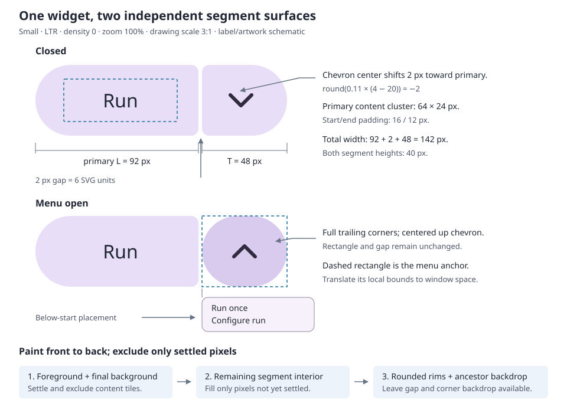

# Roo Windows Material 3 Split Button Design

**Status: proposed.** Reviewed against the source tree on 2026-10-11. Buttons,
menus, non-touch input, shared button appearance helpers, and density are
implemented. The split button and the menu amendments below are not. See the
[design status index](../README.md).

## Objective

Add a compact Material 3 control that runs a primary action or opens a menu of
related actions, with predictable touch, keyboard, rendering, and lifetime
behavior.

## Motivation

A device's **Run** action often needs alternatives such as **Run once** or
**Configure run**. Two unrelated buttons obscure that relationship, while an
application-built composite repeats layout and menu coordination code. A
dedicated split button can express the relationship and avoid retaining three
widget objects for each control.

## Background

The [design glossary](../glossary.md) defines the framework's task, ownership,
surface, and presentation terminology. Relevant implemented facilities are:

- [`Button`](../../../src/roo_windows/material3/button/button.h) and
  [`IconButton`](../../../src/roo_windows/material3/button/icon_button.h), with
  shared [`ButtonSize`](../../../src/roo_windows/material3/button/button_types.h)
  and private [appearance](../../../src/roo_windows/material3/button/internal/button_appearance.h)
  and [geometry](../../../src/roo_windows/material3/button/internal/button_geometry.h)
  resolvers. These helpers already exist; no extraction is a prerequisite.
- [`Menu`](../../../src/roo_windows/material3/menu/menu.h), a reusable presenter,
  not an `Activity`. `show(Task&, const Widget&, ...)` and
  `showFromRect(Task&, const Rect&, ...)` return `MenuShowResult`. The root chain
  owns a hosted transient focus scope. `onFinished()` runs after detachment;
  `dismissChain()` can defer detachment while click feedback settles.
- [`DropdownButton`](../../../src/roo_windows/material3/utilities/dropdown_button.h),
  which selects a value from a borrowed string table. A split button invokes an
  action; it does not adopt that selector's value model or allocate a new menu
  and rows on every open.
- [`SurfaceWidget`](../../../src/roo_windows/core/surface_widget.h), the current
  surface-owning base. `BasicSurfaceWidget` is no longer the applicable API.
  The [widget authoring rules](../../../.github/instructions/roo-windows-widget-authoring.instructions.md)
  require foreground-first, final-color painting and explicit decoration
  overflow. The ancestor must remain able to paint gaps between surfaces.
- The shared [click controller](../../../src/roo_windows/core/click_animation.h)
  admits one interaction at a time and settles deferred actions after a
  completed refresh. `OVERLAY_CUSTOM` supports component-owned visuals while
  retaining this lifecycle. `OVERLAY_NONE` bypasses its paint-time settlement.
- [Non-touch input](../implemented/non_touch_input_design.md) provides focus,
  Enter/Space activation, and directional traversal. The task's Enter/Space
  fallback calls the base press hook directly, without a pointer `onDown()`.
- [Density](../implemented/material3_density_design.md) removes eligible
  whitespace without scaling text or icon artwork. Existing buttons read the
  theme setting; menu density is independently controlled by `MenuPolicy`.

Material references are the [overview](https://m3.material.io/components/split-button/overview),
[specifications](https://m3.material.io/components/split-button/specs), and
[guidelines](https://m3.material.io/components/split-button/guidelines).
The Material pages require JavaScript and did not expose their specification
text during this review. The concrete geometry below is checked against the
official AndroidX token files, version `18_0_18`, and its
[split-button implementation](https://github.com/androidx/androidx/blob/androidx-main/compose/material3/material3/src/commonMain/kotlin/androidx/compose/material3/SplitButton.kt),
accessed 2026-10-11. AndroidX supports broader secondary-action composition;
requiring a menu here is a Roo API scope decision, not a universal Material
restriction. Density, focus shortcuts, and motion choices below are also
explicit Roo adaptations.

## Requirements

1. Present one primary action and one related-menu action. Support label-only,
   icon-only, and icon-plus-label primary content and a fixed trailing chevron.
2. Provide filled, filled tonal, outlined, and elevated styles in all five
   expressive sizes, with rounded outer corners and a 2 dp separation.
3. Make both actions reachable by touch and keyboard. A gesture cannot invoke
   the other action after crossing the separation; disabled controls invoke
   neither action. Preserve normal primary-action callback semantics.
4. Anchor the menu to its action segment. Show the open treatment only after
   successful presentation and remove it when the complete root chain detaches.
   Admission failure, replacement, teardown, and deferred dismissal must be safe.
5. Match natural sizing, constrained layout, hit regions, and rendering at all
   supported density levels and zoom factors. Explicit parent constraints win.
6. Paint independent state layers, outlines, and shadows without covering the
   separation or writing an intermediate color under foreground content.
7. Keep labels, icons, and the related menu as explicit borrows. Retain no child
   buttons, second application callback, per-instance palette, or private timer.
   Account for all retained state and validate embedded resource costs.

## Design Overview

`SplitButton` is one `SurfaceWidget` with two **segments**: local rectangles for
the primary and menu actions. They are geometry, not child widgets or separate
focus nodes. A **gesture segment** identifies the current pointer stream; a
separate **click segment** identifies an admitted click until semantic delivery.
Keeping them separate prevents a later rejected down event from retargeting an
earlier deferred click. Both fit in packed flags.

The widget borrows one `Menu` for its lifetime. A **presentation observer** is a
non-owning, per-presentation housekeeping hook on that menu. It clears the
trigger's open visual after detachment without replacing the menu subclass's
existing `onFinished()` hook. Only a successful show installs the observer;
there is no permanent registration at construction. `Widget::activated` records
that this trigger owns the open presentation, not menu-item selection.

| Requirement | Chosen mechanism |
| --- | --- |
| Related actions and compact storage | One childless widget, one borrowed menu, existing primary callback registry |
| Material appearance and sizing | Shared button colors; a separate split geometry table and one rectangle resolver |
| Touch and keyboard reachability | Locked pointer segment; Enter/Space for primary, Down for menu |
| Safe open-state lifetime | Successful-admission result, per-presentation observer, synchronous cancellation for lifetime changes |
| Correct repaint | Custom overlay, two decorations, explicit settled exclusions, ancestor-painted separation |

For example, an application constructs a persistent menu containing **Run once**
and **Configure run**, then constructs `SplitButton(context, menu, "Run")` and
registers `setOnInteractiveChange(...)` for the default run action. Tapping Run
or pressing Enter invokes that handler once. Tapping the chevron or pressing
Down opens the menu; menu items retain their own invocation behavior. Choosing
an item does not implicitly rename the primary action.

## Design Details

### Geometry, content, and density

Authored lengths in this table are dp. The linked files identify each row's
source. Inner radii describe the corners facing the separation; outer radii
remain full. The last column is the nominal trailing width before scaling.

| Size | Height | Primary start/end padding | Trailing icon slot | Trailing start/end padding | Inner rest / hover / press | Trailing width |
| --- | ---: | --- | ---: | --- | --- | ---: |
| [Extra small](https://github.com/androidx/androidx/blob/androidx-main/compose/material3/material3/src/commonMain/kotlin/androidx/compose/material3/tokens/SplitButtonXSmallTokens.kt) | 32 | 12 / 10 | 22 | 13 / 13 | 4 / 8 / 8 | 48 |
| [Small](https://github.com/androidx/androidx/blob/androidx-main/compose/material3/material3/src/commonMain/kotlin/androidx/compose/material3/tokens/SplitButtonSmallTokens.kt) | 40 | 16 / 12 | 22 | 13 / 13 | 4 / 12 / 12 | 48 |
| [Medium](https://github.com/androidx/androidx/blob/androidx-main/compose/material3/material3/src/commonMain/kotlin/androidx/compose/material3/tokens/SplitButtonMediumTokens.kt) | 56 | 24 / 24 | 26 | 15 / 15 | 4 / 12 / 12 | 56 |
| [Large](https://github.com/androidx/androidx/blob/androidx-main/compose/material3/material3/src/commonMain/kotlin/androidx/compose/material3/tokens/SplitButtonLargeTokens.kt) | 96 | 48 / 48 | 38 | 29 / 29 | 8 / 20 / 20 | 96 |
| [Extra large](https://github.com/androidx/androidx/blob/androidx-main/compose/material3/material3/src/commonMain/kotlin/androidx/compose/material3/tokens/SplitButtonXLargeTokens.kt) | 136 | 64 / 64 | 50 | 43 / 43 | 12 / 20 / 20 | 136 |

The primary uses the current button family's label-large typography, leading
icon slots, and icon-to-label gaps. The five leading slots are 20/24/24/32/40 dp
and the gaps are 4/8/8/12/16 dp. Keep actual borrowed artwork intact; a larger
icon enlarges its slot. Render the built-in chevron procedurally at its authored
slot size so asset-size rounding cannot enlarge the trailing segment. It points
down while closed and up while open. There is no custom trailing icon setter.

Measure the primary as one line. Cache label ink/advance width, line height,
and the horizontal origin needed for negative bearings on construction,
`setLabel()`, and `requestLayoutDescending()`. Suggested minimums use those
cached values and cheap icon extents; they never traverse glyphs. Account for
both advance and ink bounds, as the current dropdown helper does. Do not wrap
or add ellipsis in v1; constrained content is clipped to its segment.

Let $S(x)$ denote `Scaled(x)`, $d$ the theme density in $[-5,0]$, $C_w$ the
primary content width, and $C_h$ the larger of the primary and chevron content
heights. At density zero, content height includes nominal icon slots. At
compact densities, use the density design's centered painted-icon footprint.
Let $h_s$, $p_s$, $p_e$, $t_s$, $t_e$, and $i_t$ denote the selected table's
height, primary paddings, trailing paddings, and trailing icon slot.

$$
g=S(2),\qquad T=S(t_s)+S(i_t)+S(t_e),\qquad
W_0=S(p_s)+C_w+S(p_e)+g+T
$$

$$
H_0=\max\left(S(\max(24,h_s+4d)),\ C_h+2S(4)\right)
$$

Only height participates in density. The content floor protects artwork at
every level, including zero. Horizontal spacing, chevron size, outline, and
typography do not shrink. This extends Roo's button density policy to split
buttons; it does not change the scope of already implemented widgets. Read the
theme directly, with no per-instance density override. The borrowed menu keeps
its independently authored `MenuPolicy::density` and layout direction.

These are the initial natural dimensions; the rounded-interior content floor
in [painting](#segment-surfaces-and-painting) completes the sizing calculation.
Return the resulting natural dimensions from the cached sizing path and resolve
them through `WidthSpec` and `HeightSpec` in `onMeasure()`. Split geometry owns
its padding internally, so `getPadding()` is zero; callers' explicit layout
constraints and outer margins retain their usual meaning. Default outer
margins match `Button`.

For measured width $W$ and height $H$, reserve the trailing segment first:

$$
T'=\min(T,W),\qquad L=\max(0,W-T'-g).
$$

In left-to-right layout the primary rectangle is `(0, 0, L-1, H-1)` and the
trailing rectangle is `(W-T', 0, W-1, H-1)`, using the actual `Rect` constructor's
inclusive end coordinates. Empty dimensions produce empty segments. With less
than $T+g$ width, the primary disappears and only the remaining gap space and
clipped trailing segment remain. Expanded width goes to the primary. A local
`LayoutDirection` setting mirrors the two rectangles, paddings, and optical
offset for right-to-left layout; it does not rewrite the caller's menu policy.

Clamp every radius to half the segment's smaller measured dimension before
narrowing to the radius storage type. Keep scaled dimensions in signed wide
intermediates: 136 dp at 200% is 272 px. Outlined strokes use
`Scaled(SmallNumber(1))`, preserving fractional widths at 75% and 150% zoom.

Optical alignment follows AndroidX's
[horizontal centering rule](https://github.com/androidx/androidx/blob/androidx-main/compose/material3/material3/src/commonMain/kotlin/androidx/compose/material3/HorizontalCenterOptically.kt).
For the trailing segment, let $r_s,r_e$ be the average current radii at its
logical start and end. Shift the centered icon by

$$
\delta=\operatorname{round}\!\left(\operatorname{clamp}
  (0.11(r_s-r_e),-S(t_s),S(t_e))\right).
$$

Round to nearest pixel, with half ties toward positive infinity, then clamp
again to the available horizontal slack under tight constraints. Convert the
logical offset to physical direction. In the open state all trailing corners
are full, so the offset is zero. The widget width and separation never change
when opening; the trailing shape changes inside its existing rectangle.



The figure shows Small at 100% zoom with a 64 px primary content cluster:
$W_0=16+64+12+2+48=142$, $L=92$, $H=40$; no further content-floor increase is
needed. The closed offset is
$\operatorname{round}(0.11(4-20))=-2$ px. Drawing scale is 3 SVG units per pixel;
the 2 px separation is therefore exactly 6 SVG units in both states.

### Segment surfaces and painting

Derive from `SurfaceWidget` because the component owns fills, outlines, and
elevation. Keep its whole-widget background transparent and border empty; those
single-surface hooks cannot describe the separation. Override
`fullyCoversBoundsWithOpaqueColors()` to false and
`getDirectPaintExclusionBounds()` to empty. Otherwise the generic final
exclusion would suppress ancestor repaint through the gap.

Use `OVERLAY_CUSTOM` and `ClickOverlayAnimation::kFade`. The framework retains
sampled click timing and terminal settlement but does not apply its area
overlay to the whole rectangle. Resolve per-segment layers from the theme:
hover and focus affect both segments, press affects only the admitted click
segment, and activated affects only the trailing segment. Suppress all layers
when disabled, and return false from `useAutomaticDisabledStyle()` because the
shared appearance resolver already supplies disabled colors. Do not apply the
whole-widget `overlaySpec().base_overlay()` unchanged to both segments.

Reuse `ResolveButtonAppearance`, `ResolveButtonContainerRole`, and
`ResolveButtonElevation` by explicitly mapping the four split variants to
`ButtonVariant`. No new per-widget theme table or color cache is introduced.
Inner-corner priority is press, then trailing-open, then hover, then rest.
Focus changes the layer without changing corners. Press interpolation uses
the existing button convention, `min(1, 3 * sampled_progress)`, and a held press
uses the pressed endpoint. The custom fade uses the shared sampled progress
and theme pressed opacity. Open/close and hover geometry change immediately;
v1 has no independent menu-shape animation track.

Implement ordinary `paint(PaintContext&)` with a segment helper; no custom
widget-tree traversal is needed:

1. Resolve both rectangles, current corner radii, final layer colors, and
   elevation from the same geometry/state snapshot.
2. Within each segment's flat interior, draw icon and label content with its
   final composited background using tiled/stacked drawables. Exclude each
   settled rectangle, then fill only the remaining flat interior. Never fill
   first and draw text over that intermediate color.
3. In `emitPersistentDecoration()`, register one `PaintDecoration` per segment
   for the rounded rim, outline, and shadow. Use the same layer-composited fill
   as the corresponding interior. Register the trailing segment first as the
   deterministic foreground order where the two shadows overlap.
4. Leave the gap and transparent corner pixels unexcluded. Ancestor output and
   the decoration compositor resolve the actual backdrop, including content
   underneath a transparent parent. Do not pre-clear the widget or the gap to
   a guessed background color.

Use per-segment content clipping like `Button`; text and icons must not cross
the rounded rim or the neighboring segment. Derive natural content floors from
that safe region so normal-sized content remains intact; explicit tight parent
constraints alone are allowed to clip it. The height formula is a lower bound:
raise the natural dimensions when the resolved corner/outline inset requires
more room around oversized content. Use the same helper for minimums and paint.

`getParentDecorationBounds()` returns the union of both segment shadow extents,
translated to parent coordinates; `hasDecorationOverflow()` agrees with it.
Expose maximum segment elevation through `getElevation()` for conservative
framework damage. A shape or elevation change invalidates the union of old and
new coverage in the parent, including newly exposed rounded edges. Do not rely
on `borderStyleChanged()` for the empty whole-widget border. Appearance setters
and `onClickAnimationChanged(previous_progress)` recompute before/after segment
geometry without retaining two rectangles or an appearance cache. Override
interior invalidation to propagate rounded exposure to the parent even though
the whole-widget border is empty. Invalidation
must restore old shadow pixels even when elevation drops to zero.

### Touch, keys, and semantic delivery

Hit testing uses the two measured rectangles, including their rounded-corner
bounding boxes, but excludes the gap. Override both exact and sloppy target
path hooks so the generic minimum sloppy span cannot reclaim the gap or create
overlapping expanded action regions. Compact density uses the same rectangles
for paint and input; there is no hidden 48 dp hit expansion.

`onDown()` records the gesture segment. `onShowPress()` and `onSingleTapUp()`
must use the shared controller's admission result before assigning the click
segment. A down/up stream received while that controller is busy is rejected
without modifying or canceling the previous admitted action. Preserve this
distinction even when both streams target this same widget.

For an admitted pointer stream, release must still be inside its original
segment. Release in the other segment, gap, or outside the widget cancels; it
never retargets. Scroll takeover and `onCancel()` clear that stream's state and
cancel its controller ownership. Hiding, disabling, and detaching cancel pending
actions through the existing framework lifecycle. The split-specific state
must also reset on those transitions.

Both actions use `ClickActivationPolicy::kAfterNaturalAnimation`, preserving
ordinary button delivery timing. `onClicked()` snapshots and clears the pending
segment before dispatch. Primary calls `onPrimaryInvoked()`, whose default calls
`triggerInteractiveChange()`. Menu calls `showMenu()`. A direct programmatic
`onClicked()` with no pending segment means primary activation, never the last
touched segment. Guard against disabled/unpresented invocation. Do not access
widget members after a primary callback, which can destroy the widget.

The control is one focus stop. Enter/Space invoke primary; Down opens the menu,
matching the existing dropdown convention. On Enter/Space key down, prepare the
primary click segment only when the controller can admit it, then let the task
fallback own physical-key pairing, press, release, and cancellation. Its
synthetic center coordinate is not used to choose a segment. Clear the key flag
on release, focus loss, or cancellation. Down uses the trailing segment and
the same controller admission/confirmation path, consumes its down/up events,
and ignores repeat. Tab, Shift-Tab, Left, Right, and Up retain normal traversal.

While a menu is hosted, the menu focus scope and outside-input barrier handle
keys and pointer events. An outside tap on either segment dismisses the menu
without click-through or immediate reopening. Back/Escape closes a submenu
first; the trailing open visual stays until the root chain is detached.

### Menu admission and lifetime

`showMenu()` first checks enabled/presented state, nonempty primary content, and
obtains `getTask()`.
Use [`CaptureTransientSourceGeometry`](../../../src/roo_windows/core/transient_surface_host.h)
to validate widget provenance and obtain its full window-coordinate bounds.
Translate the local trailing rectangle by that origin, then pass it to
`Menu::showFromRect(..., MenuPlacement::kBelowStart, observer)`. Do not add local
offsets to an already clipped origin. The menu keeps its existing viewport
clamping and flip behavior. Missing owner returns
`kInteractionOwnerUnavailable`; unusable source/segment returns
`kAnchorUnavailable`; other results pass through unchanged.

Set `activated` and observe effective presentation only for `kShown`. Failure
to register presentation observation immediately cancels the just-admitted
menu and returns `kInteractionOwnerUnavailable`. Every
other result leaves the trigger closed, except that a repeated request from
the already-open owner returns `kAlreadyPresented` and keeps it open. A second
trigger sharing the same `Menu` cannot replace that presentation's observer or
claim its open state. The normal shared transient admission policy remains
responsible for replacing other replaceable menus.

Add a nullable observer parameter to `Menu::show()` and `showFromRect()`, stored
as one pointer in the existing `Menu::Impl`. Failed admission retains no new
observer. On normal terminal delivery, first complete host detachment and focus
restoration, clear the stored pointer and menu interaction-owner state, notify
the observer once, then invoke the existing `Menu::onFinished(reason)` as the
last operation. Submenu transitions do not notify it.

The observer is restricted housekeeping: it clears activated state, cancels
presentation observation, and invalidates the trigger. It must not invoke
application callbacks, mutate menu structure, admit another presentation, or
destroy either object. This restriction makes ordering before the unrestricted
`onFinished()` safe; the latter retains its existing reentrant/destructive
callback semantics. No access to the menu follows that callback.

Lifetime changes cannot wait for `dismissChain()`'s final feedback frame. Add
`Menu::cancelPresentation()` to synchronously disable input, cancel hosted click
feedback, detach/unbind the chain, release transient submenu state, clear its
observer, and notify that observer with `kCancel`. Suppress the application
`onFinished()` hook and preserve persistent root groups for reuse. It is
idempotent. Implement it using the existing registration cancellation path,
with explicit menu-state cleanup; do not call `prepareForDerivedDestruction()`,
which also clears root groups. Menu destruction additionally clears any active
observer through the same housekeeping path before releasing persistent state.

`SplitButton::dismissMenu()` uses synchronous cancellation only for its own
activated presentation. Its destructor, disable transition, hidden/detached
presentation notification, geometry setters, and theme/layout refresh call
this path. It is safe after context shutdown: clear local state without calling
dead services, using `tryContext()` and the existing menu shutdown contract.
The borrowed menu must outlive the widget; label bytes and icon objects must
outlive their use. All mutation takes place on the UI task.

Anchor geometry is a snapshot, as in current menu presentation. A local bounds
change closes the menu; an unchanged `onLayout()` is inert. Ancestor movement
without a child bounds change is not tracked; an
application moving/scrolling that subtree programmatically must call
`dismissMenu()` first. The outside-input barrier already prevents an underlying
user scroll while the menu is open. Live anchor following is outside v1.

### RAM, work, and code-size budget

Do not count a polymorphic observer base as free: on the usual 32-bit ABI it
adds a secondary vptr. The private-state sketch below makes the estimate
inspectable. Using the [target baseline](../../material3_target_baseline.md),
budget approximately:

| Retained payload | 32-bit estimate |
| --- | ---: |
| `SurfaceWidget` / `Widget` base | 24 B |
| Observer subobject vptr | 4 B |
| Borrowed string view, icon pointer, menu pointer | 16 B |
| Three compact cached label metrics | 6 B |
| Packed variant, size, direction, gesture/click/key flags | 2 B |
| `SplitButton` total | about 52 B; acceptance ceiling 56 B |
| Observer pointer in every existing `Menu::Impl` | +4 B payload, including idle menus |

These are estimates, not measured results. The menu's persistent root tree,
rows, optional submenu allocation, callback registry entries, and active
presentation-registry storage are additional. Binding an already-built menu
does not allocate a second menu. Observation can allocate on open, as it does
for other observed widgets; segment layout, animation sampling, and painting
add no heap allocation. Existing glyph renderer allocation is measured
separately, not disguised as zero total paint allocation.

For comparison, a 40 B `Button`, an approximately 32 B `IconButton`, and at
least a 44 B container already total about 116 B, before a concrete layout's
fields, child collection, and coordination state. Both approaches still need
the same menu. The single widget roughly halves retained control storage,
at the cost of a dedicated two-segment painter and input routing.

Geometry, hit testing, and state updates do constant work over two segments.
Label-metric refresh is linear in label length; ordinary paint still visits its
glyphs. Shared const tokens contain five rows, tens of bytes in flash, rather
than copies in every widget. Reuse existing palette, decoration, and click
machinery to limit compiled code. Phase 4 records target ABI, linked section,
allocation, and stack deltas; no unmeasured speed or firmware-size claim is an
acceptance substitute.

## Proposed API

Add `material3/button/split_button.h` and its matching `.cpp`. This sketch shows
the new consumer contract and retained state, omitting routine getters and
rendering-hook declarations already specified above.

```cpp
namespace roo_windows::material3 {

/// Visual emphasis for a primary action and its related menu.
enum class SplitButtonVariant : uint8_t {
  kFilled, kFilledTonal, kOutlined, kElevated,
};

/// Housekeeping recipient for one admitted root-menu presentation.
/// The menu borrows it until detachment. The callback cannot reenter or destroy
/// menu/observer state, or invoke application code.
class MenuPresentationObserver {
 public:
  /// Clears trigger state after detachment and before application completion.
  virtual void onMenuClosed(Menu& menu, PresentationFinishReason reason) = 0;

 protected:
  ~MenuPresentationObserver() = default;
};

/// Primary action and borrowed menu rendered as two coordinated segments.
class SplitButton : public SurfaceWidget, private MenuPresentationObserver {
 public:
  /// Borrows @p menu and @p label; defaults to Small and left-to-right layout.
  /// Menu and context must match. The menu must outlive this widget.
  explicit SplitButton(ApplicationContext& context, Menu& menu,
                       roo::string_view label = {},
                       SplitButtonVariant variant = SplitButtonVariant::kFilled);

  /// Cancels this trigger's presentation before its observer subobject dies.
  ~SplitButton() override;

  /// Changes emphasis and repaints both segments.
  void setVariant(SplitButtonVariant variant);

  /// Changes size, canceling an open menu and requesting layout.
  void setSize(ButtonSize size);

  /// Replaces borrowed primary text and refreshes cached label metrics.
  void setLabel(roo::string_view label);

  /// Borrows primary artwork; nullptr clears it.
  void setIcon(const MonoIcon* icon);

  /// Mirrors segment geometry; menu placement policy remains caller-owned.
  void setLayoutDirection(LayoutDirection direction);

  /// Presents the related menu and returns its admission result.
  MenuShowResult showMenu();

  /// Synchronously cancels this trigger's menu without application callbacks.
  void dismissMenu();

  /// True from successful admission until the root chain detaches.
  bool isMenuOpen() const;

 protected:
  /// Delivers the default action through triggerInteractiveChange().
  virtual void onPrimaryInvoked();

 private:
  void onMenuClosed(Menu& menu, PresentationFinishReason reason) override;

  roo::string_view label_;
  const MonoIcon* icon_ = nullptr;
  Menu* menu_;
  int16_t label_width_;
  int16_t label_height_;
  int16_t label_origin_;
  uint16_t flags_;  // Variant, size, direction, gesture/click segment, key state.
};

}  // namespace roo_windows::material3
```

Provide the corresponding `variant()`, `size()`, `label()`, `icon()`,
`layoutDirection()`, and `menu()` accessors. Empty primary content is allowed
during construction; `isClickable()` requires nonempty text or an icon so an
unlabeled blank action cannot be activated. Both segments share enabled state.
No menu rebinding, text variant, square shape, arbitrary secondary callback,
appearance override object, or value-selection API is introduced.

The companion additions to the existing `Menu` declaration are:

```cpp
/// Presents relative to an attached widget; borrows observer only on success.
MenuShowResult show(Task& interaction_owner, const Widget& placement_source,
                    MenuPlacement placement = MenuPlacement::kBelowStart,
                    MenuPresentationObserver* observer = nullptr);

/// Presents at captured window coordinates with the same observer contract.
MenuShowResult showFromRect(Task& interaction_owner, const Rect& bounds_in_window,
                            MenuPlacement placement = MenuPlacement::kBelowStart,
                            MenuPresentationObserver* observer = nullptr);

/// Synchronously detaches without application completion, retaining root groups.
void cancelPresentation();
```

Default null arguments preserve existing call sites and behavior. The existing
`Menu::onFinished()` remains protected and virtual. There is no persistent
`setPresentationObserver()` that can overwrite another trigger's registration.

Representative consumer setup, with the menu populated before this code:

```cpp
// run_menu, its borrowed rows, and label/icon storage outlive run_button.
material3::SplitButton run_button(context, run_menu, "Run");
run_button.setOnInteractiveChange([&controller]() { controller.runDefault(); });
// Attach run_button through the application's usual layout ownership API.
```

## Implementation Plan

Follow the [shared C++ instructions](../../../.github/instructions/general-cpp-code-authoring-instructions.md),
[widget instructions](../../../.github/instructions/roo-windows-widget-authoring.instructions.md),
and [example instructions](../../../.github/instructions/embedded-example-authoring.instructions.md).
Run validation from the canonical `roo_windows` repository. Each phase is one
commit; the target names marked new are created by that phase. No partial
public split-button API is exposed: internal geometry/paint work precedes the
complete interactive widget, so no warning-only menu stub is needed.

### Phase 1: Safe menu observation and synchronous cancellation

Add the per-presentation observer and `cancelPresentation()`, preserving null
observer behavior. Update [menu usage documentation](../../material3_menus.md)
and its implemented design with the observer lifetime and distinction between
ordinary dismissal and callback-free synchronous cancellation.

Extend `//:material3_menu_test` to cover successful/failed admission, shared-menu
observer contention, replacement, root versus submenu dismissal, deferred final
feedback, owner/window destruction, and cancellation preserving root groups.
Verify that housekeeping runs before an `onFinished()` that destroys/reopens the
menu, and that cancellation runs no application completion. Run that target and
`//:material3_dropdown_button_test` to protect the existing derived-menu user.

Proposed commit message:

> Material 3 split-button design Phase 1: add safe menu presentation observation.
>
> Add per-presentation housekeeping and synchronous cancellation that preserves
> root groups, with lifetime tests and menu contract documentation.

### Phase 2: Internal geometry and two-surface rendering

Add private split tokens, the common geometry resolver, and the segment painter
under `material3/button/internal/`. Include this document's numeric example and
source links next to token tests. Expose no incomplete public widget.

Create `//:material3_split_button_geometry_test` and
`//:material3_split_button_golden_test` (new), using a minimal test widget for
the internal painter. Cover five sizes, six densities, constrained/empty bounds,
RTL, negative text bearings, oversized icons, all variants, and fractional
outlines. Check open bounds, optical offsets, backdrop-visible gaps, overlapping
shadows, and shrinking shape/elevation restoration. Instrument framebuffer writes
to detect intermediate colors; final screenshots alone do not prove that rule.
Run both new targets and `//:material3_button_test`.

Proposed commit message:

> Material 3 split-button design Phase 2: add segment geometry and painting.
>
> Define sourced size tokens, density-aware geometry, optical centering, and
> two-surface rendering with focused geometry and framebuffer coverage.

### Phase 3: Complete interactive widget and usage example

Add the public widget, cached metrics, borrowing contract, touch routing,
Enter/Space and Down integration, menu ownership observation, and cleanup.
Add a self-contained **Run / Run once / Configure run** example at
`examples/material3/split_buttons/run_actions/run_actions.ino` (new), including
the hardware and `ROO_TESTING` setup required by the example instructions.
Document pointer and keyboard behavior with the example in the same commit.

Create `//:material3_split_button_test` (new), using actual task input routing
and completed refreshes. Test slow/quick presses, gutter and cross-segment
release, scroll takeover, a second tap during pending settlement, stale pointer
state followed by keyboard activation, key repeat/focus loss, primary-handler
self-destruction, and all admission/dismissal/teardown paths. Replace the golden
fixture's test widget with the public widget and capture held/terminal/open
states. Build `//examples/material3/split_buttons/run_actions:run_actions` (new)
and run the split, menu, and existing dropdown behavior tests.

Proposed commit message:

> Material 3 split-button design Phase 3: add the complete interactive control.
>
> Connect touch and keyboard actions to primary callbacks and borrowed menus,
> with lifecycle regressions, open-state goldens, and a runnable device example.

### Phase 4: Embedded resource and visual acceptance

Add `//:material3_split_button_resource_test` (new) and a target size probe.
Record an acceptance report alongside this design with compiler/flags, object
sizes, shared menu implementation delta, linked `.text`/`.rodata`/`.data`/`.bss`,
and static stack usage for measurement and paint. Compare equivalent controls
with the same already-populated menu and primary callback registration.

The target gate is at most 56 B for `SplitButton`, no fields added to `Widget`
or ordinary `Button`, and one observer pointer of additional menu payload
rounded only by ABI alignment. Fail the gate and revise the implementation
before acceptance if these limits are exceeded. Resource fixtures must report
zero split-specific allocations in repeated measure/paint/feedback paths;
report open/close allocations and existing renderer allocations separately.

Run split geometry and golden targets at `ROO_WINDOWS_ZOOM=75/100/150/200`,
review light/dark captures, and compile the example for the supported embedded
target without requiring firmware upload. Record manual touchscreen/emulator
checks separately from automated evidence. Update the status index, roadmap,
and links only when the defined scope and acceptance pass.

Proposed commit message:

> Material 3 split-button design Phase 4: record embedded acceptance evidence.
>
> Add allocation and ABI gates, zoom/palette evidence, target build and section
> reports, and update design status for the completed split-button scope.

## Testing Plan

Validation combines geometry units, real task/menu behavior, deterministic
framebuffer goldens and write instrumentation, example compile coverage, and
host/target resource probes. The phase sections own the detailed cases and
commands; existing menu, button, and dropdown targets provide regression
coverage for shared paths. Physical touch usability is a separate manual check,
especially for compact density. The current documentation-only review requires
valid relative links, SVG structure and bounds, and a whitespace-clean diff;
it does not establish implementation or device acceptance.

## Caveats

This is a bounded Roo interpretation of Material's split-button family. It has
one keyboard focus stop, whole-control hover/focus layers, menu-only secondary
behavior, and immediate open/close geometry. It does not claim platform
accessibility semantics for two independently exposed controls. The snapshot
anchor and application responsibility for ancestor movement are specified in
[Menu admission and lifetime](#menu-admission-and-lifetime).

### Rejected Alternatives

#### Compose a Button, IconButton, and layout

Composition reuses independent focus and interaction machinery and is a valid
application solution. It retains at least roughly twice the control payload,
and still needs split-specific corners, gap handling, and menu-open styling.
The [resource analysis](#ram-work-and-code-size-budget) selects one widget for
this narrowly defined family; it does not justify a generic compound-widget
framework.

#### Use a whole-widget area overlay or no overlay

An area overlay incorrectly shares the press/open visual and bridges the gap.
No overlay bypasses click settlement. The custom overlay and explicit segment
composition in [painting](#segment-surfaces-and-painting) retain the common
controller and its scheduling without either failure.

#### Require a special Menu subclass or a permanent observer setter

A subclass uses the existing terminal hook but excludes callers' existing menu
subclasses. A permanent setter allows two triggers to overwrite one another
and complicates destruction. The [per-presentation contract](#menu-admission-and-lifetime)
costs one pointer per menu implementation and a measured observer subobject on
the trigger while preserving existing menu ownership and completion behavior.

#### Poll menu state or keep only the gesture segment

Polling introduces wakeups and misses teardown boundaries; a gesture-only field
can be overwritten before a deferred click dispatches. One terminal observer
and separate packed gesture/click identities cover those cases without a
private timer or additional application callback storage.

## Future Work

- Independent segment hover and accessibility/focus nodes when a concrete
  consumer requires them.
- Animated open/close shape transitions using the shared animation registry.
- Live anchor following for programmatically moving control trees.
- Additional appearance policies or generic secondary actions as separately
  reviewed extensions with their own resource and behavior contracts.
