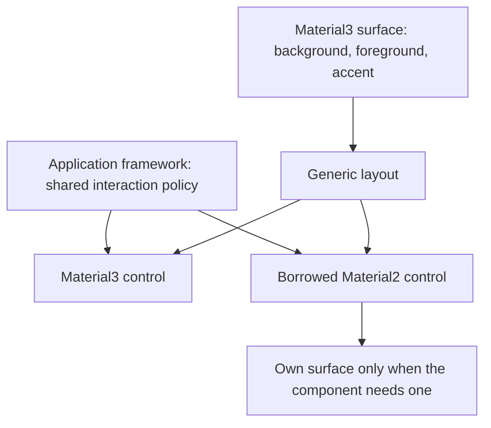

# Optional design systems and resolved appearance inheritance

Status: proposed. Material2 isolation, independent system palettes, and the
simplified Material3 state opacities are implemented prerequisites. None of the
phases below is marked complete. Revised 2026-10-16 around a shared application
look and feel rather than independent interaction policies per design system.

## Objective

Let applications borrow components from other design systems while maintaining
a common look and feel, with no mandatory Material2 or Material3 dependency in
core widget inheritance or core-only builds.

## Motivation

A predominantly Material3 application can need a legacy Material2 control that
has no suitable local equivalent. That control should adapt to its surrounding
surface and share the application's interaction strength and feedback timing.
It should not acquire a different hover or press policy merely because its
implementation lives in another design-system directory.

Today independent palettes solve ownership, but container-role inheritance still
speaks Material3 and interaction settings differ by system. Define the common
framework vocabulary and application defaults first. Keep component shapes,
semantic palettes, typography, and choices of framework behavior in their
respective design systems.

## Background

The [design glossary](../glossary.md) defines shared runtime and rendering
terminology. Relevant current APIs are:

- [Theme](../../../src/roo_windows/core/theme.h) owns `material2` and `material3`
  by value, exposed through `material2Theme()` and `material3Theme()`.
  Framework color helpers still delegate to Material3.
- [Widget](../../../src/roo_windows/core/widget.h) exposes
  `effectiveContainerRole()` and `effectiveOverlayColorRole()` using Material3
  `ColorToken`. Generic descendants inherit a container role; point overlays
  normally use the parent's role. `interactionColor()`, `interactionOpacity()`
  and `disabledContentOpacity()` already provide resolved rendering hooks.
- [SurfaceWidget](../../../src/roo_windows/core/surface_widget.h) introduces a
  role through `containerRole()` and separately resolves alpha-composited
  backgrounds. A role is semantic information, not a pixel color.
- [Material2 ThemeMixin](../../../src/roo_windows/material2/theme_mixin.h)
  maps those role identities to its independently owned palette and state
  settings. It does not read Material3 palette values.
- Material3 role consumers include
  [tabs](../../../src/roo_windows/material3/tabs/tabs.cpp), which resolve a
  parent's role back to a fill, and
  [navigation destinations](../../../src/roo_windows/material3/navigation_destination/navigation_destination.cpp),
  which choose selected versus inherited interaction styling. Controls and
  button-group entries also choose different roles with state. Replacing every
  role lookup with one foreground color would lose behavior.
- [Application](../../../src/roo_windows/core/application.h) owns the software
  keyboard and exposes a Material2 alert convenience method.
  [Task](../../../src/roo_windows/core/task.h) owns a Material2 text-field
  editor. These are additional obstacles to a core-only build.
- The root [Bazel target](../../../BUILD) currently collects all sources.
  Linker removal of unused code does not prove header or source independence.

The earlier [color-token design](../implemented/theme_color_tokens_design.md)
and [component surface theme design](../implemented/material3_component_surface_theme_design.md)
remain historical foundations. This proposal changes the boundary through
which their results reach generic widgets; it does not replace Material3's
component roles or color scheme.

## Requirements

1. Borrowed widgets must adopt common interaction defaults and surrounding
   colors where their component semantics permit it.
2. Core layouts, rendering, and input must work without either design system's
   source files or headers installed.
3. System palettes remain independently owned. Coordinating them must be an
   explicit operation; editing one palette must not silently mutate another.
4. Preserve explicit color/font overrides, component behavior, and invalidation
   contracts. Historical interaction shading is not a compatibility requirement.
5. Define transient interaction, persistent component state, disabled treatment,
   and simultaneous-state behavior independently of design systems.
6. Distinguish framework capabilities, application defaults, and component
   choices, including layout, gestures, animation, spacing, and decoration.
7. Preserve existing field/accessor names unless the semantic change or removal
   of a dependency requires changing them. Avoid compatibility aliases.
8. Add no retained palette copies, policy pointers, or allocation to each widget.
   Measure target-ABI size and paint cost.
9. Apply feature switches consistently across translation units. Use of a
   disabled system must fail at compile time.

## Design Overview

The **framework vocabulary** is the set of rendering, layout, input, and
feedback mechanisms available to components. It does not prescribe the visual
style of a particular component.

The **application look and feel** is the set of common defaults owned once by
`Theme::framework`. Interaction opacities and default click feedback belong here,
not in each system theme. Components use those defaults unless a concrete
component requirement justifies a local override.

An **inherited color style** supplies background, foreground, and accent for a
surface. Background remains the existing resolved/composited background query;
a new temporary `SurfaceColors` value carries only foreground and accent.
There is no per-widget style storage, system identifier, interaction-opacity
array, or inherited interaction-color field.

An **appearance boundary** is a widget supplying foreground/accent defaults for
its descendants. A generic layout forwards these defaults. A system component
establishing its own surface resolves appropriate colors from its system theme.
A borrowed unfilled control uses the inherited foreground/accent where it has
no stronger semantic requirement.

The accent is readable emphasis ink on that surface, not necessarily the raw
application primary color. Core carries it but does not decide when it replaces
foreground. Each component chooses its content and interaction ink, including
choices that depend on selection, error, or the particular interaction state.

`Theme` stays a concrete bag of supported system themes plus the common framework
settings. Explicit palette coordination creates consistent defaults across that
bag without introducing live projections. Build switches omit unused systems.

For example, a Material3 surface supplies its foreground and accent through a
generic layout to a borrowed Material2 checkbox. The checkbox uses foreground
when inactive and accent when checked, and uses the same hover opacity as the
neighboring Material3 control. A contained Material2 button instead creates a
surface from its own, explicitly coordinated palette. Its shape and typography
remain Material2 unless the application overrides them.

The illustration shows inheritance and shared policy, not paint ordering:



## Design Details

### Common vocabulary and responsibility

Use the existing framework types rather than inventing a parallel component
framework. The following division is authoritative:

| Area | Framework capability / application default | Component responsibility |
| --- | --- | --- |
| State | Hover, focus, press, drag; persistent selection/activation; availability | Which states apply and what they mean for the control |
| State layers | Resolved ink, opacity, region, clipping, and composition; shared opacity defaults | Ink per interaction, region geometry, and whether to draw a layer |
| Click feedback | Existing ripple/fade reveal, point/area/custom/no overlay, shared duration and default reveal | Boundedness, focus point, special reveal or no feedback |
| Activation | Existing six `ClickActivationPolicy` choices and delivery lifecycle | When the action must execute; visual theme changes do not alter action timing |
| Gestures | Existing tap/click, long-press and drag recognition, axis/claim arbitration, cancellation | Which gestures participate and their semantic actions |
| Layout | Generic row/column, flex, stacked/grid, measurement, alignment and scrolling mechanisms | Composition and component minimum-size requirements |
| Spacing | Existing scaled dimensions, `PaddingSize`, `Padding`, and `Margins` vocabulary | Padding/margin choices and system-specific density rules |
| Shadows/decorations | Elevation rendering, borders, clipping, overflow and decoration primitives | Elevation, outline, shape and decoration selection |
| Animation | Shared scheduling, click lifecycle and animation primitives | Shape morphing, indicators and component-specific transitions |
| Colors and text | Root/inherited color style, generic text rendering and explicit overrides | Semantic palette roles, typography catalogs, and component color selection |

The existing spacing scale is shared; this proposal does not add another runtime
spacing scale or merge Material3 density into it. Document the distinction in the
[glossary](../glossary.md) and link the existing APIs. A shared mechanism does not
imply that every widget uses it or uses identical geometry.

### Interaction states and combination

Separate three categories without mechanically renaming existing state flags:

- Transient interactions: hovered, focused, pressed, dragged. These can request
  a state layer.
- Persistent component states: selected, checked, expanded, activated. Components
  express them through fills, icons, outlines, indicators, or other styling.
  They do not automatically request an extra generic state layer.
- Availability: enabled/disabled. Disabled controls suppress transient feedback
  and use the disabled treatment described below.

`FrameworkTheme::state` owns hover, focus, pressed and dragged opacity. Default
values are 20, 26, 26 and 41 on the 0..255 alpha scale (8%, 10%, 10%, 16%). These
are the implemented Material3 defaults, adopted as application defaults even in
core-only builds. Their values are not a dependency on Material3 types or files.
The token provenance is recorded in the
[color-theming guide](../../material3_color_theming.md#interaction-opacities).

`interactionOpacity(state)` defaults to this common policy for every system.
Remove the duplicate Material2/Material3 state storage and neutral/colored
opacity distinction. Preserve a widget-local override hook for demonstrated
exceptions; do not add a second global matrix or a registry of exceptions.
A component using no overlay continues to draw none regardless of these values.

For shared feedback on a single widget, choose one eligible transient state in
this priority order: dragged, pressed/clicking, focused, hovered. Do not sum
opacities. Eligibility includes the widget's feedback suppression hooks. A
zero-opacity winning state remains transparent; it does not expose a lower
priority state. On release or cancellation, recompute the winner from remaining
states. Persistent flags contribute no generic layer.

A click ripple/fade uses the pressed state's ink and opacity. Its existing reveal
progress modulates that one effect. Suppress the same widget's lower-priority
base state layer during the click reveal; do not apply the pressed opacity both
as a full-area layer and as a ripple. An active drag suppresses the visual click
effect without cancelling its semantic-delivery bookkeeping. Existing ancestor
subtree effects remain distinct from arbitration of a single widget's states.
This priority is the application's chosen framework policy, not a claim that all
Material releases and platforms use an identical arbitration implementation.

Move the existing shared click duration and default ripple/fade choice into
`FrameworkTheme::interaction`, retaining their current defaults. Existing
component overrides keep precedence. A running click samples its duration and
reveal choice at admission using its single existing controller, so theme edits
do not restart it or alter delivery ordering; later clicks use the new defaults.
Keep frame scheduling limits and activation policy independent of appearance.
There is no automatic new animation for hover/focus transitions in this scope.

### Disabled treatment

Keep disabled treatment separate from transient layers. The framework owns the
default disabled-content opacity (49 on the existing 0..128 scale). Generic
content can use the existing subtree fade. Components with distinct disabled
container, outline, and label colors resolve those locally and avoid applying
the generic fade a second time. A shared disabled-content default does not mean
that all disabled visual parts have the same opacity or color.

### Inherited colors and appearance boundaries

`Widget::surfaceColors()` forwards the parent's foreground/accent, falling back
to framework root colors when detached. `defaultColor()` reads the foreground.
`background()` and `effectiveBackground()` retain their existing surface and
alpha-composition semantics; do not add a duplicate stored background field to
the inherited value.

A Material3 surface translates its own semantic role into foreground and accent
appropriate to that surface. On colored surfaces those can be equal; on neutral
surfaces they commonly differ. A plain background-color override does not infer
new foreground/accent values from RGB or attempt automatic contrast correction.
Applications needing a different pair provide an appearance boundary override.

Generic text and icons use inherited foreground unless explicitly overridden.
Borrowed Material2 checkbox/radio/switch/slider content uses inherited accent
for active affordances and foreground for ordinary content. Material2 navigation
activation chooses accent in its own component code. Remove `usesHighlighterColor()`
from core: having an accent color does not imply a universal highlighter policy.
Preserve existing explicit color/font override semantics.

A component creating its own filled surface selects background and readable
content from its system palette, and publishes a corresponding pair to its
children. Three inherited colors do not replace error, inverse, container,
outline, or other semantic palette roles. Nor do they force a borrowed widget
to adopt another system's shape or typography.

### Interaction ink is component-specific and state-aware

Change the hook to `interactionColor(InteractionState state)`. The generic
fallback is foreground for the affected surface: parent surface for a point
halo, local surface for an area overlay. This is a fallback for generic/custom
widgets, not a Material3 component policy.

Material3 components resolve interaction ink from their own variant, component
state, and interaction. In particular, the paint region being on the parent's
surface does not require taking the parent's content color. A checkbox can use
accent/primary ink for a halo on a neutral parent. Persistent selection can
change the ink for a later hover without adding a selected-state overlay.

Keep Material3 `containerRole()` helpers local where useful. Remove core role
inheritance and the Material2 translation bridge. Tabs inherit background via
the existing background query and foreground/accent via `surfaceColors()`;
navigation and button-group entries resolve their own state-layer ink rather
than reconstructing it from inherited container tokens. Directly painted effects
(text fields and keyboard feedback included) use the common opacity policy too.

The state-aware hook accommodates component tokens that distinguish hover,
focus, and pressed ink. The rendering pipeline must request the winning state's
color, including pressed ink for click animation, rather than choosing one
color and then varying only alpha. Component compliance is audited in phase 1;
existing golden images are evidence of current output, not specification proof.

### Theme ownership and explicit coordination

Add `FrameworkTheme` in `core/framework_theme.h`. It owns the existing eight
framework root color roles, shared state settings, disabled-content default,
and shared click defaults. Root foreground uses content, root accent uses
emphasis, and root background uses canvas. Rich root roles are not inherited as
a palette; `SurfaceColors` remains a pair.

Preserve `frameworkColor()`, `frameworkStateLayer()`, and
`disabledContentOpacity()` as forwarding helpers where useful. The state-layer
helper combines the requested framework ink with common opacity; it does not
reconstruct a Material3 container role. Preserve system fields/accessors and
independent palettes. Removing their duplicated state members is intentional.

Provide `ApplyCoordinatedMaterial3Palette(Theme&, const material3::ColorScheme&)`
in a Material3 integration header/target. It assigns the Material3 palette,
copies its existing framework-role mapping into framework root colors, and,
when Material2 is enabled, copies all currently matching Material2 color fields
by name. It changes no interaction settings, component roles, density, fonts,
or explicit widget overrides. The name denotes the application-wide operation;
ordinary assignment to `.material3Theme().color` continues to affect only that
palette. The helper performs no invalidation itself.

This supplies a concrete path for a predominantly Material3 app to coordinate
borrowed filled widgets as well as unfilled ones. It is an explicit value copy,
not a live projection. Reapply it when deliberately installing another coordinated
palette; direct subsequent edits remain independent. The helper compiles with
Material3 alone and excludes all Material2 includes/code when Material2 is off.
Core-only and Material2-only applications customize their available themes
directly; no Material3 conversion is required to construct defaults.

Applications mutate themes between UI frames and call `invalidateTheme()` on
each affected application. Environments retain their existing borrowing
lifetimes. Reparenting resolves the new inherited pair on the next paint;
no per-widget cache, subscription list, or generation counter is added.
Detached roots use framework root colors unless their component establishes
its own boundary. Existing presentation-owner relationships can supply live
originating-surface colors where that is the component's specified behavior.

### Optional systems and remaining application dependencies

Use build-wide `ROO_WINDOWS_ENABLE_MATERIAL2` and
`ROO_WINDOWS_ENABLE_MATERIAL3`, each defaulting to 1. Both must be 0 or 1.
Conditional theme includes, members, and accessors are absent when disabled.
Keep `.material2`, `.material3`, `material2Theme()`, and `material3Theme()` when
enabled. `DefaultTheme()` remains the same immutable default entry point in
all configurations, including neither system enabled.

Split Bazel source groups into core, Material2, Material3, and optional software
keyboard libraries. The public aggregate selects enabled groups and propagates
consistent feature definitions. There must be no dependency cycle through
core's default-theme implementation. Header-only system theme value types can
be included by configured theme composition without pulling component sources
into core. A disabled system's files must not appear in that build's inputs.

For Arduino's recursive source discovery, guard optional translation units
before their system-specific includes. Build flags apply to the entire library
and consumers, not a sketch-local define after headers have been compiled.
Document how to omit the disabled directories physically. This is optional
installation within the existing package; separate published packages are
outside this proposal.

### Remaining application dependencies

Move `Application::showAlertDialog` to a Material2 free helper, preserving its
owned-dialog cleanup and presentation result behavior. Move the legacy
`TextFieldEditor` adapter into Material2; generic task/application input routing
uses the existing system-neutral text-input contracts. Remove concrete editor
members, overloads, and friends from core instead of conditionalizing their
runtime semantics.

Make the built-in software keyboard an optional integration, selected by
`ROO_WINDOWS_ENABLE_SOFTWARE_KEYBOARD` (defaulting to the Material2 switch).
It requires Material2 until its controls are separately redesigned; reject
keyboard-enabled/Material2-disabled builds. Retain `keyboard()` when enabled.
With it disabled, hardware input and application-provided semantic editors
continue to work, and core has no keyboard source dependency. Move the legacy
editor/keyboard installation into the enabled integration rather than requiring
Material2 from every `Task`.

### Resource model

`SurfaceColors` contains two four-byte colors: eight bytes of transient payload.
There are no opacity arrays or retained style fields on widgets. Shared state
settings occupy four opacity bytes plus the disabled-content byte; click settings
live once per theme, with active-click snapshots only in the existing shared
controller. Measure exact alignment and controller deltas on the target ABI.

For a query through `d` generic ancestors, color resolution takes at most `d`
virtual forwards plus a constant-size palette resolution. Across `n` widgets,
worst-case work is O(n*d), reaching O(n²) for a chain whose depth grows with `n`.
The existing role walk has the same depth dependence. Resolve the pair once per
use site, not once per field. Interaction opacity lookup is constant-time and
does not walk the ancestor chain.

Framework colors add 32 bytes per theme plus common settings and alignment;
removing both systems' duplicate state settings offsets part of that cost.
Disabled systems remove their entire theme member. Additional virtual slots
have shared flash cost but require no extra per-instance vptr. Phase 1 establishes
target-ABI and CPU gates; exact linked-size deltas are measured, not assumed.

## Proposed API

Illustrative final signatures; implementation adds full public documentation.
Existing enum spellings remain unless their contract changes.

```cpp
struct SurfaceColors {
  roo_display::Color foreground;
  roo_display::Color accent;
};

struct StateLayerTheme {  // Core, owned once by FrameworkTheme.
  uint8_t hover = 20;
  uint8_t focus = 26;
  uint8_t pressed = 26;
  uint8_t dragged = 41;
  uint8_t disabledContentOpacity = 49;  // Separate 0..128 scale.
  uint8_t opacity(InteractionState state) const;
};

class Widget {
 public:
  virtual SurfaceColors surfaceColors() const;
  virtual roo_display::Color interactionColor(InteractionState state) const;
  virtual uint8_t interactionOpacity(InteractionState state) const;
  // Preserve defaultColor(), disabledContentOpacity(), background(),
  // effectiveBackground(), and existing feedback/activation-policy hooks.
  // No core effectiveContainerRole(), usesHighlighterColor(), or style fields.
};

struct Theme {
  FrameworkTheme framework;  // Root colors, state, and click defaults by value.
#if ROO_WINDOWS_ENABLE_MATERIAL2
  material2::Material2Theme material2;  // No duplicate state policy.
  material2::Material2Theme& material2Theme();
  const material2::Material2Theme& material2Theme() const;
#endif
#if ROO_WINDOWS_ENABLE_MATERIAL3
  material3::Material3Theme material3;  // No duplicate state policy.
  material3::Material3Theme& material3Theme();
  const material3::Material3Theme& material3Theme() const;
#endif
  // Preserve framework forwarding helpers.
};
```

Representative application use after migration:

```cpp
Theme theme = DefaultTheme();
ApplyCoordinatedMaterial3Palette(theme, palette);  // Explicit palette copies.
theme.framework.state.hover = 20;                // Shared across systems.
// Pass theme to Environment as today; after later edits:
app.invalidateTheme();
```

Delete `Material3Theme::stateLayer()` once its callers migrate: without owning
state policy it would need an implicit framework dependency. Callers resolve
component ink and obtain opacity through the widget or framework instead.
During migration, adapters can resolve existing roles, but every new hook ships
with a working implementation. No unimplemented public stubs are introduced.

## Implementation Plan

Authoring references: [C++ instructions](../../../.github/instructions/general-cpp-code-authoring-instructions.md),
[widget instructions](../../../.github/instructions/roo-windows-widget-authoring.instructions.md),
and [example instructions](../../../.github/instructions/embedded-example-authoring.instructions.md).
Each phase is one reviewable commit with its own tests and documentation.
The stashed earlier stage 3 is reference material, not a patch to apply wholesale.

### Phase 1: document vocabulary and characterize the boundaries

Add the responsibility/state vocabulary to the glossary. Inventory role consumers,
component-specific feedback and explicit overrides. Audit interaction ink against
versioned official component tokens/implementations: record a source revision,
variant/selection/error/interaction mapping, current behavior, and intended change
for each migrated component. This audit is a bounded research step: pin one
AndroidX source commit for the primary component baseline, use versioned Material
Web tokens only for components absent from that baseline, and record each fallback.
Its exit criterion is a complete, cited mapping for every shipped Material3
component that paints interaction feedback, with expected test values and all
revision conflicts resolved in favor of the primary baseline. Add regression
cases for each mapping; do not freeze known mismatches as compatibility requirements.

Measure target-ABI sizes and median paint time for 100 widgets at depths 1, 8,
and 32. Later phases must add no widget-instance state or resolution allocations
and stay within 10% of baseline median paint time for each fixture. Failures
require removing redundant work before proceeding, not adding per-widget caches.
Record controller/theme size and linked-code deltas. Validate characterization
and document intentional baseline changes.

Proposed commit message:

> Optional design systems, phase 1: define shared styling responsibilities.
>
> Document the common vocabulary, audit component interaction ink, and record
> mixed-system rendering and resource baselines for the revised design.

### Phase 2: share interaction defaults across systems

Add framework root/default ownership and move interaction opacities and generic
disabled opacity into it. Migrate both systems, direct state-layer callers, and
keyboard feedback; remove duplicated state tables/settings and the palette-only
Material3 state-layer helper. Keep existing role-based ink temporarily. Add an
example changing one hover/press setting for both systems. Validate live updates,
independent palette edits, and disabled composition without double fading.

Proposed commit message:

> Optional design systems, phase 2: share application interaction defaults.
>
> Move state opacities into the framework theme and migrate both systems and
> direct painters while preserving independently owned palettes.

### Phase 3: specify feedback arbitration and shared click defaults

Move click duration/default reveal into framework settings. Add the state-aware
color hook with a temporary adapter to current ink selection. Implement the
priority and click-layer suppression contract above, including active-animation
snapshots. Document the behavior in click examples. Test simultaneous states,
release/cancel restoration, zero opacity, drag during click, ripple/fade paths,
and all existing activation-delivery policies. Validate dirty/full equivalence,
single-write painting, and controller/CPU costs.

Proposed commit message:

> Optional design systems, phase 3: unify transient feedback composition.
>
> Resolve one eligible interaction state with state-specific ink and shared
> click defaults without changing semantic activation policies.

### Phase 4: introduce inherited foreground and accent

Add `SurfaceColors`, forwarding through generic layouts and resolving at system
surface boundaries. Keep old role declarations temporarily for remaining callers.
Migrate generic labels/icons to the pair while preserving explicit overrides.
Add the borrowed-checkbox example from the overview and tests for distinct colors,
transparent backgrounds, detached roots, reparenting, and live surface changes.
Verify resource gates and document accent as surface-relative emphasis ink.

Proposed commit message:

> Optional design systems, phase 4: inherit surface foreground and accent.
>
> Expose a compact resolved color pair through generic layouts and system
> surfaces, with borrowed-widget and explicit-override coverage.

### Phase 5: localize component styling and remove core role inheritance

Migrate Material3 component interaction colors to the phase 1 mappings and the
state-aware hook. Migrate Material2 content/accent choices to inherited colors
where appropriate and retain local palette resolution for owned surfaces.
Update tabs, navigation, button groups, and other role consumers. Remove core
role APIs, `Material2ColorRole`, and `usesHighlighterColor()` from core. Update
relevant examples and goldens after reviewing intended changes. Validate
component states, mixed-system nesting, no ancestor-role leakage into component
ink, and phase 1 resource gates; run the full library suite.

Proposed commit message:

> Optional design systems, phase 5: resolve component styling without core tokens.
>
> Implement component-specific interaction ink and borrowed-widget color
> adaptation, removing core role inheritance and highlighter selection.

### Phase 6: coordinate application palettes explicitly

Add the coordinated Material3 palette helper and its root/M2 mappings specified
above. Add a Material3 application example borrowing Material2 controls, including
a contained button, and demonstrate live palette replacement. Test every copied
field, independent later edits, unchanged shared interaction settings and explicit
overrides, and Material3-only use. Update the color-theming guide with migration
from system `.state` settings to `theme.framework.state`.

Proposed commit message:

> Optional design systems, phase 6: coordinate palettes for borrowed components.
>
> Add explicit value-copy palette installation and a mixed-system example,
> preserving independent theme ownership and shared interaction settings.

### Phase 7: extract Material2 application conveniences

Move the alert helper and legacy editor adapter out of core and make software
keyboard integration optional as described above. Update consumers and input
examples. Validate alert cleanup and failed presentation, editor teardown,
keyboard visibility, hardware input and cross-task routing, including a
keyboard-disabled build.

Proposed commit message:

> Optional design systems, phase 7: isolate legacy application integrations.
>
> Move Material2 alert/editor conveniences out of core and make the built-in
> keyboard optional while preserving generic semantic input routing.

### Phase 8: enforce optional installation

Add system switches, conditional theme composition, integration dependencies,
and build partitions. Document Bazel/Arduino configuration with core-only,
Material2-only, Material3-only, and mixed examples. Compile/link all four with
disabled directories physically excluded from fixtures. Verify build inputs,
invalid flag combinations, and the coordinated helper's conditional dependencies.
Run the full default suite and affected frontend/companion builds serially with
persistent Bazel storage and existing limits. Record final resource comparisons.

Proposed commit message:

> Optional design systems, phase 8: build without unused design systems.
>
> Select theme and source dependencies consistently, with physical-absence
> coverage and examples for each supported system combination.

## Testing Plan

Use focused theme, overlay, container, component, dialog, keyboard and click
lifecycle targets as each phase lands. Existing starting points include
`//:theme_color_tokens_test`, `//:material2_theme_test`,
`//:material3_container_test`, `//:surface_widget_invalidation_test`, and
`//:overlay_test`. Rename token-specific tests only when their subject is removed.

Acceptance covers shared live feedback settings, component-specific ink,
borrowed-widget adaptation, explicit overrides, palette coordination without
aliasing, interaction arbitration, and optional-installation builds. Retain
single-write rendering and dirty/full repaint equivalence. Review intended
golden changes against the recorded component contracts, not historical output
alone. Apply the resource gates from phase 1. Run Bazel builds serially and keep
all Bazel storage off RAM-backed `/tmp`.

## Caveats

Shared opacity and feedback arbitration intentionally change Material2 appearance
and simultaneous-state rendering. Palette coordination adapts colors but does
not convert widget geometry or typography. A borrowed widget remains recognizably
its own component where those choices matter.

A supplied accent is not guaranteed to contrast with an arbitrary application
background override; the surface owner must supply an appropriate pair. Component
roles can require more colors than the inherited pair, especially for filled,
error, disabled, and inverse surfaces.

Core root colors are independently owned. Directly editing Material3 no longer
implicitly changes framework roots; coordinated installation is explicit.
Feature switches change ABI and must agree across the application and libraries.

### Rejected Alternatives

#### Independent default interaction policies per system

This preserves each system's historical shading but makes borrowed controls feel
unrelated. Shared defaults meet the motivating use case while local component
hooks preserve necessary exceptions.

#### Derive all interaction ink from the parent or a highlighter flag

This is compact but cannot represent component/state-specific ink. Carry accent
as an inherited color and let components choose when to use it; use the
state-aware hook for resolved interaction ink.

#### Replace every system palette with three colors

The small inherited vocabulary supports ordinary content and active affordances,
but cannot express the semantic combinations needed by richer components.
Independent palettes plus explicit coordination preserve those distinctions.

#### Keep Material3 roles in core or infer roles from RGB

The former prevents optional installation; the latter is ambiguous when two
roles have the same color. Resolve roles at component boundaries instead.

#### Make Material3Theme implement Material2Theme or project it live

That couples ownership and mutation. Explicit copies coordinate palette
installation while allowing later independent customization.

#### Runtime registries or per-widget policy pointers

The supported systems are known at build time. A concrete theme bag and virtual
resolution hooks meet the requirements without additional instance state or
runtime registration machinery.

#### Rely on linker garbage collection

It removes unused code but cannot prove source/header independence or remove
unused theme members. Physical-absence fixtures enforce the installation contract.

## Future Work

Separate published packages, runtime plugins, additional palette-coordination
adapters, a Material2-free software keyboard, and a runtime common spacing scale
are outside this proposal. Component-specific shape and typography adapters can
be added for demonstrated borrowing needs; they are not required to share the
framework interaction policy or inherited colors.
