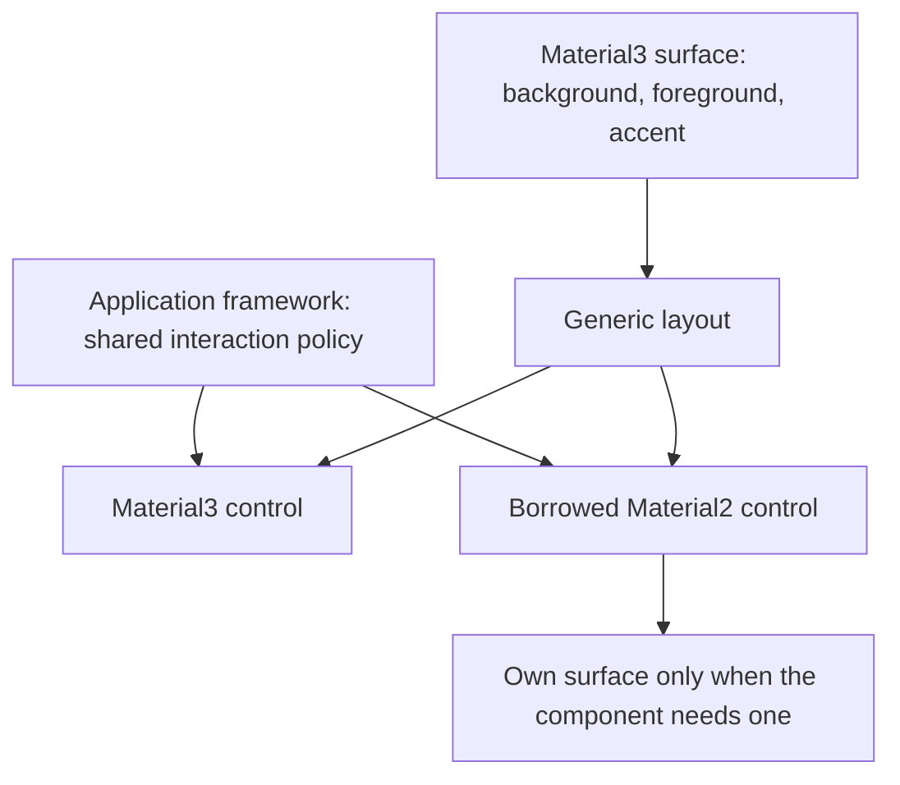
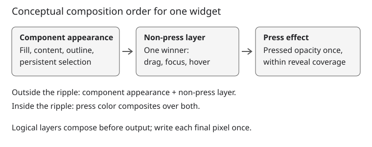

# Optional design systems and resolved appearance inheritance

Status: proposed. Material2 isolation, independent system palettes, and the
simplified Material3 state opacities are implemented prerequisites. Phase 1
characterization is recorded in the
[boundary audit](optional_design_systems_phase1_audit.md). Phases 2–6 implement
shared feedback, inherited surface colors, local component styling, and explicit
coordinated palette installation. Later
phases remain proposed. Revised 2026-10-16 around a shared application look and
feel rather than independent interaction policies per design system.

## Objective

Let applications borrow components from other design systems while maintaining
a common look and feel, with no mandatory Material2 or Material3 dependency in
core widget inheritance or core-only builds.

## Motivation

A predominantly Material3 application can need a legacy Material2 control that
has no suitable local equivalent. That control should adapt to its surrounding
surface and share the application's interaction strength and feedback timing.
It should not acquire a different hover or press policy merely because its
implementation lives in another design-system directory.

Today independent palettes solve ownership, but container-role inheritance still
speaks Material3 and interaction settings differ by system. Define the common
framework vocabulary and application defaults first. Keep component shapes,
semantic palettes, typography, and choices of framework behavior in their
respective design systems.

## Background

The [design glossary](../glossary.md) defines shared runtime and rendering
terminology. The following inventory describes the pre-migration APIs:

- [Theme](../../../src/roo_windows/core/theme.h) owns `material2` and `material3`
  by value, exposed through `material2Theme()` and `material3Theme()`.
  Framework color helpers still delegate to Material3.
- [Widget](../../../src/roo_windows/core/widget.h) exposes
  `effectiveContainerRole()` and `effectiveOverlayColorRole()` using Material3
  `ColorToken`. Generic descendants inherit a container role; point overlays
  normally use the parent's role. `interactionColor()`, `interactionOpacity()`
  and `disabledContentOpacity()` already provide resolved rendering hooks.
- [SurfaceWidget](../../../src/roo_windows/core/surface_widget.h) introduces a
  role through `containerRole()` and separately resolves alpha-composited
  backgrounds. A role is semantic information, not a pixel color.
- [OverlaySpec](../../../src/roo_windows/core/overlay_spec.cpp) already
  alpha-composites a pressed ripple over the widget's overlay color. The overlay
  query first sums simultaneous-state opacities, including pressed; the ripple
  can therefore apply pressed twice. During expansion it folds the base into the
  ripple and clears the separate base, restricting both to the ripple coverage.
- [Material2 ThemeMixin](../../../src/roo_windows/material2/theme_mixin.h)
  maps those role identities to its independently owned palette and state
  settings. It does not read Material3 palette values.
- Material3 role consumers include
  [tabs](../../../src/roo_windows/material3/tabs/tabs.cpp), which resolve a
  parent's role back to a fill, and
  [navigation destinations](../../../src/roo_windows/material3/navigation_destination/navigation_destination.cpp),
  which choose selected versus inherited interaction styling. Controls and
  button-group entries also choose different roles with state. Replacing every
  role lookup with one foreground color would lose behavior.
- [Application](../../../src/roo_windows/core/application.h) owns the software
  keyboard and exposes a Material2 alert convenience method.
  [Task](../../../src/roo_windows/core/task.h) owns a Material2 text-field
  editor shared by Material2 and Material3 text fields. Its caret, selection,
  and input functionality is needed even without the software keyboard.
- [EditorDestination](../../../src/roo_windows/keyboard/editor_destination.cpp)
  presents an M2 text field and back/confirm buttons, including when opened by
  an M3 field. It holds the draft and commits on confirmation after removal
  from navigation. The keyboard is hosted separately in an application-owned
  task; the destination does not contain it.
- [KeyboardWidget](../../../src/roo_windows/keyboard/keyboard.cpp) already draws
  all keys in one `SurfaceWidget`, using `KeyboardColorTheme`. Its direct styling
  dependencies on M2 typography helpers and M3 pressed-state colors prevent
  independent installation; it does not need replacement M3 key widgets.
- [Material3 dialog scaffolding](../../../src/roo_windows/material3/dialog/dialog_scaffold.h)
  embeds Material2 horizontal dividers. Optional installation also requires
  replacing this direct component dependency with Material3 dividers.
- The root [Bazel target](../../../BUILD) currently collects all sources.
  Linker removal of unused code does not prove header or source independence.

The earlier [color-token design](../implemented/theme_color_tokens_design.md)
and [component surface theme design](../implemented/material3_component_surface_theme_design.md)
remain historical foundations. This proposal changes the boundary through
which their results reach generic widgets; it does not replace Material3's
component roles or color scheme.

## Requirements

1. Borrowed widgets must adopt common interaction defaults and surrounding
   colors where their component semantics permit it.
2. Core layouts, rendering, and input must work without either design system's
   source files or headers installed.
3. System palettes remain independently owned. Coordinating them must be an
   explicit operation; editing one palette must not silently mutate another.
4. Preserve explicit color/font overrides, component behavior, and invalidation
   contracts. Historical interaction shading is not a compatibility requirement.
5. Define transient interaction, persistent component state, disabled treatment,
   and simultaneous-state behavior independently of design systems.
6. Distinguish framework capabilities, application defaults, and component
   choices, including layout, gestures, animation, spacing, and decoration.
7. Preserve existing field/accessor names unless the semantic change or removal
   of a dependency requires changing them. Avoid compatibility aliases.
8. Add no retained palette copies, policy pointers, or allocation to each widget.
   Measure target-ABI size and paint cost.
9. Apply feature switches consistently across translation units. Use of a
   disabled system must fail at compile time.
10. Each system's extracted editor must retain that system's appearance while
    sharing editing semantics and the application keyboard. Software keyboard
    availability must be independent of which design systems are installed.

## Design Overview

The **framework vocabulary** is the set of rendering, layout, input, and
feedback mechanisms available to components. It does not prescribe the visual
style of a particular component.

The **application look and feel** is the set of common defaults owned once by
`Theme::framework`. Interaction opacities and default click feedback belong here,
not in each system theme. Components use those defaults unless a concrete
component requirement justifies a local override.

An **inherited color style** supplies background, foreground, and accent for a
surface. Background remains the existing resolved/composited background query;
a new temporary `SurfaceColors` value carries only foreground and accent.
There is no per-widget style storage, system identifier, interaction-opacity
array, or inherited interaction-color field.

An **appearance boundary** is a widget supplying foreground/accent defaults for
its descendants. A generic layout forwards these defaults. A system component
establishing its own surface resolves appropriate colors from its system theme.
A borrowed unfilled control uses the inherited foreground/accent where it has
no stronger semantic requirement.

Feedback has three contributions: component appearance (including persistent
selection), one non-press interaction layer, and one press effect. The press
ripple composites over the non-press layer without replacing that layer or
adding a second full-area pressed tint.

The accent is readable emphasis ink on that surface, not necessarily the raw
application primary color. Core carries it but does not decide when it replaces
foreground. Each component chooses its content and interaction ink, including
choices that depend on selection, error, or the particular interaction state.

`Theme` stays a concrete bag of supported system themes plus the common framework
settings. Explicit palette coordination creates consistent defaults across that
bag without introducing live projections. Build switches omit unused systems.

Editing has three separate responsibilities: a task-owned neutral engine handles
text input and caret/selection behavior; each system supplies its own editor
**destination**, the navigation screen holding a temporary draft; and one
optional application-owned keyboard produces semantic input for the active
editor. The destinations share draft completion and navigation lifecycle logic,
while their fields, actions, and appearance belong to their respective systems.
For example, an M3 field that cannot fit above the keyboard opens an M3 editor
and uses the same keyboard as an M2 field. The detailed ownership and build
contracts are in [Editing and keyboard integration](#editing-and-keyboard-integration).

For example, a Material3 surface supplies its foreground and accent through a
generic layout to a borrowed Material2 checkbox. The checkbox uses foreground
when inactive and accent when checked, and uses the same hover opacity as the
neighboring Material3 control. A contained Material2 button instead creates a
surface from its own, explicitly coordinated palette. Its shape and typography
remain Material2 unless the application overrides them.

The illustration shows inheritance and shared policy, not paint ordering:



## Design Details

### Common vocabulary and responsibility

Use the existing framework types rather than inventing a parallel component
framework. The following division is authoritative:

| Area | Framework capability / application default | Component responsibility |
| --- | --- | --- |
| State | Hover, focus, press, drag; persistent selection/activation; availability | Which states apply and what they mean for the control |
| State layers | Resolved ink, opacity, region, clipping, and composition; shared opacity defaults | Ink per interaction, region geometry, and whether to draw a layer |
| Click feedback | Existing ripple/fade reveal, point/area/custom/no overlay, shared duration and default reveal | Boundedness, focus point, special reveal or no feedback |
| Activation | Existing six `ClickActivationPolicy` choices and delivery lifecycle | When the action must execute; visual theme changes do not alter action timing |
| Gestures | Existing tap/click, long-press and drag recognition, axis/claim arbitration, cancellation | Which gestures participate and their semantic actions |
| Layout | Generic row/column, flex, stacked/grid, measurement, alignment and scrolling mechanisms | Composition and component minimum-size requirements |
| Spacing | Existing scaled dimensions, `PaddingSize`, `Padding`, and `Margins` vocabulary | Padding/margin choices and system-specific density rules |
| Shadows/decorations | Elevation rendering, borders, clipping, overflow and decoration primitives | Elevation, outline, shape and decoration selection |
| Animation | Shared scheduling, click lifecycle and animation primitives | Shape morphing, indicators and component-specific transitions |
| Colors and text | Root/inherited color style, generic text rendering and explicit overrides | Semantic palette roles, typography catalogs, and component color selection |

The existing spacing scale is shared; this proposal does not add another runtime
spacing scale or merge Material3 density into it. Document the distinction in the
[glossary](../glossary.md) and link the existing APIs. A shared mechanism does not
imply that every widget uses it or uses identical geometry.

### Interaction states and combination

Separate three categories without mechanically renaming existing state flags:

- Transient interactions: hovered, focused, pressed, dragged. These can request
  a state layer.
- Persistent component states: selected, checked, expanded, activated. Components
  express them through fills, icons, outlines, indicators, or other styling.
  They do not automatically request an extra generic state layer.
- Availability: enabled/disabled. Disabled controls suppress transient feedback
  and use the disabled treatment described below.

`FrameworkTheme::state` owns hover, focus, pressed and dragged opacity. Default
values are 20, 26, 26 and 41 on the 0..255 alpha scale (8%, 10%, 10%, 16%). These
are the implemented Material3 defaults, adopted as application defaults even in
core-only builds. Their values are not a dependency on Material3 types or files.
The token provenance is recorded in the
[color-theming guide](../../material3_color_theming.md#interaction-opacities).

`interactionOpacity(state)` defaults to this common policy for every system.
Remove the duplicate Material2/Material3 state storage and neutral/colored
opacity distinction. Preserve a widget-local override hook for demonstrated
exceptions; do not add a second global matrix or a registry of exceptions.
A component using no overlay continues to draw none regardless of these values.

Resolve one **non-press layer** from eligible dragged, focused, and hovered
states, in that priority order. Do not sum those opacities. A zero-opacity winner
stays transparent rather than exposing a lower-priority state. This deterministic
priority is application policy: it avoids retaining interaction-order history on
widgets. Compose instead selects the most recently started non-press interaction
that remains active. Reproducing that rule would require remembering, for example,
whether hover began before or after focus; the existing Boolean state flags do
not encode it. Accept this bounded difference: use only the existing flags, with
no per-widget history, timestamps, order code, or side registry. When the winner
ends, recompute from the remaining active states. Press is not in this contest.

Resolve the **press effect** independently, using pressed ink and opacity once.
During ripple reveal, restrict it to the revealed region; during fade reveal,
modulate its opacity by the existing progress. Exclude pressed from the non-press
query and never add a second full-area pressed tint. Press-suppression hooks
suppress only this contribution. Keep the non-press layer underneath the ripple
and outside its expanding boundary. Drag participates in non-press arbitration;
click cancellation remains owned by existing gesture/input handling.

Compose in this order: component appearance, non-press layer, press effect.
Source-over composite the effect colors, retaining the renderer's existing
coverage-preserving tint application to content, clipping, and ancestor-effect
contracts. Resolve final pixels in one write, including point halos and deferred
contributors. With the same ink and normalized alphas $a_b$ (non-press) and $a_p$
(press), combined alpha is $a_p + a_b(1-a_p)$, not $a_b+a_p$. Different inks require
compositing the colors too; one summed opacity and one ink are insufficient.



The official [Compose implementation](https://raw.githubusercontent.com/androidx/androidx/androidx-main/compose/material/material-ripple/src/commonMain/kotlin/androidx/compose/material/ripple/Ripple.kt)
separates a non-press layer from press ripples; [Material Web](https://raw.githubusercontent.com/material-components/material-web/main/ripple/internal/_ripple.scss)
also separates hover and pressed effects. The
[Material3 internal ripple at AndroidX c4b0af2](https://android.googlesource.com/platform/frameworks/support/+/c4b0af2cf608b0ee1d5542627f3c1358bbd956ac/compose/material3/material3/src/commonMain/kotlin/androidx/compose/material3/internal/ripple/Ripple.kt)
likewise handles press separately and selects one remaining non-press interaction.
These implementations support simultaneous press and non-press feedback, not
one winner across all four states. Use the shared Compose opacity-ripple path
above as the composition-order baseline; phase 1 pins its exact revision.
Adopt that separation without importing either platform's full motion behavior.

Preserve the existing controller's admission, reveal curve, final-frame settlement,
and activation-delivery timing. An early release can retain its press effect
until existing settlement completes. A press held after reveal completes retains
one full-region pressed contribution at unchanged opacity. Explicitly remove the
current drop from a stronger ripple to a paler held state: reaching full
expansion alone must not reduce the tint. The reference
[Compose ripple animation](https://raw.githubusercontent.com/androidx/androidx/androidx-main/compose/material/material-ripple/src/commonMain/kotlin/androidx/compose/material/ripple/RippleAnimation.kt)
finishes its entrance and waits for a finish signal before fading out; expansion
completion itself does not start that fade. Once neither a click reveal nor a
held press remains, remove only the press effect, leaving current non-press feedback
and component appearance. Cancellation follows existing settlement rules. No new
release fade or hover/focus transition animation is introduced. Ink follows live
component state, including selection changes, without restarting reveal.
Terminal painting must settle the controller even when opacity is zero or
feedback is suppressed; visual eligibility must not strand semantic delivery.

Persistent selected/activated flags remain, but request no automatic framework
tint. Components can still paint a persistent tint, fill, icon, outline, or
indicator. An automatic extra layer would shade components that already express
selection. Before removing Material2's selected/activated opacity entries,
migrate `ToggleButtons` to a component-owned active layer: apply a local
foreground tint of 31/255 over the button's painted icon and container, with
transient effects composited above it. Its internal button becomes a
`SurfaceWidget`, adds no style fields, and forwards inherited foreground/accent
when the pair is introduced. This follows the
[Material 2 states guidance](https://m2.material.io/design/interaction/states.html),
which uses selection overlays and permits activation overlays, without restoring
an automatic layer for every widget. The component supplies its tint through
`componentOverlayColor()` so the paint-effect path applies it above direct and
deferred ink.
Preserve explicit styling overrides. Every other persistent-layer consumer must
receive an explicit replacement in the same phase; selection must remain visible
without hover or focus.

Move the existing shared click duration and default ripple/fade choice into
`FrameworkTheme::click` (`durationMillis` and `reveal`), retaining their current
defaults. Existing component overrides keep precedence. A running click samples
its duration and reveal choice at admission using its single existing controller,
so theme edits do not restart it or alter delivery ordering; later clicks use the
new defaults.
Keep frame scheduling limits and activation policy independent of appearance.
There is no automatic new animation for hover/focus transitions in this scope.

### Disabled treatment

Keep disabled treatment separate from transient layers. The framework owns the
default disabled-content opacity (49 on the existing 0..128 scale). Generic
content can use the existing subtree fade. Components with distinct disabled
container, outline, and label colors resolve those locally and avoid applying
the generic fade a second time. A shared disabled-content default does not mean
that all disabled visual parts have the same opacity or color.

### Inherited colors and appearance boundaries

`Widget::surfaceColors()` forwards the parent's foreground/accent, falling back
to framework root colors when detached. `defaultColor()` reads the foreground.
`background()` and `effectiveBackground()` retain their existing surface and
alpha-composition semantics; do not add a duplicate stored background field to
the inherited value.

A Material3 surface translates its own semantic role into foreground and accent
appropriate to that surface. On colored surfaces those can be equal; on neutral
surfaces they commonly differ. A plain background-color override does not infer
new foreground/accent values from RGB or attempt automatic contrast correction.
Applications needing a different pair provide an appearance boundary override.

Generic text and icons use inherited foreground unless explicitly overridden.
Borrowed Material2 checkbox/radio/switch/slider content uses inherited accent
for active affordances and foreground for ordinary content. Material2 navigation
activation chooses accent in its own component code. Remove `usesHighlighterColor()`
from core: having an accent color does not imply a universal highlighter policy.
Preserve existing explicit color/font override semantics.

A component creating its own filled surface selects background and readable
content from its system palette, and publishes a corresponding pair to its
children. Three inherited colors do not replace error, inverse, container,
outline, or other semantic palette roles. Nor do they force a borrowed widget
to adopt another system's shape or typography.

### Interaction ink is component-specific and state-aware

Change the hook to `interactionColor(InteractionState state)`. The generic
fallback is foreground for the affected surface: parent surface for a point
halo, local surface for an area overlay. This is a fallback for generic/custom
widgets, not a Material3 component policy.

Material3 components resolve interaction ink from their own variant, component
state, and interaction. In particular, the paint region being on the parent's
surface does not require taking the parent's content color. A checkbox can use
accent/primary ink for a halo on a neutral parent. Persistent selection can
change the ink for a later hover without adding a selected-state overlay.

Keep Material3 `containerRole()` helpers local where useful. Remove core role
inheritance and the Material2 translation bridge. Tabs inherit background via
the existing background query and foreground/accent via `surfaceColors()`;
navigation and button-group entries resolve their own state-layer ink rather
than reconstructing it from inherited container tokens. Directly painted effects
(text fields and keyboard feedback included) use the common opacity policy too.

The state-aware hook accommodates component tokens that distinguish hover,
focus, and pressed ink. Request the winning non-press state's color and the
pressed color separately, rather than choosing one ink and varying only alpha.
Component compliance is audited in phase 1; existing golden images are evidence
of current output, not specification proof.

### Theme ownership and explicit coordination

Add `FrameworkTheme` in `core/framework_theme.h`. It owns five framework root
colors, shared state settings, disabled-content default, and shared click
defaults. Retain these existing `FrameworkColorRole` names:

| Role | Framework responsibility | Coordinated Material3 source |
| --- | --- | --- |
| `kCanvas` | Main-window background restoration | `background` |
| `kSurface` | Detached/root generic container fill | `surface` |
| `kContent` | Root inherited foreground | `onSurface` |
| `kEmphasis` | Root inherited accent | `primary` |
| `kOutline` | Generic surface outline default | `outlineVariant` |

Keep canvas and surface distinct to preserve existing rendering responsibilities.
Generic icons and scrollbars use inherited foreground; components choose accent
where appropriate. Root content/emphasis provide the fallback pair. The five
roles are not an inherited palette; `SurfaceColors` remains a pair.

Remove `kMutedContent`, `kCritical`, and `kOnCritical` from the framework API and
storage. They have no current rendering consumer: the critical-color read is
only in MainWindow's unused palette preparation. Delete that entire preparation
block and its unused helper/dependencies. Error and secondary-content roles
remain in system palettes for components that need them.

Preserve `frameworkColor()` and `disabledContentOpacity()` as forwarding helpers.
Remove `frameworkStateLayer()` from core and Material3 after deleting the unused
palette preparation and migrating tests/examples; it has no remaining production
caller. Resolve component ink and opacity separately through widget hooks.
Preserve system fields/accessors and independent palettes. Removing their
duplicated state members is intentional.

Provide `ApplyCoordinatedMaterial3Palette(Theme&, const material3::ColorScheme&)`
in a Material3 integration header/target. It assigns the Material3 palette,
copies the five mappings above into framework root colors, and,
when Material2 is enabled, copies all currently matching Material2 color fields
by name. It changes no interaction settings, component roles, density, fonts,
or explicit widget overrides. The name denotes the application-wide operation;
ordinary assignment to `.material3Theme().color` continues to affect only that
palette. The helper performs no invalidation itself.

This supplies a concrete path for a predominantly Material3 app to coordinate
borrowed filled widgets as well as unfilled ones. It is an explicit value copy,
not a live projection. Reapply it when deliberately installing another coordinated
palette; direct subsequent edits remain independent. The helper compiles with
Material3 alone and excludes all Material2 includes/code when Material2 is off.
Core-only and Material2-only applications customize their available themes
directly; no Material3 conversion is required to construct defaults.

Applications mutate themes between UI frames and call `invalidateTheme()` on
each affected application. Environments retain their existing borrowing
lifetimes. Reparenting resolves the new inherited pair on the next paint;
no per-widget cache, subscription list, or generation counter is added.
Detached roots use framework root colors unless their component establishes
its own boundary. Existing presentation-owner relationships can supply live
originating-surface colors where that is the component's specified behavior.

### Optional systems and remaining application dependencies

Use build-wide `ROO_WINDOWS_ENABLE_MATERIAL2` and
`ROO_WINDOWS_ENABLE_MATERIAL3`, each defaulting to 1. Both must be 0 or 1.
Conditional theme includes, members, and accessors are absent when disabled.
Keep `.material2`, `.material3`, `material2Theme()`, and `material3Theme()` when
enabled. `DefaultTheme()` remains the same immutable default entry point in
all configurations, including neither system enabled.

Split Bazel source groups into core, Material2, Material3, and optional software
keyboard libraries. System-specific editor destination sources belong to their
system's integration group and are selected only when both that system and the
software keyboard are enabled. The keyboard library depends on neither system;
all eight combinations of the three Boolean switches are supported. The public
aggregate selects enabled groups and propagates consistent feature definitions.
There must be no dependency cycle through
core's default-theme implementation. Header-only system theme value types can
be included by configured theme composition without pulling component sources
into core. A disabled system's files must not appear in that build's inputs.

For Arduino's recursive source discovery, guard optional translation units
before their system-specific includes. Build flags apply to the entire library
and consumers, not a sketch-local define after headers have been compiled.
Document how to omit the disabled directories physically. This is optional
installation within the existing package; separate published packages are
outside this proposal.

### Material3 dividers

Material3 dialogs currently borrow Material2 dividers, whose two-tone rendering
and palette lookup belong to that system. Add public
`material3::HorizontalDivider` and `material3::VerticalDivider` in
`material3/divider/divider.h` with implementation in the matching `.cpp`.
Both derive directly from `Widget`: they paint separator ink over the inherited
surface, introduce no appearance boundary, and depend on no Material2 code.

Use the Material3 divider defaults: `color.outlineVariant` and 1 dp thickness,
following the official [divider tokens](https://raw.githubusercontent.com/androidx/androidx/androidx-main/compose/material3/material3/src/commonMain/kotlin/androidx/compose/material3/tokens/DividerTokens.kt).
Phase 1 pins these tokens alongside the component baseline. Resolve the color
from the live Material3 theme. Convert thickness with the existing `Scaled()`
geometry scale and clamp to at least one physical pixel; Material3 compactness
settings do not change the stroke. Draw one uniform stripe. Horizontal dividers
stretch in width; vertical dividers stretch in height. Their preferred cross-axis
size is the resolved thickness, with zero built-in padding or margins. Existing
layout padding and margins express full-width and inset placement.

Provide virtual `dividerColor()` and `dividerThickness()` hooks for application
subclasses; the latter returns a positive physical-pixel thickness. These hooks
add no retained divider fields. A changed color requires paint invalidation;
a changed thickness also requires layout. Paint through `PaintContext` so the
stripe composes with the inherited background and effects in one write per pixel.

Replace both divider members in the Material3 dialog scaffold. Its measurement
and placement must use the divider thickness rather than hard-coded two-pixel
rectangles. Preserve its scroll-dependent visibility and content insets. Existing
Material2 dividers retain their own implementation and appearance.

### Remaining application dependencies

Remove `Application::showAlertDialog` and its Material2 includes from core's
public API, without a forwarding member or a system-neutral alert factory.
Despite its location, this utility constructs a concrete Material2 alert and
exposes a Material2 callback type. Preserve the convenience as
`material2::ShowAlertDialog(Task&, ...)` beside `material2::AlertDialog`, retaining
its title, supporting text, button labels, callback, and `PresentationStartResult`
contracts. Obtain the application/context from the task, retain UI-thread
validation, and preserve cleanup after completion, failed admission, and teardown.
Applications can instead own and show a `material2::AlertDialog` or
`material3::AlertDialog` directly. Application does not select a dialog style.

### Editing and keyboard integration

Extract the shared engine currently named `material2::TextFieldEditor` into a
system-neutral module. Retain one task-owned engine and the existing
`internal::TextEditTarget` contract for both systems. Caret/selection metrics,
scrolling, masking, and hardware/semantic input must work without Material2 or
the software keyboard. Migrate core members, overloads, and friends to the neutral
engine and keep concrete field adapters in their systems. The producer-side
`TextInputEmitter` alone does not replace this shared consumer engine.

#### Independent system keyboard

Select the built-in keyboard with `ROO_WINDOWS_ENABLE_SOFTWARE_KEYBOARD`, a
build-wide Boolean defaulting to 1 independently of the system switches. Retain
`Application::keyboard()` when enabled. Move keyboard installation into this
optional integration. With it disabled, fields edit in place through the neutral
engine, hardware/semantic input continues to work, and core has no keyboard
source dependency. Both systems' fields must compile with the other system and
the keyboard physically absent. With both systems disabled, the keyboard can
still deliver semantic input to a custom `internal::TextEditTarget`.

Keep the existing single-widget key renderer, layouts, repeat/alternative-key
behavior, and independent `KeyboardColorTheme`. Replace M2 font helpers with
keyboard-local functions selecting the same font assets, sizes, and zoom behavior
from the font library directly; do not copy the M2 typography catalog. Use the
keyboard theme's `text` color for pressed ink and framework pressed opacity for
both keys and alternative-key feedback. This removes direct M3 palette access
and adds no color or font fields to each key or widget. The keyboard retains
its own system appearance regardless of the active field's design system.

The application continues to own one keyboard and its separate task. Opening
an editor destination activates its field through the shared engine, which
routes keyboard input to that field. Do not reparent the keyboard into the
destination, construct one keyboard per destination, or change keyboard hosting.
Switching editors must preserve existing routing and visibility semantics.

#### System-specific editor destinations

Replace the neutral-named public `EditorDestination` with
`material2::EditorDestination` and `material3::EditorDestination`, in each
system's `editor_destination/editor_destination.h` and matching `.cpp`.
No compatibility alias keeps M2 presentation in the keyboard module.

| Responsibility | M2 destination | M3 destination |
| --- | --- | --- |
| Draft field | Existing underlined M2 field | Filled M3 field |
| Back and confirm actions | M2 buttons | M3 icon buttons |
| Appearance and measurement | M2 palette, typography, and dimensions | M3 palette, typography, shapes, and density |
| Editing and completion | Shared neutral engine and destination lifecycle | Same engine and lifecycle |
| Software input | Shared application keyboard | Same keyboard instance |

Retain the simple back/field/confirm row. Each destination measures its own
controls within the viewport available above the keyboard. Keep the original
field's label/hint and obscure-text setting when creating the draft. Confirm copies
the draft back; Back cancels without modifying the original. Keyboard confirmation
and the visible confirm action use the same completion path.

Extract a small internal destination base alongside neutral editing support,
compiled only with keyboard integration. It owns the existing editing,
confirmation, and completion guards and callback lifecycle; concrete destinations
own their controls and typed source-field adapters. Keep the draft in the editor
field, without an additional retained string in the base. Share navigation
admission, removal, and completion ordering instead of duplicating that fragile
logic. Preserve cleanup on failed admission, source destruction, and application
teardown. Recheck the source after any user callback that can destroy it, and
deliver completion only after the destination leaves navigation history.

Replace `ApplicationContext::editorDestination()` and its non-allocating query
with typed `material2EditorDestination()` / `material3EditorDestination()` and
matching `...IfPresent()` accessors, present only when the corresponding system
and keyboard are enabled. Each lazily owns one destination, reused on later
visits. Concrete construction lives in the corresponding system integration;
neutral editing and keyboard sources include neither system's destination.
Preserve the existing refusal to start another extracted edit while a destination
is attached or completing, applying the guard across both cached destinations.
Use their existing lifecycle flags; add no registry or state to ordinary widgets.

Field adapters select their own system's destination directly. Move extraction
eligibility and source-lifetime integration out of the current M2-backed shared
class. Preserve automatic extraction for M3 fields and explicit extraction for
M2 fields. The destination's own field starts editing through an internal
in-place entry point that still requests the keyboard but skips extraction.
This prevents another extraction attempt on a small viewport without disabling
software input or adding a persistent flag to every field.

### Resource model

`SurfaceColors` contains two four-byte colors: eight bytes of transient payload.
There are no opacity arrays or retained style fields on widgets. Shared state
settings occupy four opacity bytes plus the disabled-content byte; click settings
live once per theme, with active-click snapshots only in the existing shared
controller. Retain both non-press and press colors in transient paint state;
update OverlaySpec and point/area/deferred composition instead of folding the
base into ripple coverage. Measure paint-stack/arena high-water deltas, alignment,
and controller deltas on the target ABI; add no Widget instance fields.

For a query through `d` generic ancestors, color resolution takes at most `d`
virtual forwards plus a constant-size palette resolution. Across `n` widgets,
worst-case work is O(n*d), reaching O(n²) for a chain whose depth grows with `n`.
The existing role walk has the same depth dependence. Resolve the pair once per
use site, not once per field. Interaction opacity lookup is constant-time and
does not walk the ancestor chain.

Framework colors add 20 bytes per theme plus common settings and alignment;
removing both systems' duplicate state settings offsets part of that cost.
Disabled systems remove their entire theme member. Additional virtual slots
have shared flash cost but require no extra per-instance vptr. Phase 1 establishes
target-ABI and CPU gates; exact linked-size deltas are measured, not assumed.

Editing retains one engine per task and one keyboard per application when
configured. Destination ownership uses one pointer per enabled system when the
keyboard is enabled: a mixed build adds one pointer over the current single
slot. Destination objects allocate only on first use and remain cached; after
both systems have been used, a mixed application retains both sets of controls,
but only the active destination holds draft content. Clearing a string can retain
its capacity. No second keyboard or per-key widget allocation is introduced.
Measure idle and post-use context/destination heap costs separately in phase 10,
including retained draft capacity; disabled integrations add no ownership slots.

## Proposed API

Illustrative final signatures; implementation adds full public documentation.
Existing enum spellings remain unless their contract changes.

```cpp
enum class FrameworkColorRole : uint8_t {
  kCanvas, kSurface, kContent, kEmphasis, kOutline
};

struct SurfaceColors {
  roo_display::Color foreground;
  roo_display::Color accent;
};

struct StateLayerTheme {  // Core, owned once by FrameworkTheme.
  uint8_t hover = 20;
  uint8_t focus = 26;
  uint8_t pressed = 26;
  uint8_t dragged = 41;
  uint8_t disabledContentOpacity = 49;  // Separate 0..128 scale.
  uint8_t opacity(InteractionState state) const;  // Selected/activated return 0.
};

class Widget {
 public:
  virtual SurfaceColors surfaceColors() const;
  virtual roo_display::Color interactionColor(InteractionState state) const;
  virtual uint8_t interactionOpacity(InteractionState state) const;
  // Preserve defaultColor(), disabledContentOpacity(), background(),
  // effectiveBackground(), press-feedback and activation-delivery hooks.
  // getOverlayOpacity() resolves only the winning non-press layer;
  // the renderer resolves press separately through interactionOpacity().
  // No core role inheritance, highlighter policy, persistent-layer hooks,
  // or retained style fields. Selection/activation state flags remain.
};

struct Theme {
  FrameworkTheme framework;  // Root colors, state, and click defaults by value.
#if ROO_WINDOWS_ENABLE_MATERIAL2
  material2::Material2Theme material2;  // No duplicate state policy.
  material2::Material2Theme& material2Theme();
  const material2::Material2Theme& material2Theme() const;
#endif
#if ROO_WINDOWS_ENABLE_MATERIAL3
  material3::Material3Theme material3;  // No duplicate state policy.
  material3::Material3Theme& material3Theme();
  const material3::Material3Theme& material3Theme() const;
#endif
  // Preserve framework forwarding helpers.
};
```

Representative application use after migration:

```cpp
Theme theme = DefaultTheme();
ApplyCoordinatedMaterial3Palette(theme, palette);  // Explicit palette copies.
theme.framework.state.hover = 20;                // Shared across systems.
// Pass theme to Environment as today; after later edits:
app.invalidateTheme();
```

Delete `Material3Theme::stateLayer()` once its callers migrate: without owning
state policy it would need an implicit framework dependency. Callers resolve
component ink and obtain opacity through the widget or framework instead.
During migration, adapters can resolve existing roles, but every new hook ships
with a working implementation. No unimplemented public stubs are introduced.

## Implementation Plan

Authoring references: [C++ instructions](../../../.github/instructions/general-cpp-code-authoring-instructions.md),
[widget instructions](../../../.github/instructions/roo-windows-widget-authoring.instructions.md),
and [example instructions](../../../.github/instructions/embedded-example-authoring.instructions.md).
Each phase is one reviewable commit with its own tests and documentation.
The stashed earlier stage 3 is reference material, not a patch to apply wholesale.

### Phase 1: document vocabulary and characterize the boundaries

The [Phase 1 boundary audit](optional_design_systems_phase1_audit.md) records
the role inventory, pinned component sources, current versus intended feedback,
test vectors, target ABI sizes, and host paint fixture results. Existing and new
component regressions cover current appearance; tests for intended interaction
pixels join the phase that changes that renderer or component.

Add the responsibility/state vocabulary to the glossary. Inventory role consumers,
component-specific feedback and explicit overrides. Include persistent-layer
consumers, shared editing, framework-color callers, and both stages of current
ripple composition. Audit interaction ink and effect composition against
versioned official component tokens/implementations: record a source revision,
variant/selection/error/interaction mapping, current behavior, and intended change
for each migrated component. This audit is a bounded research step: pin one
AndroidX source commit for the primary component baseline, use versioned Material
Web tokens only for components absent from that baseline, and record each fallback.
Its exit criterion is a complete, cited mapping for every shipped Material3
component that paints interaction feedback, with expected test values and all
revision conflicts resolved in favor of the primary baseline. Add regression
cases for each mapping; do not freeze known mismatches as compatibility requirements.

Measure target-ABI sizes and median paint time for 100 widgets at depths 1, 8,
and 32. Later phases must add no widget-instance state or resolution allocations
and stay within 10% of baseline median paint time for each fixture. Failures
require removing redundant work before proceeding, not adding per-widget caches.
Record controller/theme size and linked-code deltas. Validate characterization
and document intentional baseline changes.

Proposed commit message:

> Optional design systems, phase 1: define shared styling responsibilities.
>
> Document the common vocabulary, audit component interaction ink, and record
> mixed-system rendering and resource baselines for the revised design.

### Phase 2: share interaction defaults across systems

Add the five framework root colors and common interaction/disabled opacities.
Remove MainWindow's unused palette preparation, the three unused framework roles,
and `frameworkStateLayer()`. Migrate both systems, direct painters, and keyboard
feedback; remove duplicate state settings and Material3's palette-only state-layer
helper. Keep role-based ink temporarily. In this same commit, implement the
component-owned active layer for ToggleButtons and replacements for every
inventoried persistent-layer consumer, then remove obsolete generic
selection/activation-overlay hooks. Preserve logical state flags.

Add the shared hover/press example and test five-role defaults/mapping, absence
of removed-role callers, live updates, independent palettes, and disabled
composition. Test selected appearance without hover/focus, then with hover,
focus, press, and disabled state; removing settings must not erase selection.

Proposed commit message:

> Optional design systems, phase 2: share application interaction defaults.
>
> Own five root colors and shared opacities in the framework theme, remove
> unused palette plumbing, and migrate persistent selection into components
> while preserving independently owned system palettes.

### Phase 3: specify feedback arbitration and shared click defaults

Move click duration/default reveal into framework settings. Add the state-aware
color hook with a temporary adapter to current ink selection. Resolve one
non-press layer and an independent press effect, including active-click snapshots.
Remove pressed from the base query and composite both colors as specified above.
Update OverlaySpec, point/area/custom feedback consumers, and deferred snapshots
to retain non-press coverage outside the ripple.

Document composition and settlement in click examples. Test non-press arbitration,
overlap with pressed, different inks, zero opacity, drag, and ripple/fade paths.
Check pixels inside/outside reveal, full expansion while held, early release,
cancellation, and post-settlement selection/hover/focus. Include a pressed-only
case proving pressed contributes exactly once and that a pixel already fully
inside the ripple retains its tint across reveal completion while still held.
Test both hover-then-focus and focus-then-hover: the fixed priority must produce
the same winner, restore remaining feedback on exit, and use no retained history.
Exercise every activation-delivery policy, including suppressed feedback. Validate dirty/full equivalence,
single-write painting, transient paint memory, controller size, and CPU costs.

Proposed commit message:

> Optional design systems, phase 3: unify transient feedback composition.
>
> Composite an independent pressed effect over one non-press layer, with
> state-specific ink and shared click defaults, preserving activation policies
> and existing reveal/settlement timing.

### Phase 4: introduce inherited foreground and accent

Add `SurfaceColors`, forwarding through generic layouts and resolving at system
surface boundaries. Keep old role declarations temporarily for remaining callers.
Migrate generic labels/icons and scrollbar ink to the pair, preserving overrides.
Add the borrowed-checkbox example from the overview and tests for distinct colors,
transparent backgrounds, detached roots, reparenting, and live surface changes.
Verify resource gates and document accent as surface-relative emphasis ink.

Implementation validation (2026-10-17): the full library run passed 164/167
initially; the three text/density golden targets passed after reviewing and
refreshing their intentional root-foreground changes. The focused inheritance
target and borrowed-checkbox example also pass. Root text now uses framework
content rather than the old inherited Material 3 background role.

The ESP32-C3 size probe reports `SurfaceColors` = 8 bytes and unchanged
`Widget` / `SurfaceWidget` / `Container` sizes of 24 / 24 / 44 bytes. No inherited
pair is stored and resolution adds no allocations. Theme/controller sizes also
remain unchanged from phase 3: `Theme` 268, M2 theme 68, M3 theme 164,
`ClickAnimation` 36, and `OverlaySpec` 36 bytes.

Five interleaved optimized host fixture runs against submitted phase 3
(`b089a1bd`), pinned to CPU 2, produced these median CPU microseconds per full
refresh. Both builds used `-c opt --copt=-Wno-error=stringop-truncation`.
Host timings varied between runs; these measurements check the 10% regression
gate and do not estimate display-bus latency.

| Ancestor depth | Phase 3 | Phase 4 | Change |
| ---: | ---: | ---: | ---: |
| 1 | 254.02 | 218.59 | -13.95% |
| 8 | 235.52 | 230.55 | -2.11% |
| 32 | 276.21 | 285.46 | +3.35% |

The optimized host fixture ELF changes by +3,824 text bytes, +288 data bytes,
and -32 BSS bytes (`size`); these include the linked test/runtime code and are
not an embedded flash estimate.

Proposed commit message:

> Optional design systems, phase 4: inherit surface foreground and accent.
>
> Expose a compact resolved color pair through generic layouts and system
> surfaces, with borrowed-widget and explicit-override coverage.

### Phase 5: localize component styling and remove core role inheritance

Migrate Material3 component interaction colors to the phase 1 mappings and the
state-aware hook. Migrate Material2 content/accent choices to inherited colors
where appropriate and retain local palette resolution for owned surfaces.
Update tabs, navigation, button groups, and other role consumers. Remove core
role APIs, `Material2ColorRole`, and `usesHighlighterColor()` from core. Update
relevant examples and goldens after reviewing intended changes. Validate
component states, mixed-system nesting, no ancestor-role leakage into component
ink, and phase 1 resource gates; run the full library suite.

Implementation validation (2026-10-17): all 168 library test targets pass,
including example build coverage. A final optimized card regression also
verifies that subclass `containerRole()` overrides remain virtual and control
both fill and inherited content. The new component-ink matrix checks button
variants, toggle selection, point halos, list/menu selection, borrowed M2
controls, live color changes, and explicit state-aware overrides against
distinct colors. Existing overlay tests retain pixel-level composition coverage.

Generic layouts remain ordinary `Panel`/`FlexLayout` instances. Concrete layout
subclasses that own a surface publish their pair explicitly; system surface
classes share local resolution without adding instance state. Tab entries use
the strip's actual background, while the strip retains its configured local
variant surface. Menu feedback reuses the virtual headline-color resolver.
Unfilled M2 widgets bypass local surface-role resolution at compile time.

Eight golden images were reviewed and refreshed: M3 checkbox enabled outlines,
light/dark density galleries (outlined-button hover ink), bar/rail destination
interaction states, and the M2 switch resting-state gallery. Geometry is
unchanged; the differences reflect component-specific or inherited ink.

The ESP32-C3 size probe remains unchanged from phase 4: `SurfaceColors` 8,
`Widget` / `SurfaceWidget` / `Container` 24 / 24 / 44, `Theme` 268, M2/M3 themes
68 / 164, `ClickAnimation` / `OverlaySpec` 36 / 36, and
`PaintContext` / `ClipperState` / `PaintEffectStack` / rounded arena
32 / 252 / 12 / 96 bytes. Resolution adds no allocations or stored widget state.

Five interleaved optimized fixture runs against submitted phase 4 (`44af8a90`),
pinned to CPU 2, pass the 10% regression gate. Both binaries use
`-c opt --copt=-Wno-error=stringop-truncation`; the retained phase 4 binary's
ELF section sizes match the recorded phase 4 build.

| Ancestor depth | Phase 4 CPU µs | Phase 5 CPU µs | Change |
| ---: | ---: | ---: | ---: |
| 1 | 40.37 | 40.46 | +0.22% |
| 8 | 41.83 | 42.83 | +2.39% |
| 32 | 52.78 | 50.80 | -3.75% |

The linked host fixture changes by -10,356 text bytes, -1,184 data bytes, and
+3,424 BSS bytes, for -8,116 bytes overall. These sections include linked test
and host runtime code; they are not embedded flash/RAM estimates. Target object
sizes above remain the embedded RAM check.

Proposed commit message:

> Optional design systems, phase 5: resolve component styling without core tokens.
>
> Implement component-specific interaction ink and borrowed-widget color
> adaptation, removing core role inheritance and highlighter selection.

### Phase 6: coordinate application palettes explicitly

Add the coordinated Material3 palette helper and its root/M2 mappings specified
above. Add a Material3 application example borrowing Material2 controls, including
a contained button, and demonstrate live palette replacement. Test every copied
field, independent later edits, unchanged shared interaction settings and explicit
overrides, and Material3-only use. Update the color-theming guide with migration
from system `.state` settings to `theme.framework.state`.

Implemented by `material3/palette.h` and `palette.cpp`. The helper copies values
without allocation or invalidation; the coordinated-palette example explicitly
invalidates its application after each replacement. Focused tests cover all M3
and matching M2 fields, root mappings, independent edits and reapplication,
interaction/component settings, explicit widget colors and fonts, and live
repainting of a borrowed contained button.

An isolated palette target compiles and tests with
`ROO_WINDOWS_ENABLE_MATERIAL2=0` and no M2 headers in its inputs. This phase guards
the M2 theme section and palette integration only; full-library optional source
selection remains Phase 11.

Proposed commit message:

> Optional design systems, phase 6: coordinate palettes for borrowed components.
>
> Add explicit value-copy palette installation and a mixed-system example,
> preserving independent theme ownership and shared interaction settings.

### Phase 7: add Material3 dividers and remove dialog borrowing

Implement the two Material3 divider widgets and override hooks specified above,
then replace the dialog scaffold's Material2 members and fixed two-pixel geometry.
Add a focused example showing horizontal section separators and a vertical
separator between adjacent panes, with inset placement supplied by the layout.
Document the defaults, subclass overrides, and invalidation requirements.

Test both orientations, measurement and placement, light/dark and live palette
changes, color/thickness overrides, minimum one-pixel thickness at 75% zoom,
and dirty/full repaint equivalence with single-write rendering. Cover dialog
scroll-boundary visibility and update dialog goldens for the intentional divider
appearance change. Verify the new divider headers/sources and dialog scaffold
have no Material2 dependency; phase 11 compiles them with Material2 physically
absent. Record target-ABI sizes and confirm the default divider adds no fields
beyond `Widget`.

Proposed commit message:

> Optional design systems, phase 7: add Material3 dividers for independent dialogs.
>
> Add horizontal and vertical Material3 dividers with live outline-variant ink
> and scaled one-dp thickness, migrate dialog scaffolding, and cover layout,
> theme updates, rendering, and a divider example.

### Phase 8: isolate application conveniences and shared editing

Remove Application's alert member and add the explicit Material2 free helper.
Extract the neutral editing engine and migrate both systems' fields and core
routing. Preserve the current destination and keyboard behavior during this
extraction. Update input documentation and direct system-specific alert examples.

Validate alert completion cleanup, failed admission and teardown; editor caret,
selection, masking, replacement and teardown; hardware and semantic input; and
cross-task routing. Verify no core public alert signature or Material2 editor
engine type remains. Keep existing keyboard/editor tests passing.

Proposed commit message:

> Optional design systems, phase 8: isolate legacy application integrations.
>
> Remove the core alert convenience, preserve it in Material2, and extract the
> editing engine shared by both systems while preserving input and completion.

### Phase 9: make the system keyboard independently optional

Remove the keyboard's M2 typography and M3 palette dependencies as specified in
[Editing and keyboard integration](#editing-and-keyboard-integration). Add its
independent feature switch and guard installation, ownership, accessors, and
presentation paths. Keep one application-hosted keyboard and existing semantic
routing. Add a keyboard-disabled input example and configuration documentation;
when disabled, both systems edit in place and omit destination ownership.

Test visibility, routing, cancellation, repeat, alternative keys, zoom-dependent
font metrics, and keyboard-theme ink with shared pressed opacity. Review the
intentional feedback-color change and verify dirty/full repaint equivalence.
Audit keyboard sources for direct system includes and palette/font access,
and test keyboard-disabled hardware/semantic editing. Core theme composition
still includes both systems at this phase; phase 11 verifies their physical
absence after system switches land.

Proposed commit message:

> Optional design systems, phase 9: make the keyboard independent of M2 and M3.
>
> Retain the shared keyboard renderer and input routing, remove system styling
> dependencies, and make keyboard installation independently configurable.

### Phase 10: provide matching editor destinations for both systems

Move existing M2 presentation into `material2::EditorDestination`, add the M3
filled-field/icon-button presentation, and share the internal destination
lifecycle. Replace the context's single accessor/slot with conditional typed lazy
accessors. Migrate explicit M2 callers and automatic M3 extraction, preserving
source lifetime and completion semantics. Add the internal in-place editing path
for destination fields. Remove the old keyboard-module destination and its API.

Add focused examples for editing a setting through each system's destination,
using the same application keyboard, plus migration documentation. Test draft
commit/cancel, masking, keyboard and button confirmation, failed admission,
source destruction (including from a value-change callback), teardown, and
refusal of overlapping extracted edits across systems. Exercise a viewport too
small for the original field, verifying matching presentation and no nested
extraction from the destination field. Test switching between M2 and M3 editors
with one keyboard and correct active-target routing. Cover light/dark, density,
zoom, and live theme changes in destination rendering. Record lazy allocation,
retained draft capacity, and context/control sizes against the resource model;
ordinary widget/field sizes must not grow for extraction policy.

Proposed commit message:

> Optional design systems, phase 10: add system-specific editor destinations.
>
> Share draft completion and navigation lifecycle across M2 and M3 editor
> presentations, with typed lazy ownership and one application keyboard.

### Phase 11: enforce optional installation

Add system switches, conditional theme composition, integration dependencies,
and build partitions. Document Bazel/Arduino configuration with core-only,
Material2-only, Material3-only, and mixed examples. Compile/link all eight
combinations of system and keyboard switches, with disabled directories
physically excluded. Cover M3 dividers, dialogs, editable text fields, and the
M3 editor destination with M2 absent; cover the equivalent M2 editor with M3
absent. With the keyboard disabled, exclude both destinations and keyboard files
while exercising in-place hardware/semantic editing. With neither system enabled
and keyboard enabled, route input to a minimal neutral edit target.
Verify build inputs, reject non-Boolean switch values, and check coordinated
palette helper and destination accessor availability in each configuration.
Run the full default suite and affected frontend/companion builds serially with
persistent Bazel storage and existing limits. Record final resource comparisons.

Proposed commit message:

> Optional design systems, phase 11: build without unused design systems.
>
> Select theme, destination, and keyboard dependencies consistently, with
> physical-absence coverage for every supported feature combination.

## Testing Plan

Use focused theme, overlay, container, component, divider, dialog, keyboard and
click lifecycle targets as each phase lands. Existing starting points include
`//:theme_color_tokens_test`, `//:material2_theme_test`,
`//:material3_container_test`, `//:surface_widget_invalidation_test`, and
`//:overlay_test`. Rename token-specific tests only when their subject is removed.

Acceptance covers shared live feedback settings, component-specific ink,
borrowed-widget adaptation, explicit overrides, palette coordination without
aliasing, non-press arbitration, press composition, persistent selection, and
optional-installation builds. Include matching editor presentation, shared
completion/lifetime semantics, one-keyboard routing, and independent keyboard
configuration across the feature matrix. Retain single-write rendering and
dirty/full repaint equivalence. Review intended
golden changes against the recorded component contracts, not historical output
alone. Apply the resource gates from phase 1. Run Bazel builds serially and keep
all Bazel storage off RAM-backed `/tmp`.

## Caveats

Shared opacity and feedback arbitration intentionally change Material2 appearance
and simultaneous-state rendering. Palette coordination adapts colors but does
not convert widget geometry or typography. A borrowed widget remains recognizably
its own component where those choices matter.

A supplied accent is not guaranteed to contrast with an arbitrary application
background override; the surface owner must supply an appropriate pair. Component
roles can require more colors than the inherited pair, especially for filled,
error, disabled, and inverse surfaces.

Core root colors are independently owned. Directly editing Material3 no longer
implicitly changes framework roots; coordinated installation is explicit.
Feature switches change ABI and must agree across the application and libraries.

### Rejected Alternatives

#### Independent default interaction policies per system

This preserves each system's historical shading but makes borrowed controls feel
unrelated. Shared defaults meet the motivating use case while local component
hooks preserve necessary exceptions.

#### Collapse every interaction into one winning layer

One layer is cheap, but replacing hover/focus with press reveal erases feedback
outside the expanding ripple and cannot compose different inks. Keep one
non-press winner and one pressed effect. Composite their colors instead of
summing alpha or applying pressed twice.

#### Retain interaction order on every widget

Compose's most-recent-active rule distinguishes interaction sequences with the
same current flags. Matching that distinction requires additional retained
ordering information. For this embedded framework, keep the documented fixed
non-press priority and existing flags; do not add widget state or a registry for
that difference. Press still composites independently as in the references.

#### Retain unused framework semantic colors

Muted-content and error roles belong in component palettes where needed. Five
core defaults cover current generic consumers without speculative storage or
retaining an unused palette-preparation path.

#### Derive all interaction ink from the parent or a highlighter flag

This is compact but cannot represent component/state-specific ink. Carry accent
as an inherited color and let components choose when to use it; use the
state-aware hook for resolved interaction ink.

#### Replace every system palette with three colors

The small inherited vocabulary supports ordinary content and active affordances,
but cannot express the semantic combinations needed by richer components.
Independent palettes plus explicit coordination preserve those distinctions.

#### Keep Material3 roles in core or infer roles from RGB

The former prevents optional installation; the latter is ambiguous when two
roles have the same color. Resolve roles at component boundaries instead.

#### Make Material3Theme implement Material2Theme or project it live

That couples ownership and mutation. Explicit copies coordinate palette
installation while allowing later independent customization.

#### Runtime registries or per-widget policy pointers

The supported systems are known at build time. A concrete theme bag and virtual
resolution hooks meet the requirements without additional instance state or
runtime registration machinery.

#### Keep one M2 editor destination or duplicate keyboards per system

One M2 destination reuses the existing UI, but makes extracted M3 editing depend
on M2 and changes its appearance. Separate system presentations preserve the
field's design system; sharing their lifecycle avoids duplicated completion and
lifetime logic. Per-system keyboards would duplicate controls and routing without
serving that requirement. Keep the separate application keyboard host described
in [Editing and keyboard integration](#editing-and-keyboard-integration).

#### Rely on linker garbage collection

It removes unused code but cannot prove source/header independence or remove
unused theme members. Physical-absence fixtures enforce the installation contract.

## Future Work

Separate published packages, runtime plugins, additional palette-coordination
adapters, alternate keyboard hosting inside destinations, and a runtime common
spacing scale are outside this proposal. Component-specific shape and typography
adapters can be added for demonstrated borrowing needs; they are not required to share the
framework interaction policy or inherited colors.
