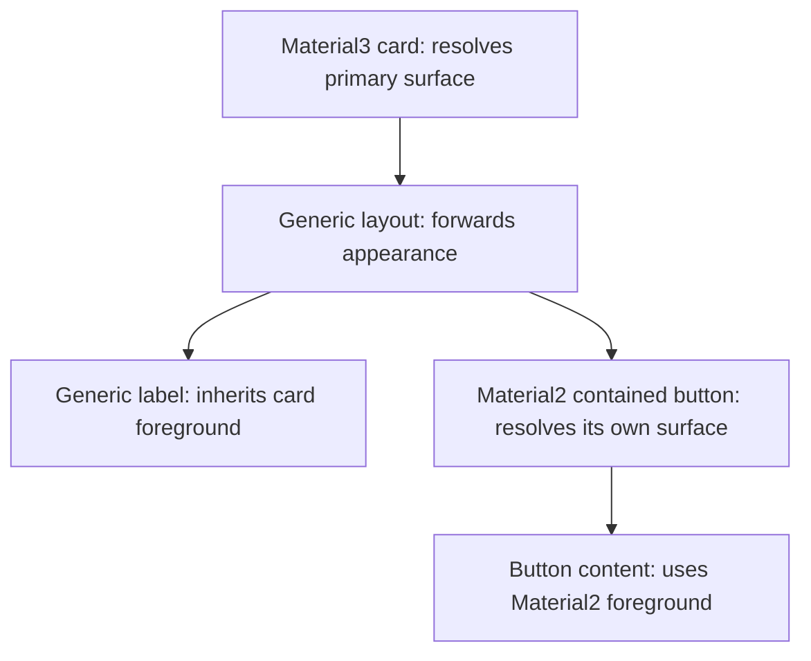

# Optional design systems and resolved appearance inheritance

Status: proposed. Material2 isolation and independently owned theme settings
are implemented prerequisites; none of the phases below is marked complete.

## Objective

Allow core-only, Material2-only, Material3-only, and mixed-system applications
without making core widget inheritance depend on either system's color tokens.

## Motivation

An application can now customize Material2 independently of Material3, but a
Material2 button still translates an inherited Material3 token before choosing
its foreground and interaction styling. Removing Material3 from that build
therefore fails even when the application uses no Material3 widgets.

Resolve the visual information needed by generic descendants at the component
that owns the appearance. Keep system-specific roles within their system, and
make build selection determine which system themes and components are present.

## Background

The [design glossary](../glossary.md) defines shared runtime and rendering
terminology. Relevant current APIs are:

- [Theme](../../../src/roo_windows/core/theme.h) owns `material2` and `material3`
  by value, exposed through `material2Theme()` and `material3Theme()`.
  Framework color helpers still delegate to Material3.
- [Widget](../../../src/roo_windows/core/widget.h) exposes
  `effectiveContainerRole()` and `effectiveOverlayColorRole()` using Material3
  `ColorToken`. Generic descendants inherit a container role; point overlays
  normally use the parent's role. `interactionColor()`, `interactionOpacity()`
  and `disabledContentOpacity()` already provide resolved rendering hooks.
- [SurfaceWidget](../../../src/roo_windows/core/surface_widget.h) introduces a
  role through `containerRole()` and separately resolves alpha-composited
  backgrounds. A role is semantic information, not a pixel color.
- [Material2 ThemeMixin](../../../src/roo_windows/material2/theme_mixin.h)
  maps those role identities to its independently owned palette and state
  settings. It does not read Material3 palette values.
- Material3 role consumers include
  [tabs](../../../src/roo_windows/material3/tabs/tabs.cpp), which resolve a
  parent's role back to a fill, and
  [navigation destinations](../../../src/roo_windows/material3/navigation_destination/navigation_destination.cpp),
  which choose selected versus inherited interaction styling. Controls and
  button-group entries also choose different roles with state. Replacing every
  role lookup with one foreground color would lose behavior.
- [Application](../../../src/roo_windows/core/application.h) owns the software
  keyboard and exposes a Material2 alert convenience method.
  [Task](../../../src/roo_windows/core/task.h) owns a Material2 text-field
  editor. These are additional obstacles to a core-only build.
- The root [Bazel target](../../../BUILD) currently collects all sources.
  Linker removal of unused code does not prove header or source independence.

The earlier [color-token design](../implemented/theme_color_tokens_design.md)
and [component surface theme design](../implemented/material3_component_surface_theme_design.md)
remain historical foundations. This proposal changes the boundary through
which their results reach generic widgets; it does not replace Material3's
component roles or color scheme.

## Requirements

1. Generic layouts and rendering must work without either design system's
   source files or headers installed.
2. An application must be able to combine systems and customize their settings
   independently. Installing one palette must not mutate another implicitly.
3. Preserve existing same-system appearance, component states, explicit color
   and font overrides, and theme invalidation behavior.
4. Define how generic descendants and components from another system inherit
   appearance, including point interactions and detached presentation roots.
5. Preserve accessor and field names unless removing a dependency requires a
   change. Do not introduce compatibility aliases solely for this migration.
6. Avoid theme copies, heap allocations, or additional policy pointers in every
   widget. Measure target-ABI size and paint cost before accepting the migration.
7. Keep disabled-system configuration consistent across every translation unit.
   Unsupported component use must fail at compile time.

## Design Overview

Introduce **resolved surface appearance**: a temporary value containing the
foreground, accent ink, six interaction opacities, and disabled-content opacity
appropriate to a surface. It contains neither tokens nor a system identifier.
It is computed from live theme settings and is never cached in each widget.
Background geometry and alpha composition remain in the existing `background()`
and `effectiveBackground()` APIs.

An **appearance boundary** is a widget that supplies resolved appearance for
its descendants. A system surface establishes a boundary from its own theme;
a generic layout forwards its parent's appearance. A component's interaction
appearance can differ from its descendant appearance, as it does today for
selected indicators and point interactions.

Material3 retains roles in component-local helpers. Generic descendants receive
resolved appearance rather than interpreting those roles. Material2 establishes
its own boundaries and removes its Material3 role-identity bridge.

`Theme` remains a concrete bag of supported themes. An independently owned
framework theme supplies core defaults. Build-wide feature switches omit
unselected system members, accessors, headers, and sources. This satisfies
optional installation without adding a runtime registry or heap ownership.

For example, a Material3 primary card supplies `onPrimary` to a generic label
through an intervening generic layout. A contained Material2 button in that
layout supplies its own `primary` fill and `onPrimary` foreground to its own
label. Changing the Material3 palette updates the card and generic label;
changing the Material2 palette updates the button. No theme synchronizes with
another.

The illustration shows inheritance relationships, not paint ordering:



## Design Details

### Inheritance and component policy

`Widget::surfaceAppearance()` returns the parent's resolved value, or framework
root defaults when detached. A system widget with an explicit surface resolves
its local role and overrides this hook. A plain `SurfaceWidget` continues to
inherit appearance: an arbitrary background override does not imply an
algorithm for choosing a contrasting foreground.

The default `defaultColor()` reads the surface foreground. Existing explicit
widget color setters retain their current sentinel or override semantics.
`usesHighlighterColor()` selects accent rather than foreground for interaction
ink. Default interaction hooks read `interactionAppearance()`; this inherits
parent surface appearance for point overlays and local surface appearance for
other overlays. State-specific component overrides continue to take precedence.
Disabled-content opacity comes from the component's surface appearance.
Existing subtree effect application, clipping, and pixel ownership are unchanged.

System controls that draw their own content resolve their own component colors
and settings. An unfilled control interacting with an ancestor's surface uses
that surface's resolved interaction appearance, even across systems. This is
visual inheritance from the actual surface, not projection of one stored theme
into another. A control needing its own interaction policy overrides the hook.

This deliberately ends the current cross-system reinterpretation of a
Material3 role through Material2's palette. With independently customized
palettes, that reinterpretation can select ink unrelated to the surface being
painted. Existing same-system output is preserved; mixed-system tests establish
the new boundary contract explicitly.

### Roles that do more than select a foreground

Keep `containerRole()` and other role helpers within Material3 classes where
useful, without making them core virtuals. Do not infer roles by comparing RGB
values: different roles can have the same color.

- Tabs and their entries share resolved surface appearance. An entry needing
  the parent's fill uses its effective background rather than resolving a
  parent token again. Explicit tab component roles remain in Material3.
- Unselected navigation indicators inherit parent interaction appearance;
  selected indicators resolve the secondary-container appearance locally.
- Checkbox, radio, switch, and slider state transitions resolve their current
  local role into appearance. Point overlays retain their parent-surface rule.
- Button-group entries keep their existing variant/state role selection inside
  Material3 and expose the result through the interaction hook.

Audit all role overrides and consumers before removing the core declarations.
Component role setters and theme slots that are already local keep their names.

### Live themes and ownership

`Theme`, environments, and application contexts keep their existing borrowing
lifetimes. Callers mutate theme settings between UI frames and call
`Application::invalidateTheme()` on each affected application. No generation
counter, subscription list, or per-widget resolved cache is added.

A detached presentation root uses framework defaults unless its component
establishes an appearance boundary. Components requiring an originating
surface's styling use their existing presentation-owner relationship to query
live appearance; do not retain a copied palette across frames. Reparenting
changes inherited appearance on the next paint through existing invalidation.

### Framework settings and optional systems

Add `FrameworkTheme` in `core/framework_theme.h`, owning the existing eight
framework color roles and root interaction defaults. Preserve `frameworkColor`,
`frameworkStateLayer`, and `disabledContentOpacity` as forwarding helpers on
`Theme`, now forwarding to `framework` rather than Material3. Initialize its
values to today's default output using independent constants. Custom Material3
settings no longer implicitly customize generic root defaults; migration docs
show explicit framework customization.

Use build-wide `ROO_WINDOWS_ENABLE_MATERIAL2` and
`ROO_WINDOWS_ENABLE_MATERIAL3`, each defaulting to 1. Both must be 0 or 1.
Conditional theme includes, members, and accessors are absent when disabled.
Keep `.material2`, `.material3`, `material2Theme()`, and `material3Theme()` when
enabled. `DefaultTheme()` remains the same immutable default entry point in
all configurations, including neither system enabled.

Split Bazel source groups into core, Material2, Material3, and optional software
keyboard libraries. The public aggregate selects enabled groups and propagates
consistent feature definitions. There must be no dependency cycle through
core's default-theme implementation. Header-only system theme value types can
be included by configured theme composition without pulling component sources
into core. A disabled system's files must not appear in that build's inputs.

For Arduino's recursive source discovery, guard optional translation units
before their system-specific includes. Build flags apply to the entire library
and consumers, not a sketch-local define after headers have been compiled.
Document how to omit the disabled directories physically. This is optional
installation within the existing package; separate published packages are
outside this proposal.

### Remaining application dependencies

Move `Application::showAlertDialog` to a Material2 free helper, preserving its
owned-dialog cleanup and presentation result behavior. Move the legacy
`TextFieldEditor` adapter into Material2; generic task/application input routing
uses the existing system-neutral text-input contracts. Remove concrete editor
members, overloads, and friends from core instead of conditionalizing their
runtime semantics.

Make the built-in software keyboard an optional integration, selected by
`ROO_WINDOWS_ENABLE_SOFTWARE_KEYBOARD` (defaulting to the Material2 switch).
It requires Material2 until its controls are separately redesigned; reject
keyboard-enabled/Material2-disabled builds. Retain `keyboard()` when enabled.
With it disabled, hardware input and application-provided semantic editors
continue to work, and core has no keyboard source dependency. Move the legacy
editor/keyboard installation into the enabled integration rather than requiring
Material2 from every `Task`.

### Resource model

The appearance value has two four-byte colors and seven opacity bytes: a
15-byte payload, normally 16 bytes after alignment. It is returned temporarily;
there is no added instance field in `Widget` or `SurfaceWidget`. Extra virtual
slots have shared flash cost; no extra per-instance vptr is required.

For a query through `d` generic ancestors, resolution costs at most `d` virtual
forwards plus one constant-size palette resolution. Across `n` widgets the
worst-case work is O(n*d), and O(n²) for a chain whose depth grows with `n`.
The current role walk has the same depth dependence. Resolve once per use site
rather than once per appearance field; do not add a retained cache to hide
repeated queries.

The framework color payload adds 32 bytes per `Theme`, plus root interaction
settings and alignment. Disabled systems remove their entire theme member.
Exact ABI sizes and linked code deltas are acceptance measurements, not portable
promises. Phase 1 defines the size and CPU gates.

## Proposed API

Illustrative final signatures; public declarations receive full Doxygen comments
when implemented. The new value is a rendering contract, not stored widget state.

```cpp
struct SurfaceAppearance {
  roo_display::Color foreground;
  roo_display::Color accent;
  uint8_t interaction_opacity[6];  // Existing InteractionState order.
  uint8_t disabled_content_opacity;  // Existing 0..128 scale.
};

class Widget {
 public:
  virtual SurfaceAppearance surfaceAppearance() const;
  virtual SurfaceAppearance interactionAppearance() const;
  // Keep existing defaultColor(), interactionColor(), interactionOpacity(),
  // disabledContentOpacity(), background(), and effectiveBackground() names.
  // No new appearance fields.
};

struct Theme {
  FrameworkTheme framework;
#if ROO_WINDOWS_ENABLE_MATERIAL2
  material2::Material2Theme material2;
  material2::Material2Theme& material2Theme();
  const material2::Material2Theme& material2Theme() const;
#endif
#if ROO_WINDOWS_ENABLE_MATERIAL3
  material3::Material3Theme material3;
  material3::Material3Theme& material3Theme();
  const material3::Material3Theme& material3Theme() const;
#endif
  // Preserve framework forwarding helpers.
};
```

Each phase installs working implementations with its entry points. During the
migration, resolved hooks can delegate to the old role path until their system
is migrated; there are no exposed unimplemented stubs or silent fallbacks for
a disabled system.

## Implementation Plan

Authoring references: [C++ instructions](../../../.github/instructions/general-cpp-code-authoring-instructions.md),
[widget instructions](../../../.github/instructions/roo-windows-widget-authoring.instructions.md),
and [example instructions](../../../.github/instructions/embedded-example-authoring.instructions.md).
Each phase is one reviewable commit, including its tests and documentation.
The stashed earlier stage 3 is reference material, not a patch to apply wholesale.

### Phase 1: characterize inheritance and cost

Record all core token consumers and freeze same-system behavior, including tabs,
selected navigation indicators, point overlays, disabled subtrees, and explicit
overrides. Add mixed-system fixtures to expose existing reinterpretation before
changing it. Document which assertions will deliberately change in phase 4.

Record target-ABI widget/theme sizes and host paint timings for 100 widgets at
depths 1, 8, and 32, using repeated runs and median time. Acceptance for subsequent
phases: no widget-instance size increase, no appearance-resolution allocations,
and no more than 10% median paint-time regression on any fixture. Exceeding the
CPU gate requires eliminating redundant resolution before proceeding, not adding
per-widget caches. Record linked-size deltas without claiming a universal byte
budget. Validate the characterization targets and store measurement commands
and results beside this design.

Proposed commit message:

> Optional design systems, phase 1: characterize inherited appearance.
>
> Record role consumers, rendering baselines, and resource measurements for the
> optional design systems design, including the intended mixed-system boundary.

### Phase 2: introduce resolved hooks

Add `SurfaceAppearance` and the two hooks, initially resolving existing roles.
Route generic content and interaction rendering through them. Keep background
composition and role APIs temporarily. Add a generic forwarding example and
hook tests; run overlay, surface invalidation, and material3 container tests.
Check the phase 1 resource gates.

Proposed commit message:

> Optional design systems, phase 2: expose resolved surface appearance.
>
> Route generic foreground and interaction rendering through live resolved hooks
> while retaining the existing role implementation during migration.

### Phase 3: localize Material3 role resolution

Migrate Material3 component surfaces and special consumers listed above to the
resolved contract. Retain component-local roles and names. Update container,
tabs, navigation, and button-group tests and relevant examples. Require unchanged
same-system goldens and the phase 1 gates before moving on.

Proposed commit message:

> Optional design systems, phase 3: resolve Material3 roles at component boundaries.
>
> Keep Material3 token selection inside its components and expose resolved
> descendant and interaction appearance, including tabs and navigation states.

### Phase 4: remove core tokens and the Material2 bridge

Add independent framework defaults, migrate Material2 to its own boundaries,
and remove core role declarations and `Material2ColorRole`. Update generic
helpers and all remaining callers. Add a mixed-system example and documentation
for root customization and cross-system inheritance. Validate independent live
updates, overrides, reparenting, and detached roots; run the full library suite
and frontend integration build. Verify the resource gates.

Proposed commit message:

> Optional design systems, phase 4: remove core color-token dependencies.
>
> Introduce framework defaults, remove the Material2 role bridge, and establish
> resolved appearance inheritance across generic and mixed-system subtrees.

### Phase 5: extract Material2 application conveniences

Move the alert helper and legacy text-editor adapter out of core. Make software
keyboard integration optional as specified above. Update existing consumers and
input examples in this commit. Validate alert ownership, failed presentation,
keyboard visibility, hardware input, editor teardown, and cross-task routing
using existing dialog and keyboard/input tests plus a keyboard-disabled build.

Proposed commit message:

> Optional design systems, phase 5: isolate legacy application integrations.
>
> Move Material2 alert and editor conveniences out of core and make the built-in
> keyboard optional while retaining generic semantic input routing.

### Phase 6: enforce optional installation

Add the system switches, conditional theme composition, and build partitions.
Update Bazel and Arduino configuration documentation and provide core-only,
Material2-only, Material3-only, and mixed build examples. Compile and link all
four with disabled directories excluded from the test fixture, not just unused.
Check dependency inputs and verify invalid flag combinations fail clearly.
Run the full default suite and affected application builds serially, using
persistent Bazel storage and existing resource limits. Record final size and
paint-time comparisons against phase 1.

Proposed commit message:

> Optional design systems, phase 6: support builds without unused systems.
>
> Select theme members and source groups consistently across builds, with
> installation-absence coverage and examples for all four system combinations.

## Testing Plan

Use focused targets as each phase lands, including
`//:material3_container_test`, `//:material2_theme_test`,
`//:surface_widget_invalidation_test`, `//:theme_color_tokens_test`, and existing
component, overlay, dialog, and keyboard tests. Rename token-specific tests only
where their subject is removed. Preserve dirty/full repaint equivalence and
single-write rendering checks.

The final acceptance combines unchanged same-system goldens, explicit
mixed-system behavior, independent palette mutation, compile/link coverage with
system files absent, target-ABI size evidence, and the phase 1 CPU/allocation
gates. Builds run serially; Bazel outputs and caches stay off RAM-backed `/tmp`.

## Caveats

Changing a Material3 theme will no longer change independent framework root
settings. Cross-system role reinterpretation is replaced by resolved inheritance.
Both changes require migration notes and tests; neither is hidden as a mechanical
rename. Uniform feature switches affect ABI and must be identical throughout an
application and its linked libraries.

### Rejected Alternatives

#### Keep Material3 tokens as a shared core vocabulary

This preserves existing code with little churn, but requires Material3 headers
and semantics even for unrelated systems. The resolved contract removes that
requirement while retaining tokens where their meaning belongs.

#### Inherit only a background color

A color alone cannot recover foreground, accent, and interaction policy;
equal RGB values can represent distinct roles. Background inheritance remains
separate from the resolved appearance defined above.

#### Make Material3Theme implement Material2Theme

A shared object couples ownership and mutation and cannot represent independently
customized systems. The concrete bag preserves independent value ownership.

#### Runtime registry or per-widget policy pointers

These support arbitrary plugins but add lookup, lifetime, or instance-state
costs without a current requirement. A known set of systems and build-wide
selection meet the stated installation and mixed-widget needs.

#### Rely on linker garbage collection

It saves unused code but does not remove includes, compilation requirements,
or theme members. Physical-absence build fixtures enforce the stronger contract.

## Future Work

An explicit cross-system conversion helper can copy compatible colors from a
Material3 scheme into a Material2 `ColorScheme` by value. It belongs in an
integration target requiring both systems, not in either standalone theme.
The caller assigns the result and invalidates affected applications; subsequent
palette mutations stay independent. This helper is outside the six required
phases and should receive its own mapping design and tests before implementation.

Separately published system packages, runtime plugin discovery, and a
Material2-free built-in software keyboard are also outside this proposal.
