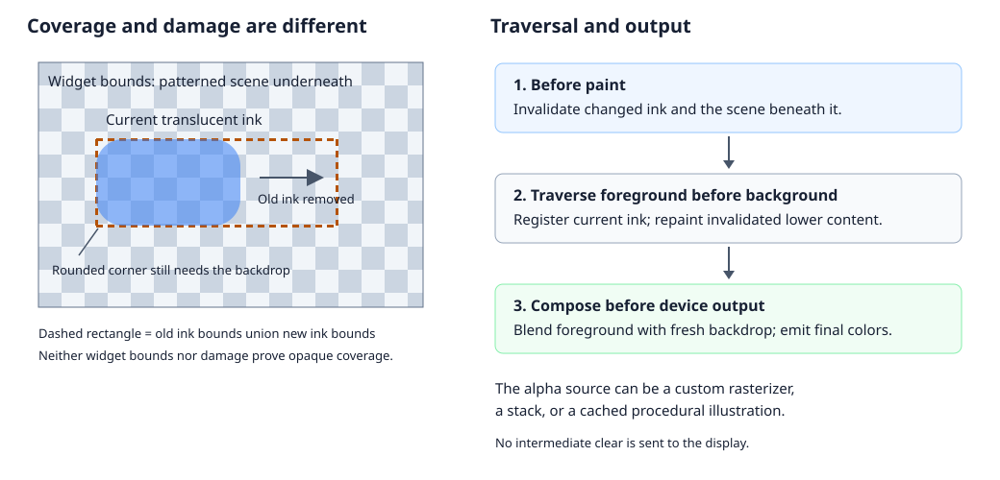
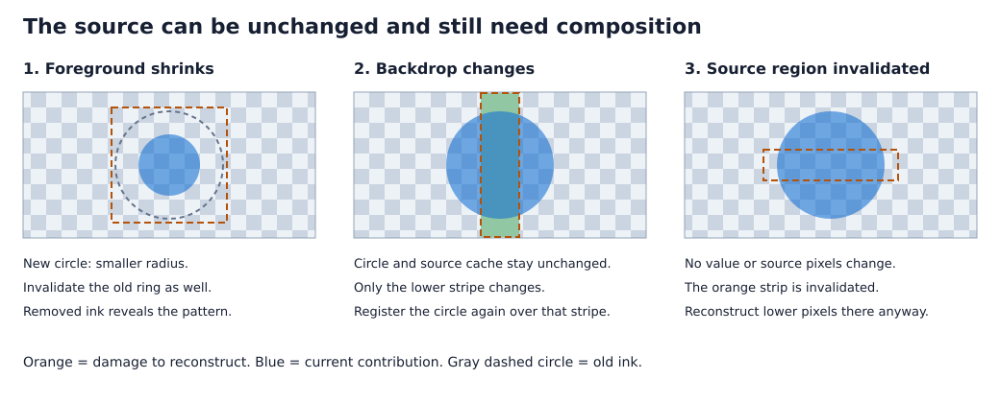
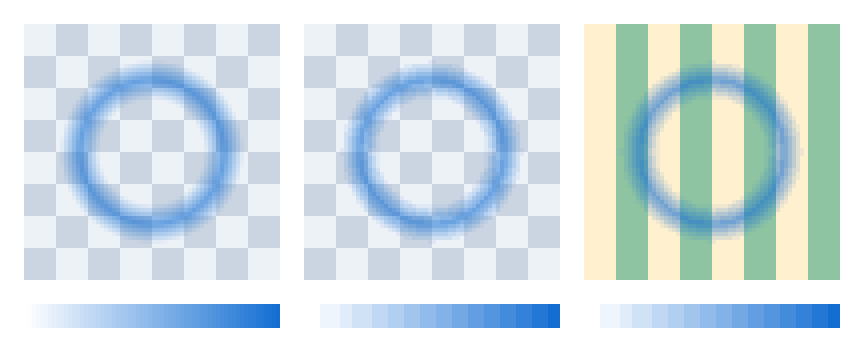
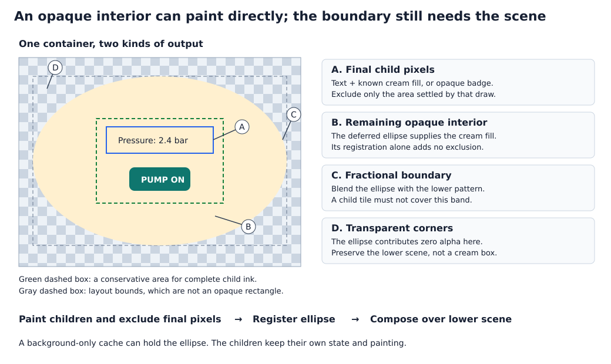
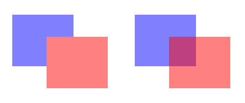

# Partial transparency and deferred foreground rendering

## Objective

Render partially covering widgets and shaped containers correctly over the
actual scene, including when their own content or the content underneath
changes. Allow callers to cache expensive drawing in a format they choose.

**Status: guidance for existing framework capabilities, 2026-11-06.** The
consumer change is in `roo_dashboard::ModernRadialGauge`. The shape and cache
examples illustrate the same contract; they require no new framework API.

## Motivation

A pressure gauge drops from 3 bar to 2 bar. The disappearing arc must reveal
the scale and the scene underneath. An antialiased edge also needs those lower
colors to calculate its final color. Drawing only the new arc leaves old ink;
clearing its rectangle to a solid color erases a patterned background.

An elliptical instrument window has the same problem at its boundary, even
when most of its interior is opaque. Its text and buttons can often paint
normally, while its curved edge must blend with the scene. A complex indicator
might instead build its entire appearance in an offscreen. These cases need
the same composition rules, without requiring the same widget base class or
pixel storage.

## Background

### How painting works today

The [widget authoring contract](../../../.github/instructions/roo-windows-widget-authoring.instructions.md)
distinguishes **dirty state**, which requests painting after a state change,
from **invalidation**, which requires reconstructing pixels even when widget
values are unchanged. See the [shared terminology](../glossary.md) and
[synchronous paint contract](../README.md#current-paint-contract).

Traversal visits foreground before background. A widget can either produce
final pixels immediately, or register an **overlay** to be sampled when lower
content later produces pixels. An overlay is above contributors visited later;
it is not necessarily the topmost item in its own widget. A container's
background shape can therefore be an overlay below its children.

An **exclusion** prevents later output at already settled pixels. For example,
a text tile containing both text and its known opaque background can settle a
rectangle in one write. Registering a translucent shape does not settle its
rectangle: the lower scene still has to contribute.

| Geometry or state | Example | What it establishes |
| --- | --- | --- |
| Layout bounds | Rectangle containing an elliptical window | Placement, not coverage. |
| Visible footprint | Bounds of an arc including caps and antialiasing | Where its ink can occur. |
| Opaque coverage | Interior of the ellipse, away from its boundary | Where lower colors cannot affect the result. |
| Damage | Old and new arc footprints | Where final scene pixels need reconstruction. |

### Existing building blocks

`PaintContext` already accepts built-in smooth shapes and arbitrary
`Rasterizable` sources. A rasterizable supplies colors at requested coordinates;
it can calculate a formula, sample an image, or combine other sources in a
`RasterizableStack`. `Offscreen<ColorMode>` is also a rasterizable. A drawable
that only emits output commands, or a sequential stream, does not automatically
provide this sampling interface.

The existing [invalidation pipeline](../../../src/roo_windows/core/container.cpp)
can arrange all lower painting before traversal starts. A translucent widget
invalidates itself and calls `notifyParentInvalidatedRegion()` with the affected
region in parent coordinates. The parent invokes `invalidateBeneath()`, which
marks lower contributors and ancestor surfaces for reconstruction.

This uses normal invalidation hooks, so lower widgets retain their own damage
bookkeeping. `fullyCoversBoundsWithOpaqueColors() == false` alone does not trigger
this notification or remove a widget's default rectangular exclusion.

Existing `SurfaceWidget` backgrounds blend through inherited background colors;
a translucent background color alone does not give a surface actual-scene
composition. The explicit shaped-container recipe below covers that case.

## Requirements

1. Reconstruct correct final pixels after state changes and region invalidation,
   including unchanged foreground above a changing backdrop.
2. Preserve holes and fractional coverage over patterned and overlapping content.
3. Remove old ink when content shrinks, disappears, moves, or changes overflow.
4. Support leaves and containers, including opaque interior content surrounded
   by a partially covering background shape.
5. Complete scheduled damage synchronously, with at most one final device write
   per pixel in ordinary rendering and no display readback.
6. Keep caching optional. Let each consumer choose its representation, precision,
   dimensions, ownership, and memory budget.
7. Preserve stacking, ancestor clipping, and inherited effects. Distinguish a
   shaped background from clipping or applying opacity to an entire subtree.
8. Keep ordinary widgets inexpensive and make lifetime and resource costs explicit.
   Retain the accelerated scroller's documented temporary background omission
   exception without treating omitted pixels as valid reusable scene content.

## Design Overview

Use one **deferred contribution contract** for both foreground ink and shaped
container backgrounds. A deferred contribution supplies its own color and
alpha, independently of the scene below it, and blends using source-over.
Its source remains available throughout the synchronous paint.

There are two separate jobs:

- **Before paint, invalidate the changed scene.** Setters and explicit region
  invalidation mark both the source widget and the scene beneath it. Damage
  contains old and new ink, including declared overflow.
- **During paint, register the current source.** Lower contributors later emit
  pixels through the registered overlays. A source can be analytic or cached;
  its cache contains local color/alpha before scene composition.

For a shrinking arc, invalidate the old and new ink before paint, then register
only the new arc during traversal. The removed portion contributes zero alpha,
so the lower scene shows through. There is no intermediate device clear.



The complete contract is:

1. Route setters and explicit region invalidation through the same backdrop-aware
   invalidation path. Changing a value is not the only reason pixels need repaint.
2. Register current sources on every relevant traversal, including clean ones.
3. Exclude only settled direct output; overlay registration alone settles nothing.
4. Keep sources alive and stable throughout the synchronous paint.

Use existing widget hooks for both leaves and containers. The compositor accepts
`Rasterizable` sources and imposes no cache format or dedicated widget base class.

## Design Details

### Example 1: a built-in circle over a patterned panel

Consider a translucent status circle. Its setter updates a sampled color or
radius and calls `invalidateInterior()`. Override both public invalidation
forms so a caller invalidating unchanged content follows the same path:

```cpp
void invalidateInterior() override {
  invalidateInterior(getInteriorBounds());
}

void invalidateInterior(const Rect& rect) override {
  Widget::invalidateInterior(rect);
  notifyParentInvalidatedRegion(rect.translate(offsetLeft(), offsetTop()));
}

void emitPersistentDecoration(PaintContext& ctx) const override {
  PaintContext ink = ctx.clipped(getContentBounds());
  ink.addOverlayShape(roo_display::SmoothFilledCircle(
      {width() * 0.5f - 0.5f, height() * 0.5f - 0.5f}, radius_, color_));
}

Rect getDirectPaintExclusionBounds() const override {
  return Rect(0, 0, -1, -1);
}
```

These are methods of an ordinary `Widget` subclass. It needs no `paint()`
override: the inherited pipeline consumes dirty state, and the persistent hook
registers the circle. `Widget` already reports nonopaque rectangular coverage.
`addOverlayShape()` stores the temporary shape in shared paint storage.

The circle fits inside its declared content bounds. `getInteriorBounds()`
includes declared foreground overflow, while `bounds()` alone would omit it.
The persistent hook reapplies the local content clip because widget finalization
widens its incoming context again. The radius and color remain stable during paint.



| Event | Before paint | During paint |
| --- | --- | --- |
| Radius shrinks | Invalidate old and new ink, conservatively the declared content area. | Register the smaller circle over freshly painted lower content. |
| Pattern underneath changes | The lower contributor schedules its own damage. | Register the unchanged circle, even though it is clean. |
| Only a circle region is invalidated | The override invalidates that region and its backdrop. | Register the unchanged circle; output remains limited to active damage. |

The gauge follows this recipe. Value, color, width, and angle setters invalidate
its full declared area. This trades some extra painting for a smaller, simpler
widget without last-painted snapshots. Setting an unchanged value still
schedules no work.
Several different assignments before a frame coalesce as ordinary damage; even
returning to the originally displayed value can leave a conservative repaint.

### Example 2: a custom rasterizable, without a bitmap

A soft halo can compute alpha from distance to a ring. For a pixel at distance
$d$ from the center, use $a = 160\max(0, 1 - |d - 18| / 5)$. Its center hole
is transparent; its brightest band is still translucent. A representative
source using existing roo_display interfaces is:

```cpp
class HaloSource : public roo_display::Rasterizable {
 public:
  roo_display::Box extents() const override { return {0, 0, 63, 63}; }

  void readColors(const int16_t* x, const int16_t* y, uint32_t count,
                  roo_display::Color* result) const override {
    for (uint32_t i = 0; i < count; ++i) {
      const float dx = x[i] - 31.5f;
      const float dy = y[i] - 31.5f;
      const float distance = std::sqrt(dx * dx + dy * dy);
      const float coverage =
          std::max(0.0f, 1.0f - std::abs(distance - 18.0f) / 5.0f);
      result[i] = roo_display::Color(
          static_cast<uint8_t>(160.0f * coverage + 0.5f), 20, 110, 210);
    }
  }
};
```

The widget owns a persistent `HaloSource halo_` and registers it with
`ctx.addOverlay(halo_, getContentBounds())`. The invalidation and exclusion
rules are identical to the circle's. The example needs `<algorithm>` and `<cmath>` and
assumes a 64-by-64 local source area; resizing the widget does not implicitly
scale the source.

No pixel buffer is allocated. Every requested sample evaluates the formula.
`readColorRect()` and `readUniformColorRect()` are optional optimizations, not
restrictions to simple shapes. A `RasterizableStack` can combine this source
with an image, text raster, or other sources before registration. Its inputs
and the stack itself must remain alive.

Sampling is pure: it does not advance animation, read changing sensor state,
consume dirty flags, or alter the source. Rounded clipping can request samples
at registration time as well as during later background output.

### Example 3: cache an illustration or a monochrome mask

An illustration containing many drawables can be expensive to resample. Render
it once into a local offscreen in conventional back-to-front order, then reuse
that rasterizable until its content changes. These are consumer-owned members
and a consumer-owned preparation method, not framework cache types:

```cpp
roo_display::Offscreen<roo_display::Argb8888> layer_{
    160, 80, roo_display::color::Transparent};
bool source_stale_ = true;

void rebuildLayer() {
  roo_display::DrawingContext dc(layer_);
  dc.fill(roo_display::color::Transparent);
  dc.draw(back_drawable);
  dc.draw(front_drawable);
  source_stale_ = false;
}

void paintWidgetContents(PaintContext& ctx) override {
  if (source_stale_) rebuildLayer();
  Widget::paintWidgetContents(ctx);  // Consume the existing paint obligation.
}

void emitPersistentDecoration(PaintContext& ctx) const override {
  ctx.addOverlay(layer_, getContentBounds());
}
```

The example retains both invalidation overrides and the empty direct exclusion
from example 1. Content setters mark the source stale and call
`invalidateInterior()`. Geometry and appearance dependencies, including fonts
and theme colors used in the source, also invalidate the cache.
`source_stale_` is separate from `isInvalidated()`: repainting the backdrop or
revealing unchanged content reuses the cached pixels. Preparation happens before
registration, including on a clean traversal when a previously occluded cache
has not yet been rebuilt.

A fresh `DrawingContext` over an offscreen uses a transparent background and
source-over drawing. `fill(Transparent)` replaces the old pixels, so removed
elements disappear. Repeated writes to this RAM buffer are permitted; the
single-write requirement concerns the device. Redirecting the incoming widget
canvas to RAM would retain its inherited background settings and can bake an
opaque backdrop into the cache.

For a monochrome logo, label, or halo, color need not be stored per pixel.
`Alpha4` stores 16 alpha levels in four bits per pixel and supplies one RGB color
from its color mode. The following persistent members use existing APIs:

```cpp
roo_display::Offscreen<roo_display::Alpha4> mask_{
    160, 80, roo_display::color::Transparent,
    roo_display::Alpha4(roo_display::color::White)};

// A differently colored view borrowing the same pixels; it owns no buffer.
roo_display::Offscreen<roo_display::Alpha4> blue_mask_{
    mask_.extents(), mask_.buffer(),
    roo_display::Alpha4(roo_display::Color(0xFF146ED2))};
```

Draw coverage into `mask_`, then register `blue_mask_`. Input RGB is discarded
by the mask; it cannot preserve differently colored internal elements. A color
view does not apply global opacity: the pixel alpha still comes from the mask.
Keep the view alive, keep its backing buffer stable, and recreate/rebind views
before registration when storage changes. The existing
[offscreen example](../../../../roo_display/examples/offscreen/offscreen.ino)
demonstrates multiple colored views of shared Alpha4 storage.



Left: example 2's halo with 8-bit alpha. Middle: the same alpha quantized to
Alpha4. Right: the identical Alpha4 mask and RGB over a different backdrop.
The strips below show an alpha ramp at the corresponding precision. Pixels
are enlarged four times without smoothing. This is an arithmetic illustration,
not a renderer golden; the [generation script](figures/render_partial_transparency_figures.py)
uses the current Alpha4 conversion and ideal source-over with final 8-bit rounding.

| Cache format | Stored information | Appropriate content |
| --- | --- | --- |
| `Argb8888` | Per-pixel color and alpha, 32 bits | Multicolor illustration with smooth transparency. |
| `Argb4444` | Per-pixel color and alpha, 16 bits | Multicolor content accepting reduced precision. |
| `Alpha8` | Alpha, 8 bits; one RGB color per view | Smooth monochrome coverage. |
| `Alpha4` | Alpha, 4 bits; one RGB color per view | Compact monochrome text, icons, and masks. |

Allocate fixed storage at construction, or provision replacement storage in an
explicit resize/layout step before paint. The widget owns that policy and any
failure handling. Source preparation performs no allocation or application-state
updates. This recipe rebuilds a stale cache completely. Partial
updates require clearing old and new ink and replaying all intersecting internal
drawables in their original order; they are outside this scope.

### Example 4: an elliptical window containing ordinary widgets

Consider a window with an opaque cream interior and an antialiased elliptical
edge. It contains a text label and a badge. Both lie wholly inside the opaque
interior, with all their ink and decoration included. The background ellipse
is one rasterizable, either analytic or cached.



Rendering proceeds as follows:

1. Paint the label and badge first. An opaque badge can supply its final pixels
   directly. Transparent glyphs can be resolved against the known cream fill in
   one text tile. Exclude only the areas those operations settle.
2. Register the ellipse **after** the children, so it lies below them and above
   the outer scene. Its opaque center fills the remaining interior. Its edge
   retains fractional alpha; the corners contribute zero alpha.
3. Lower scene output resolves the remaining pixels through the ellipse and
   any higher deferred contributions. Child exclusions prevent double writes.

The background is an overlay relative to the scene, and a background relative
to the children. Caching it does not capture its children. Children can change
without rebuilding an unchanged background source.

An ordinary `Container` or `Panel` subclass can implement this ordering through
existing hooks. The essential configuration is:

| Hook or behavior | Shaped-window contract |
| --- | --- |
| `fullyCoversBoundsWithOpaqueColors()` | Return false: the whole rectangle is not opaque. |
| `getDirectPaintExclusionBounds()` | Return an explicitly empty rectangle; child exclusions remain in effect. |
| `prepareCanvas()` | Establish the known opaque interior color for eligible child drawing, before inherited effects. Do not flatten the ellipse's boundary against an inherited solid background. |
| Invalidation | Override both `invalidateInterior()` forms, delegating to `Container` and notifying the parent before paint. |
| `paintWidgetContents()` | Prepare a stale source when necessary, then delegate to `Container::paintWidgetContents()` once. |
| `paint()` | Suppress the default rectangular surface clear. |
| `emitPersistentDecoration()` | Register the shape once, after child traversal, clipped to its declared bounds. Replace the ordinary rectangular surface decoration. |
| `respectsChildrenBoundaries()` | Return false for this recipe, disabling the shortcut that clears child decoration rectangles with a solid background. |

For this opaque-interior example, `prepareCanvas()` starts from
`Widget::prepareCanvas(in)` and sets the canvas background to the unmodified
interior color. Normal effect scopes then transform direct content and deferred
shape contributions consistently. The example uses no ordinary rectangular
border or shadow; any such decoration must follow the actual shape.

A notification from the container invalidates contributors below its subtree.
Calling `Container::invalidateInterior(rect)` also invalidates affected children.
Use both when the shape or interior fill changes: ordinary child pixels flattened
against the old fill must be repainted. A child-only update leaves the background
source reusable; a backdrop-only update needs its registration, not a rebuild.
The container's own invalidation helper follows example 1 with the appropriate
base call. Internal `invalidateDescending()` remains the existing propagation
hook and does not notify parents recursively.

Owned drawables can take the place of child widgets. Paint them in the intended
foreground order, resolving and excluding final pixels, before registering the
common shape. A drawable does not become independently hosted merely because
the container paints it. Ordinary child traversal retains clipped/unclipped
group order and ancestor masks.

**A shaped background is not a child clip.** This first example deliberately
places ordinary children inside a proven opaque region. For an ellipse centered
at $(c_x,c_y)$ with radii $r_x,r_y$, the ideal interior satisfies
$((x-c_x)/r_x)^2 + ((y-c_y)/r_y)^2 < 1$. Validate complete child paint bounds
against the rasterizer's fully opaque region, leaving its antialiasing band out.
The illustrated safe rectangle has corner value $0.5$, well inside the boundary.

A child crossing the curved edge cannot resolve transparent glyphs against
cream outside that opaque region, and an elliptical background cannot undo a
rectangular child exclusion. For such local artwork, provide a rasterizable
already masked to the shape, or explicitly flatten the owner's drawables into
an alpha source. An arbitrary live widget subtree clipped to a custom alpha mask
requires a separate mask/exclusion contract and is outside this recipe.
Existing rounded-container clipping remains supported. Making the entire fill
translucent also removes the known opaque backdrop needed by ordinary flattened
children; those contributions must instead be deferred or explicitly flattened
together before registration.

### Damage and source lifetime

Setters sample application state and invalidate affected scene regions before
paint begins. The simple recipes conservatively invalidate the declared content
area. A consumer that already knows a smaller old/new changed region can pass
it to `invalidateInterior(rect)`; no last-painted snapshot is required by the
framework. Source-only invalidation works even when every value compares equal.

A fixed-size icon with a four-pixel halo must include that halo when changing
color. If its declared footprint also shrinks, invalidate the old footprint
while its old geometry is still available, then update geometry and invalidate
the new footprint. Existing layout/show/hide paths already follow this principle.
Do not discard the old bounds and then invalidate only the new ones.

Normal invalidation invokes lower widgets' damage hooks before traversal. For
example, a keyboard with pending key damage A must merge newly exposed region B
into its private clip. The normal `invalidateDescending(rect)` path does that.
Normal scene invalidation, clipping, and exclusions also handle intersecting
translucent widgets and overlapping ordinary damage.

Do not notify the parent from `invalidateDescending()`: it is called during
ancestor and lower-contributor walks, so upward notification there would reenter
invalidation. Notify from the externally scheduled `invalidateInterior()` path,
as in example 1. An ancestor's own scene invalidation already arranges lower
painting. Raw `setDirty()` alone is insufficient for a changed deferred source;
use the backdrop-aware entry point.

Active frame damage is immutable. Paint only consumes sampled state and
registers contributions. A new application invalidation during paint retains
its existing next-frame semantics. Each source, borrowed buffer, stack input,
and sampled value remains alive and unchanged until the synchronous paint
finishes. Cache rebuilds happen before registration and do not schedule work or
change application state.

### What flattening a local group changes

Caching several local drawables preserves their internal paint order. Applying
opacity to that completed image differs from applying it to each member.
Two overlapping opaque shapes flattened and then shown at 50% opacity have
50% coverage in the overlap. Two independent 50% shapes have coverage
$1-(1-0.5)^2=0.75$ there.



Both panels draw blue first and red second over white. The left overlap is
half-opacity red; the right retains blue beneath translucent red. This is ideal
source-over arithmetic, not a renderer golden. The caller can flatten its own
drawables and scale the resulting source alpha. Neither a shaped background
nor a background-only cache applies opacity to its hosted children. Existing
affine tint/disabled effects remain distinct from group opacity.

### Resource and complexity costs

The source interface has no required pixel storage. Cache payload for width
$W$, height $H$, and $b$ bits per pixel is $\lceil WHb/8\rceil$ bytes:

| Source size | ARGB8888 | ARGB4444 | Alpha8 | Alpha4 |
| --- | ---: | ---: | ---: | ---: |
| 160 x 80 | 50 KiB | 25 KiB | 12.5 KiB | 6.25 KiB |
| 160 x 128 | 80 KiB | 40 KiB | 20 KiB | 10 KiB |
| 320 x 240 | 300 KiB | 150 KiB | 75 KiB | 37.5 KiB |

These exclude offscreen objects, color-mode state, comparison snapshots,
allocator overhead, and borrowed views. Alpha4 saves eightfold pixel storage
relative to ARGB8888 but loses per-pixel RGB and alpha precision. Precision
acceptance belongs to the consumer. No buffer, stale flag, or comparison snapshot
is added to `Widget`; existing hooks avoid new base-widget fields and vtable slots.

Let $P$ be evaluated output pixels and $L$ overlapping sources sampled there.
Basic composition costs $O(PL)$ plus source evaluation. The analytical halo pays
for a square root per sampled pixel; its cache pays build work when stale and
then memory reads. Arbitrary sampling can revisit coordinates. Report source
evaluation and cache rebuild CPU separately from invalidation traversal.

Backdrop scheduling uses the existing ancestor invalidation walk. Its work is
proportional to the nodes visited by each notification; repeated setter calls
can repeat that walk even though output damage coalesces. This contract adds no
framework storage or per-widget fields.

Shaped containers reporting nonopaque coverage visit clean children to restore
contributions/exclusions and forgo the rectangular background shortcut. Measure
this traversal and source-evaluation cost separately from cache rebuilds. The
ordinary opaque-widget path remains unchanged.

## Existing API

No new public API or widget base class is needed. Compose these existing hooks:

| Existing operation | Responsibility |
| --- | --- |
| `invalidateInterior(rect)` | Mark the source region and schedule its damage. Translucent consumers extend it as in example 1. |
| `notifyParentInvalidatedRegion(parent_rect)` | Invoke the existing beneath-invalidation path with parent-coordinate bounds. |
| `emitPersistentDecoration(ctx)` | Register current contributions on both dirty and clean traversals. |
| `addOverlay()` / `addOverlayShape()` | Supply rasterizable ink without imposing a storage format. |
| `getDirectPaintExclusionBounds()` | Suppress the default rectangle for deferred contributions; direct drawing adds its own valid exclusions. |

When a consumer caches its source, prepare stale content in its
`paintWidgetContents()` before registration.

The gauge's `invalidate()` is a convenience alias for its backdrop-aware public
invalidation; both full and region forms follow the same contract.

## Consumer Adoption

Follow the [C++ instructions](../../../.github/instructions/general-cpp-code-authoring-instructions.md)
and [widget instructions](../../../.github/instructions/roo-windows-widget-authoring.instructions.md).
There is no framework implementation plan: the required hooks already exist.
The production consumer change is confined to
[`ModernRadialGauge` in roo_dashboard](../../../../roo_dashboard/src/roo_dashboard/meters/modern_radial_gauge.cpp):
route setters and both public invalidation forms through ordinary source and
backdrop invalidation, retain clean overlay registration, and use conservative
full-area damage without last-painted snapshots. This change and its regression
tests are present in the working tree.

The widget-authoring instructions describe this path for future consumers.
The shaped-window and cache examples above are recipes, not additional required
implementation phases.

## Testing Plan

The [damage rendering tests](../../../test/damage_region_render_test.cpp) cover
overlapping alpha sources, a patterned lower widget with its own pending damage,
unchanged source-only invalidation, a clean foreground over changing lower
content, overflow and ink removal, nested ancestors, and clipped/unclipped
stacking. Check final pixels, single writes, and an idle next refresh.

The [gauge tests](../../../../roo_dashboard/test/modern_radial_gauge_test.cpp)
cover full-area value updates, explicit region/full invalidation, translucent
arcs, widths, angles, and value-dependent colors. Corrupt device pixels before
source-only invalidation tests so a missed redraw cannot pass by preserving an
already correct image. Full-render comparisons supplement independent
source-over arithmetic with explicit rounding tolerance. Existing overlay,
rounded/effect, keyboard, scrolling, and pump integration suites cover regressions.

Consumers adopting a shaped background also need child-only updates, fill
changes that repaint children flattened against the old fill, and complete
child ink inside the proven opaque region. Cache consumers need rebuild/reuse,
buffer and view lifetime, resize, theme dependencies, and format quantization
checks. These tests accompany each consumer; they do not require a framework
rollout.

## Caveats

### Rejected Alternatives

#### Paint-time backdrop repair

It could narrow a conservative dirty region after comparing final and
last-painted states, but would need extra traversal state and coordination with
lower widgets' damage bookkeeping. Ordinary invalidation already supplies the
required reconstruction before paint. Use that existing path and accept
conservative gauge-area repainting.

#### A mandatory deferred-widget subclass

It would package a few leaf overrides without adding capability and would not
naturally serve containers. Keep the existing hooks and explicit recipes.

#### Implicit rectangular exclusion changes for every widget

Existing widgets deliberately resolve content against known backgrounds and
rely on their current exclusion behavior. Keep opt-in recipe overrides explicit
and migrate consumers with tests.

#### A universal cache format or full-frame buffer

A small monochrome mask and a multicolor illustration have different storage
needs. The compositor accepts a rasterizable; the consumer chooses whether and
how to cache it. Neither caching nor area-proportional RAM is imposed on ordinary
widgets.

#### Reading the old display or clearing before drawing

The display already contains the old foreground; it is not a clean backdrop.
Some targets cannot read it. Sending an intermediate clear also violates the
single-final-write contract.

#### Automatic capture or tiled replay of arbitrary paint methods

Replay needs stable arguments, resources, effects, clipping, and a pure drawing
contract. Widget painting can consume dirty state or register more overlays.
Explicitly cache caller-owned drawables first. A tiled source is a separate
extension: for $T$ scratch pixels, $K$ commands, and $M$ tile fills, ARGB8888
scratch starts at $4T$ bytes and command traversal costs $O(MK)$. Arbitrary
sampling can revisit tiles, and nested adapters can need simultaneous scratch.

### Scope boundaries

Existing nonopaque surface backgrounds retain their established semantics.
True scene-alpha surfaces opt into the shaped/deferred recipe explicitly.
The elliptical recipe does not claim automatic clipping for arbitrary children
or opacity for a hosted subtree.

Backdrop blur and refraction require lower-image samples, neighborhood bounds,
expanded damage dependencies, and extra ordering. A `RasterizableStack` blend
operator alone does not provide those scene dependencies.

Preserve the accelerated scroller's documented temporary background omission.
Skipped output is not proof of current scene pixels or a reusable blit source.
This exception does not relax source lifetime or registration requirements.

The figures are explanatory calculations, not renderer goldens. Each consumer
needs runtime coverage of its rendering, invalidation, and source lifetime.

## Future Work

- A convenience wrapper justified by repeated leaf-consumer boilerplate.
- Arbitrary alpha-mask clipping of independently hosted widget subtrees.
- Isolated subtree opacity with explicit bounds, effect, and cache ownership.
- Pure tiled procedural sources for consumers that cannot afford a local buffer.
- Backdrop filters with neighborhood damage and sampling semantics.
